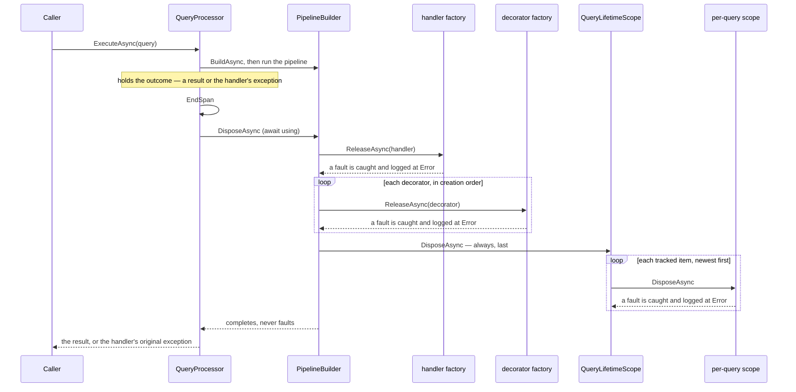
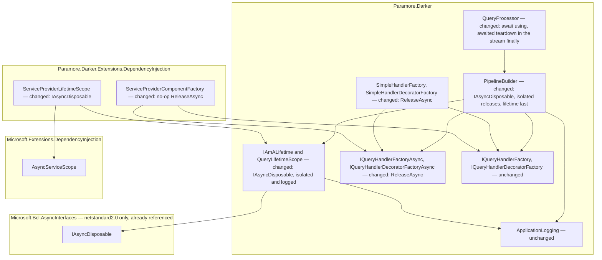

# 22. Robust Pipeline Teardown

Date: 2026-10-08

## Status

Proposed

## Context

When a query finishes, Darker releases the handler and its decorators and then disposes the per-query scope that holds their dependencies, such as an EF Core `DbContext`. Today one `Dispose` that throws stops this work: the remaining components stay unreleased, the per-query scope is never disposed, and the teardown exception replaces the query's result or the handler's own exception. The caller therefore loses either a good result or the real cause of a failure, and the application leaks the scope. On the async and stream paths a further gap exists: Darker disposes synchronously, so a Scoped service that implements only `IAsyncDisposable` cannot be disposed at all.

### Terms

- **Teardown** — the work Darker does after a pipeline completes: release every component, then dispose the lifetime. *The mechanism, end to end* specifies its order.
- **Release** — the factory step that ends Darker's use of one component. The factory decides whether release means disposal (see *The roles, and what each is responsible for*).
- **Per-query scope** — the child DI scope that the lifetime disposes at the end of a query. ADR 0014 describes how it is created and owned today.
- **Teardown fault** — an exception thrown by a release or by a disposal during teardown.

### Scope

- **Parent requirement** — [specs/015-di_lifetime_conformance/requirements.md](../../specs/015-di_lifetime_conformance/requirements.md), issue #378 under #377.
- **In scope**
  - FR1 — the pipeline builder releases the handler and each decorator in its own fault boundary, and logs each teardown fault at Error with the component type.
  - FR2 — the pipeline builder disposes the lifetime after all releases, outside every release's fault boundary, so the per-query scope is disposed whatever the releases did.
  - FR3 — teardown catches and logs every teardown fault, so the processor's `using`/`finally` never replaces a result or the handler's exception.
  - FR4 — `QueryLifetimeScope` disposes every tracked item in its own fault boundary, logs each fault, and ignores a second disposal.
  - FR5 — the same rules apply on `Execute`, `ExecuteAsync` and `ExecuteStream`, because all three paths end in the same pipeline builder teardown.
  - FR5a — the pipeline builder and the lifetime become asynchronously disposable, the async factories gain `ReleaseAsync`, and the async and stream paths await teardown. The sync path keeps synchronous teardown.
  - NFR Reliability, Diagnosability, Parity — the teardown part of each, through the mechanisms above.
  - NFR Performance — contributes: `ReleaseAsync` returns `ValueTask`, so the DI factory's no-op release allocates nothing.
  - Partial builds — the pipeline builder records each decorator as it is created, so a build that fails part-way still releases the decorators it already created. No tagged requirement names this case, but FR1's "every decorator" depends on it.
  - Release through the creating factory — the pipeline builder releases each component through the factory that created it. Today the async path creates the handler through the async factory but releases it through the sync factory.
  - FR25 — contributes: the `IAmALifetime` and async factory interface changes are breaking changes for the release notes.
- **Out of scope**
  - Where the per-query scope comes from — ADR 0023 gives the lifetime a scope handle obtained from the handler factory (FR6–FR12).
  - Whether Darker owns the per-query scope or borrows an ambient one — ADR 0024 (FR13–FR21).
  - Supersession of ADR 0014's scope-ownership account (FR22) — ADR 0024.
  - Documentation corrections in `CLAUDE.md` and the README (FR23, FR24) — owned by the spec's documentation tasks, not by an ADR.
  - Recording teardown faults on the query span — ADR 0017's span ends before teardown starts, and this ADR does not change that.
  - Lifetime validation — issue #305.

### Where this ADR sits

| ADR | Decides |
| --- | --- |
| **0022** *(this one)* | Teardown releases every component independently, disposes the per-query scope last, and never throws — synchronously on the sync path, asynchronously on the async and stream paths. |
| 0023 | The pipeline obtains its scope from the handler factory up front (`CreatePipelineScope()`) and carries it on the lifetime as an `IAmAScope` handle, replacing the factory-held `ConditionalWeakTable`. |
| 0024 | A Scoped handler may adopt an ambient scope (`ScopeAffinity.JoinAmbient`, `IAmAScopeProvider`, `Paramore.Darker.Extensions.AspNetCore`) instead of creating its own; Darker disposes only scopes it created. |

Darker disposes exactly the scopes it creates, after it has released every component resolved from them, and a teardown fault never reaches the caller.

This ADR speaks of "the per-query scope" as the lifetime owns it today. ADR 0023 changes where that scope comes from, and ADR 0024 changes whether Darker owns it. The ordering, isolation and never-throw rules here apply to whatever scope the lifetime ends up disposing.

### One faulty Dispose loses the result and leaks the scope

| Situation | What the caller sees today | What is left undisposed today | After this ADR |
| --- | --- | --- | --- |
| Query succeeds, the handler's `Dispose` throws (Simple factory) | the `Dispose` exception, not the result | every decorator, and the per-query scope | the result, with the fault logged at Error |
| Handler throws, then a release throws | the release exception, the handler's exception is lost | the remaining decorators, and the per-query scope | the handler's original exception |
| Query succeeds, a Scoped service's `Dispose` throws inside the per-query scope (DI factory) | the `Dispose` exception, not the result | the lifetime's other tracked items | the result, with the fault logged at Error |
| Async or stream path, a Scoped service implements only `IAsyncDisposable` | an `InvalidOperationException` from the DI container's synchronous scope disposal | that service, and possibly others in the same scope | the result, with `DisposeAsync` awaited |
| A decorator's creation or initialisation throws part-way through the build | the build exception (correct) | the decorators created before the failure | the build exception, with every created decorator released |
| Async path with distinct sync and async handler factories | correct | nothing, but the sync factory releases a handler the async factory created | the async factory releases its own handler |

Three consequences follow from the table:

- A defect in a component's clean-up code turns a successful query into a failed one.
- A defect in clean-up code hides the real failure from the caller, so the reported exception points at the wrong code.
- Every teardown fault leaks the per-query scope, and with it every Scoped and Transient service the scope tracks. A leaked `DbContext` holds a database connection until the garbage collector finalises it.

The mechanism is a single unguarded sequence. The pipeline builder's `Dispose` calls each factory's release in turn and then disposes the lifetime, with no exception handling between the calls. The Simple factories' release calls the component's `Dispose`, which may throw. The lifetime's `Dispose` has the same shape: it disposes its tracked items in a loop with no exception handling. The processor disposes the builder in a `using` block on `Execute` and `ExecuteAsync`, and in a `finally` block on `ExecuteStream`. In C#, an exception thrown from a `finally` block replaces the exception already in flight, and replaces a pending return.

The async gap has a separate cause. Microsoft DI's synchronous scope disposal throws `InvalidOperationException` when the scope tracks a service that implements only `IAsyncDisposable`. EF Core's `DbContext` implements both interfaces, but a user-defined Scoped service that wraps an async resource often implements only `IAsyncDisposable`. Darker's async and stream paths are already asynchronous, so they can await disposal without blocking a thread.

### The forces

- An exception thrown from a `finally` replaces the exception in flight, so teardown that can throw can mask the handler's exception (`src/Paramore.Darker/QueryProcessor.cs:67`).
- The per-query scope tracks every Scoped and Transient service of the query, so a teardown that skips the scope's disposal leaks all of them (`src/Paramore.Darker/PipelineBuilder.cs:459`).
- Release is the factory's decision, not the pipeline's: the DI factory must never dispose a Singleton, and leaves Scoped and Transient disposal to the per-query scope (ADR 0014, `src/Paramore.Darker.Extensions.DependencyInjection/ServiceProviderComponentFactory.cs:54`).
- Public factories are user-replaceable (ADR 0004, ADR 0009), so Darker cannot assume a release never throws.
- The sync path must not block on asynchronous disposal, and the async paths must not block on it either (FR5a).
- `Paramore.Darker` targets `netstandard2.0`, which has no built-in `IAsyncDisposable` and no default interface methods. `Microsoft.Bcl.AsyncInterfaces` is already referenced for `netstandard2.0` (`src/Paramore.Darker/Paramore.Darker.csproj:18`).
- A teardown fault must stay visible, so swallowing one without a diagnostic is not acceptable (NFR Diagnosability).
- ADR 0017 ends the query span before teardown starts, so teardown cannot record its faults on the span without reordering that contract.

## Decision

**Teardown releases each component in its own fault boundary, disposes the lifetime last and unconditionally, logs every teardown fault at Error, and never throws — synchronously on the sync path and asynchronously, with every disposal awaited, on the async and stream paths.**

The pipeline builder keeps the teardown role it already has, and gains an asynchronous form of it. The lifetime gains the same per-item isolation and an asynchronous form. The async factory roles replace their synchronous release with an awaitable release, because a component created on an async path may need asynchronous disposal, and only the factory knows whether release means disposal. The sync roles do not change shape. One set of rules governs both forms, so the three query paths behave the same.

### The mechanism, end to end

The async path is shown. The sync path is the same sequence with `Dispose` and `Release` in place of `DisposeAsync` and `ReleaseAsync`. The stream path is the async sequence, run from the iterator's `finally` when the caller's `await foreach` ends.



| # | During teardown | Teardown does | Diagnostic | Caller sees |
| --- | --- | --- | --- | --- |
| 1 | No component was created (the build failed first) | skips the releases, disposes the lifetime | none | the build exception |
| 2 | A release throws or faults | continues with the next release | Error, with the component type | the result or the handler's exception |
| 3 | Every release throws | disposes the lifetime | one Error per fault | the result or the handler's exception |
| 4 | A tracked item's disposal throws or faults | continues with the next tracked item | Error, with the item type | the result or the handler's exception |
| 5 | Teardown runs a second time on the same lifetime | does nothing | none | unchanged |
| 6 | The async path holds a tracked item that implements `IAsyncDisposable` | awaits `DisposeAsync` | none | the result or the handler's exception |
| 7 | The sync path holds a tracked item that implements only `IAsyncDisposable` | the item's container throws, teardown continues | Error, with the item type | the result or the handler's exception |

The load-bearing invariants read directly off the diagram and the table:

- Each release, and each tracked item's disposal, runs in its own fault boundary. One fault never prevents the next step.
- The lifetime is disposed after every release, and outside every release's fault boundary. A release fault cannot skip it.
- Neither `Dispose` nor `DisposeAsync` on the pipeline builder or the lifetime ever throws or faults. The `using` or `finally` that runs them therefore cannot replace what the pipeline produced.
- The async and stream paths await every asynchronous release and disposal. The sync path never blocks on one.
- Teardown takes no cancellation token. A cancelled query is still torn down completely.
- Each component is released through the factory that created it.

Requirements satisfied by these invariants:

- FR1, FR2, FR3 — the fault boundaries and the lifetime-last order.
- FR4 — rows 4 and 5.
- FR5, FR5a — one rule set, run synchronously or awaited.
- Acceptance criteria for teardown — rows 2, 3 and 6, on each path.

### Where the pieces live



No new assembly and no new package reference. `IAsyncDisposable` comes from the base class library on `net8.0` and `net9.0`, and from `Microsoft.Bcl.AsyncInterfaces` on `netstandard2.0`. Dependencies still point from the DI package into core, never the reverse.

### Key Components

#### The roles, and what each is responsible for

| Role | Type | Responsibilities | Responsibility classifier | Collaborators |
| --- | --- | --- | --- | --- |
| Chooses the teardown form for the path | `QueryProcessor` | Disposes the pipeline builder synchronously on `Execute`, awaits its disposal on `ExecuteAsync` and `ExecuteStream`, and ends the span before teardown | deciding, doing | `PipelineBuilder<TResult>`, `IAmADarkerTracer` |
| Tears down one pipeline | `PipelineBuilder<TResult>` | Knows each created component and the factory that created it; releases each in its own fault boundary; logs each fault at Error with the component type; disposes the lifetime last; never throws | knowing, doing | the four factory roles, `IAmALifetime`, `ILogger` |
| Releases a component | `IQueryHandlerFactory`, `IQueryHandlerFactoryAsync`, `IQueryHandlerDecoratorFactory`, `IQueryHandlerDecoratorFactoryAsync` | Decides whether releasing a component means disposing it, and does so synchronously or asynchronously | deciding, doing | the component, `IAmALifetime` |
| Owns per-query resources | `IAmALifetime`, implemented by `QueryLifetimeScope` | Tracks per-query disposables; disposes each newest first in its own fault boundary; logs each fault; disposes once | knowing, doing | tracked disposables, `ILogger` |
| Adapts the per-query DI scope | `ServiceProviderLifetimeScope` | Disposes the child DI scope, synchronously or asynchronously | doing | `AsyncServiceScope` |

The split that matters most is between the pipeline builder and the factories. The pipeline builder decides *when* each release happens and contains its faults. The factory decides *what* release means. The pipeline builder never disposes a component directly, so the DI factory's rule that Darker never disposes a Singleton (ADR 0014) stays in the one place that knows the component's lifetime.

#### `IAmALifetime`

```csharp
public interface IAmALifetime : IDisposable, IAsyncDisposable
{
    void Add(IDisposable disposable);
}
```

| Member | Input | Output | Error conditions |
| --- | --- | --- | --- |
| `Add` | a disposable to track | none | `ArgumentNullException` for null (unchanged) |
| `Dispose` | none | none | never throws. Disposes each tracked item newest first, each in its own fault boundary, and logs each fault at Error with the item type. A second call, after `Dispose` or `DisposeAsync`, does nothing |
| `DisposeAsync` | none | `ValueTask` | never faults. Same rules as `Dispose`. Awaits `DisposeAsync` on an item that implements `IAsyncDisposable`, and calls `Dispose` on any other item |

`Add` keeps its `IDisposable` parameter. A tracked item that also implements `IAsyncDisposable` receives `DisposeAsync` on the async paths. ADR 0023 changes how the lifetime carries the per-query scope; the two disposal members and their rules stay as stated here.

#### `IQueryHandlerFactoryAsync` and `IQueryHandlerDecoratorFactoryAsync`

```csharp
public interface IQueryHandlerFactoryAsync
{
    IQueryHandler Create(Type handlerType, IAmALifetime lifetime);
    ValueTask ReleaseAsync(IQueryHandler handler, IAmALifetime lifetime);
}

public interface IQueryHandlerDecoratorFactoryAsync
{
    T Create<T>(Type decoratorType, IAmALifetime lifetime) where T : IQueryHandlerDecorator;
    ValueTask ReleaseAsync<T>(T decorator, IAmALifetime lifetime) where T : IQueryHandlerDecorator;
}
```

| Member | Input | Output | Error conditions |
| --- | --- | --- | --- |
| `ReleaseAsync` (handler) | the handler, possibly null after a failed build; the lifetime | `ValueTask` | an implementation may throw or fault. The pipeline builder contains and logs the fault. Must tolerate a null handler |
| `ReleaseAsync<T>` (decorator) | the decorator; the lifetime | `ValueTask` | as above |

`ReleaseAsync` replaces `Release` on the two async interfaces. The Simple factories await `DisposeAsync` on a component that implements `IAsyncDisposable`, and otherwise call `Dispose`. The DI factory returns a completed `ValueTask` and does nothing, because the per-query scope owns Scoped and Transient disposal. ADR 0023 adds members to the factory interfaces; it does not change `ReleaseAsync`.

#### `PipelineBuilder<TResult>` (internal)

```csharp
internal sealed class PipelineBuilder<TResult> : IDisposable, IAsyncDisposable
```

| Member | Input | Output | Error conditions |
| --- | --- | --- | --- |
| `Dispose` | none | none | never throws. Releases the handler and each decorator through the sync release of the factory that created it, then disposes the lifetime |
| `DisposeAsync` | none | `ValueTask` | never faults. Releases each component through the factory that created it, awaiting `ReleaseAsync` where that factory is async, then awaits the lifetime's `DisposeAsync` |

The processor calls `Dispose` only after `Build`, and `DisposeAsync` only after `BuildAsync` or `BuildStream`.

#### Where each type is touched

| Assembly | Type | Change |
| --- | --- | --- |
| `Paramore.Darker` | `IAmALifetime` | adds `IAsyncDisposable`; documents the never-throw and idempotency contract |
| `Paramore.Darker` | `QueryLifetimeScope` | per-item fault boundary and Error logging in `Dispose`; new `DisposeAsync`; one disposed flag shared by both |
| `Paramore.Darker` | `IQueryHandlerFactoryAsync`, `IQueryHandlerDecoratorFactoryAsync` | `Release` replaced by `ReleaseAsync` returning `ValueTask` |
| `Paramore.Darker` | `SimpleHandlerFactory`, `SimpleHandlerDecoratorFactory` | implement `ReleaseAsync` |
| `Paramore.Darker` | `PipelineBuilder<TResult>` | per-item fault boundary; lifetime disposed last; new `DisposeAsync`; records each decorator as it is created; remembers the factory that created the handler |
| `Paramore.Darker` | `QueryProcessor` | `await using` on `ExecuteAsync`; awaited `DisposeAsync` in the `ExecuteStream` `finally` |
| `Paramore.Darker.Extensions.DependencyInjection` | `ServiceProviderComponentFactory` | implements `ReleaseAsync` as a no-op |
| `Paramore.Darker.Extensions.DependencyInjection` | `ServiceProviderLifetimeScope` | creates an `AsyncServiceScope`; adds `IAsyncDisposable` |

These stay deliberately unchanged. The sync factory interfaces, `IQueryHandlerFactory` and `IQueryHandlerDecoratorFactory`, keep `Release`, and `FactoryFuncWrapper` keeps its sync-only behaviour. Every `Create` member keeps its shape. The release order — handler first, then decorators in creation order — does not change. The pipeline builder still creates the lifetime before the first `Create` (ADR 0014). The processor still ends the span before teardown (ADR 0017). The stream path still builds lazily on the first `MoveNextAsync` (ADR 0019). The factory-held `ConditionalWeakTable` and the question of scope ownership are untouched here; ADR 0023 and ADR 0024 decide them.

### Technology Choices

#### Why log and continue, rather than collect the faults and throw them at the end?

A collected exception thrown after a complete teardown still escapes from the `using` or `finally` block. It would still replace a successful result and still mask the handler's exception, which FR3 forbids. The .NET design guideline that `Dispose` should not throw points the same way. Logging at Error keeps each fault visible without changing what the caller receives.

#### Why `ValueTask` rather than `Task` for `ReleaseAsync`?

`IAsyncDisposable.DisposeAsync` returns `ValueTask`, so a factory that forwards to it needs no conversion. The DI factory's release is a no-op, and a completed `ValueTask` costs no allocation, which keeps the Performance NFR on the common path. `ValueTask` is available on `netstandard2.0` through the package graph `Microsoft.Bcl.AsyncInterfaces` already brings in.

#### Why replace `Release` on the async factory interfaces, rather than add `ReleaseAsync` beside it?

Two release members on one interface give two ways to do one thing, and a reader cannot tell which one the pipeline calls. The async interfaces serve only the async and stream paths, and those paths now always await teardown. V5 permits the breaking change. A default interface method could have added `ReleaseAsync` without breaking implementers, but `netstandard2.0` does not support default interface methods.

#### Why does `ReleaseAsync` take no `CancellationToken`?

A teardown that a token can cancel can leak the per-query scope, which the Reliability NFR forbids. `IAsyncDisposable.DisposeAsync` takes no token for the same reason. Teardown runs to completion even when the query was cancelled.

#### Why `AsyncServiceScope` in the DI package?

`CreateAsyncScope` returns an `AsyncServiceScope`, which disposes asynchronously when the underlying scope supports it and synchronously otherwise. It is part of `Microsoft.Extensions.DependencyInjection.Abstractions` from version 6, on every target the DI package builds for, so Darker needs no type check of its own on the container's scope.

#### Why catch every `Exception`?

Teardown cannot know which exceptions a user's `Dispose` raises. A filtered catch would let an unlisted type escape and mask the handler's exception, which is the defect this ADR removes. Exceptions that the runtime does not let code catch, such as a stack overflow, are outside any library's control.

### Implementation Approach

Each behavioural step starts with a failing test, through `/test-first`. Tests use real registries, `ServiceCollection`-built providers and the Simple factories, and follow the `When_..._should_...` naming of `test/Paramore.Darker.Core.Tests` and `test/Paramore.Darker.Extensions.Tests`.

1. **Structural.** In `src/Paramore.Darker/PipelineBuilder.cs:424-460`, extract the handler release and each decorator-list release from `Dispose` into private methods, with no change in behaviour. In `src/Paramore.Darker/QueryLifetimeScope.cs:49-60`, extract the loop body into a private method. The full suite stays green.
2. **Behavioural — lifetime isolation (FR4).** `QueryLifetimeScope.Dispose` wraps each tracked item's `Dispose` in its own try/catch, logs at Error with the item's type through a static `ApplicationLogging.CreateLogger<QueryLifetimeScope>()` logger, and keeps the existing disposed flag. Tests: a throwing tracked item does not stop the others, and a second `Dispose` does nothing.
3. **Behavioural — sync teardown (FR1–FR3 on `Execute`).** `PipelineBuilder.Dispose` wraps each release in its own try/catch and logs at Error with `component.GetType()`. The lifetime's disposal moves outside every release's try/catch, as the final statement. The log call sits inside the catch, and a failure of the log call is itself caught, so a throwing logging provider cannot break the guarantee. Tests: a handler whose `Dispose` throws still sees its decorators released and its Scoped dependency disposed; a throwing handler plus a throwing release surfaces the handler's exception; a successful query plus a throwing release returns its result.
4. **Behavioural — partial builds.** In `GetDecorators` (`PipelineBuilder.cs:241-271`), `GetDecoratorsAsync` (`:388-422`) and `GetStreamDecorators` (`:326-365`), assign the decorator list to its field before the loop and add each decorator immediately after `Create`, before `InitializeFromAttributeParams`. Test: a decorator whose initialisation throws leaves earlier decorators released.
5. **Structural — add the async seams.** Add `IAsyncDisposable` to `IAmALifetime` (`src/Paramore.Darker/IAmALifetime.cs:33`). Add `ReleaseAsync` beside `Release` on `IQueryHandlerFactoryAsync` (`src/Paramore.Darker/IQueryHandlerFactoryAsync.cs:8`) and `IQueryHandlerDecoratorFactoryAsync` (`src/Paramore.Darker/IQueryHandlerDecoratorFactoryAsync.cs:8`). Implement both in `SimpleHandlerFactory` (`:49-53`), `SimpleHandlerDecoratorFactory` (`:50-54`), `ServiceProviderComponentFactory` (`:54-69`), and the test doubles `RecordingHandlerFactory` and `RecordingDecoratorFactory`. Nothing calls the new members yet, so behaviour is unchanged.
6. **Behavioural — async lifetime.** Implement `QueryLifetimeScope.DisposeAsync` with the step 2 rules, awaiting `DisposeAsync` where an item implements `IAsyncDisposable`. In `src/Paramore.Darker.Extensions.DependencyInjection/ServiceProviderLifetimeScope.cs:36-42`, create the scope with `CreateAsyncScope()` and add `DisposeAsync`.
7. **Behavioural — async teardown (FR5, FR5a).** Add `PipelineBuilder.DisposeAsync` with the step 3 rules. Record which factory created the handler in `ResolveHandlerAsync` (`:218-239`) and `ResolveStreamHandler` (`:367-386`), and release through that factory: `ReleaseAsync` for an async factory, `Release` for the sync fallback. In `src/Paramore.Darker/QueryProcessor.cs:104`, replace `using` with `await using (pipelineBuilder.ConfigureAwait(false))`. In `:168`, replace `pipelineBuilder.Dispose()` with `await pipelineBuilder.DisposeAsync().ConfigureAwait(false)`. Tests on both paths: a Scoped dependency that implements only `IAsyncDisposable` is disposed and its `DisposeAsync` is awaited, and the step 3 scenarios hold. `test/Paramore.Darker.Core.Tests/QueryProcessorAsyncTests.cs:24-29` and `:61` pin today's release through the sync factory; update them to assert release through the async factory.
8. **Structural — remove the old member.** Remove `Release` from the two async factory interfaces and from their implementations' async role. The suite stays green.
9. **Documentation.** Update the XML documentation on `IAmALifetime` and the async factory interfaces. Record the breaking changes from steps 5 and 8 in `release_notes.md`.

## Consequences

### Positive

- A faulty `Dispose` no longer turns a successful query into a failed one (FR3).
- The caller always sees the handler's or decorator's own exception, so diagnosis starts at the right code (FR3).
- The per-query scope is disposed on every teardown, so a teardown fault no longer leaks a `DbContext` (FR2, NFR Reliability).
- Each teardown fault is logged at Error with the type that raised it (NFR Diagnosability).
- The async and stream paths dispose `IAsyncDisposable`-only services without blocking a thread (FR5a).
- The three query paths share one rule set (FR5, NFR Parity).
- Decorators created before a build failure are now released.
- Each component is released by the factory that created it, which matters when a user configures distinct sync and async factories.

### Negative

- Custom implementations of `IQueryHandlerFactoryAsync` and `IQueryHandlerDecoratorFactoryAsync` must replace `Release` with `ReleaseAsync`, and custom `IAmALifetime` implementations must add `DisposeAsync`. Both are V5 breaking changes.
- Teardown faults appear only in logs. They are not on the query span, and a host with no logging provider never sees them (`src/Paramore.Darker/Logging/ApplicationLogging.cs:7`).
- Darker isolates faults between the items its lifetime tracks, but not inside one DI scope. When one service's `Dispose` throws, the container may leave the rest of that scope's services undisposed.
- The sync path still cannot dispose a service that implements only `IAsyncDisposable`. The container throws, teardown logs the fault, and the service is not disposed.
- A user with distinct sync and async handler factories sees the handler's release move from the sync factory to the async factory on `ExecuteAsync`.
- The async paths pay for an extra state machine at teardown. `ValueTask` keeps the no-op DI release free of allocation.

### Risks and Mitigations

- **Risk:** a swallowed fault hides a real defect, such as a connection that never closes. **Mitigation:** each fault is logged at Error with the component type, and tests assert the log entry.
- **Risk:** a throwing logging provider breaks the never-throw guarantee. **Mitigation:** the log call inside each catch is itself guarded (Implementation Approach step 3).
- **Risk:** a user calls `Execute` with a Scoped service that implements only `IAsyncDisposable` and expects it to be disposed. **Mitigation:** the Error log names the type, and the release notes state that such services need `ExecuteAsync`.
- **Risk:** the static logger captures the logger factory at type initialisation, before `AddDarker` sets `ApplicationLogging.LoggerFactory`. **Mitigation:** the pattern is the one `PipelineBuilder` already uses, and the logger types are first used during a query, after registration.

## Alternatives Considered

1. **Do nothing, and document that components must not throw from `Dispose`.** Darker accepts user-supplied factories and components (ADR 0004, ADR 0009), so it cannot enforce the rule. The leak and the masked exception stay. Rejected.
2. **Run every step, then throw an `AggregateException` of the teardown faults.** Teardown becomes complete, but the aggregate still escapes the `using` or `finally`. It replaces a successful result and masks the handler's exception, which FR3 forbids. Rejected.
3. **Attach teardown faults to the handler's exception, for example as an `AggregateException` that wraps both.** The caller no longer receives the original exception type, so `catch` clauses written for the handler's exception stop matching. Rejected by FR3.
4. **Keep synchronous teardown everywhere, and block on `DisposeAsync` on the async paths.** Sync-over-async blocks a thread-pool thread and can deadlock under a synchronisation context. FR5a requires disposal without blocking. Rejected.
5. **Make only the lifetime asynchronous, and keep a synchronous `Release` on the async factories.** On the DI path this is sufficient, because the per-query scope owns component disposal. A Simple factory on an async path could not dispose an `IAsyncDisposable`-only handler or decorator, and FR5a asks Darker to await disposal of components as well as of the scope. Rejected.
6. **Let the pipeline builder dispose components directly, bypassing the factories.** The pipeline builder does not know a component's lifetime, so it would dispose DI Singletons that ADR 0014 says Darker never disposes. Rejected.
7. **Extract teardown into a new type that holds a release callback per component.** The rules are cohesive and could live apart from building, but a callback per component allocates on every query, and the design principles ask for no new type without necessity. The pipeline builder already owns the components and the lifetime. Rejected.

## References

- Requirements: [specs/015-di_lifetime_conformance/requirements.md](../../specs/015-di_lifetime_conformance/requirements.md) — FR1, FR2, FR3, FR4, FR5, FR5a; the teardown acceptance criteria; NFR Reliability, Diagnosability, Parity.
- Related ADRs:
  - [0014-factory-component-lifetime](0014-factory-component-lifetime.md) — amended, not superseded. This ADR refines its teardown account: ADR 0014 Decision 5 states that disposal in the `using` `finally` covers the failure path, which holds only when no release throws. This ADR also extends the `IAmALifetime` role from Decision 1 with `IAsyncDisposable`, and changes the async release signature from Decision 2.
  - [0019-streaming-query-pipeline](0019-streaming-query-pipeline.md) — the stream path's teardown in the iterator `finally` becomes awaited.
  - [0009-simple-and-inmemory-factory-implementations](0009-simple-and-inmemory-factory-implementations.md) — the Simple factories gain `ReleaseAsync`.
  - [0004-factory-registry-abstractions](0004-factory-registry-abstractions.md) — the factory roles whose async release changes.
  - [0017-query-tracing-and-database-spans](0017-query-tracing-and-database-spans.md) — the span ends before teardown, unchanged.
  - [0005-dual-sync-async-support](0005-dual-sync-async-support.md), [0008-split-handler-interfaces](0008-split-handler-interfaces.md) — the separate sync and async hierarchies that the two teardown forms follow.
  - 0023 (pipeline scope handle) and 0024 (ambient scope adoption) — sibling ADRs for spec 015.
- External references:
  - Brighter ADR 0071 (pipeline scope handle and `HandlerLifetimeScope.Dispose` hardening) and Brighter ADR 0068 — the Brighter decisions this ADR mirrors. <https://github.com/BrighterCommand/Brighter/blob/master/docs/adr/>
  - Issues [#378](https://github.com/BrighterCommand/Darker/issues/378) and [#377](https://github.com/BrighterCommand/Darker/issues/377).
  - .NET guidance on implementing `Dispose` and `DisposeAsync`: <https://learn.microsoft.com/dotnet/standard/garbage-collection/implementing-disposeasync>
