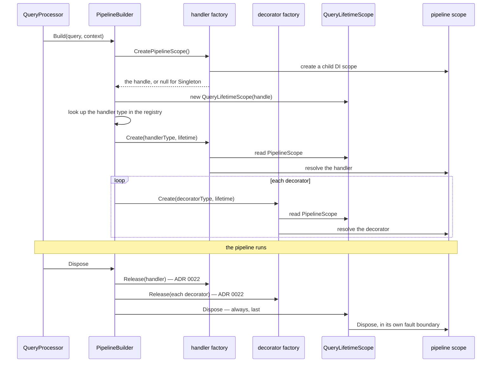
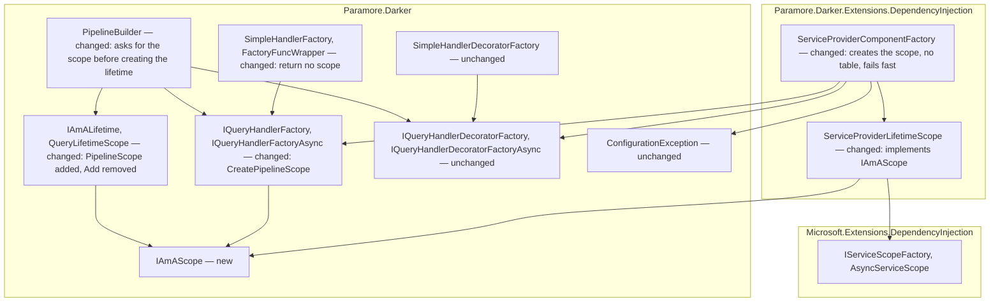
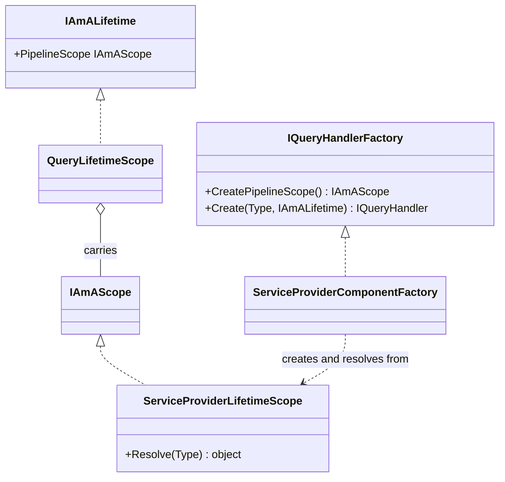

# 23. Pipeline Scope Handle

Date: 2026-10-08

## Status

Proposed

## Context

When a query uses Scoped or Transient handlers, Darker resolves the handler and its decorators from one child DI scope created for that query. Today the DI factory creates that scope as a side effect of the first `Create` call. It then remembers the scope in a table on the factory, keyed on the query's lifetime. The factory is one shared object that serves every concurrent query, so it holds per-query state. The scope's existence depends on which `Create` call runs first. Darker also has no single point where it could decide whether it owns a scope or borrows one, and ADR 0024 needs that point.

### Terms

- **Pipeline scope**: the per-query scope (see ADR 0022's *Terms*) as the lifetime carries it. *The mechanism, end to end* specifies when it is created and who reads it.
- **Scope handle**: an `IAmAScope`. It gives access to a pipeline scope for disposal only, never for resolution. *Key Components* gives its contract.
- **Recognised scope**: a pipeline scope that the DI factory can resolve from. In this ADR that means a scope the DI package created. ADR 0024 widens the term.
- **Owned scope**: a scope that Darker created and therefore disposes. In this ADR, every pipeline scope is an owned scope. ADR 0024 adds the borrowed case.
- **Teardown**, **release**, **teardown fault**: see ADR 0022's *Terms*.

### Scope

- **Parent requirement**: [specs/015-di_lifetime_conformance/requirements.md](../../specs/015-di_lifetime_conformance/requirements.md), issue #379 under #377.
- **In scope**
  - FR6: core gains `IAmAScope`. It is disposable synchronously and asynchronously and has no resolution members.
  - FR7: the two handler factory interfaces gain `CreatePipelineScope()`. The DI factory returns null for Singleton handlers and a new owned scope for Scoped and Transient handlers.
  - FR8: `IAmALifetime` gains `PipelineScope`, which is set by its constructor and never changes. The pipeline builder asks the handler factory for the scope before it creates the lifetime. Every factory reads the scope from the lifetime.
  - FR9: the DI factory's `ConditionalWeakTable` goes. The factory keeps only its constructor arguments.
  - FR10: the DI factory throws `ConfigurationException` when it must create a Scoped or Transient component and the lifetime carries no recognised scope. It never falls back to the root provider. The guard sits inside the internal factory, and `AddDarker` always supplies a scope the factory recognises, so the guard is not reachable through the public surface.
  - FR11 (owned scopes): the handler and every decorator read the same handle from the same lifetime. Each query gets its own lifetime, and each owned scope belongs to exactly one lifetime. ADR 0024 covers FR11 under adoption, including per-query decorator instances.
  - FR12: `SimpleHandlerFactory` returns null from `CreatePipelineScope()`. `SimpleHandlerDecoratorFactory` ignores the handle.
  - NFR Concurrency: the factory holds no per-query state, and each owned scope belongs to exactly one lifetime.
  - NFR Performance (contributes): on the Singleton-handler path, `CreatePipelineScope()` returns null and allocates nothing. The lifetime also stops allocating its tracking list.
  - NFR Parity: one rule on `Execute`, `ExecuteAsync` and `ExecuteStream`. On each path the pipeline builder asks the factory that will create the handler.
  - Removal of `IAmALifetime.Add`: no tagged requirement names it, but FR8 and FR9 leave it with no caller. This removal amends the `IAmALifetime` contract in ADR 0022. FR4's logging and idempotency rules apply to the pipeline scope, which is now the only disposable the lifetime holds.
  - FR22 (contributes): this ADR describes the pipeline scope handle. ADR 0024 carries the supersession of ADR 0014's scope-ownership account.
  - FR25 (contributes): the new member on the handler factory interfaces and the reshaped `IAmALifetime` are breaking changes, recorded in the release notes.
- **Out of scope**
  - Teardown order, fault boundaries, the never-throw rule and asynchronous disposal (FR1–FR5a): ADR 0022.
  - Where a scope comes from when an ambient scope exists. This includes owned versus borrowed scopes, `ScopeAffinity`, `IAmAScopeProvider`, `IAmAServiceProviderScope` and `Paramore.Darker.Extensions.AspNetCore` (FR13–FR21): ADR 0024.
  - The sibling-scope behaviour of a Scoped `QueryProcessor`: ADR 0024.
  - Supersession of ADR 0014's scope-ownership account (FR22): ADR 0024.
  - Lifetime validation, for example a Scoped dependency in a Singleton handler: issue #305.
  - Documentation corrections in `CLAUDE.md`, the README, `CONTRIBUTING.md` and the project structure guide (FR23, FR24): the spec's documentation tasks, not an ADR.

### Where this ADR sits

| ADR | Decides |
| --- | --- |
| 0022 | Teardown releases every component independently, disposes the per-query scope last, and never throws — synchronously on the sync path, asynchronously on the async and stream paths. |
| **0023** *(this one)* | The pipeline obtains its scope from the handler factory up front (`CreatePipelineScope()`) and carries it on the lifetime as an `IAmAScope` handle, replacing the factory-held `ConditionalWeakTable`. |
| 0024 | A Scoped handler may adopt an ambient scope (`ScopeAffinity.JoinAmbient`, `IAmAScopeProvider`, `Paramore.Darker.Extensions.AspNetCore`) instead of creating its own; Darker disposes only scopes it created. |

Darker disposes exactly the scopes it creates, after it has released every component resolved from them, and a teardown fault never reaches the caller.

In this ADR every scope that `CreatePipelineScope()` returns is owned, so the lifetime always disposes it. ADR 0024 adds a borrowed scope that Darker does not dispose. The lifetime delegates the meaning of disposal to the handle, so ADR 0024 can add that case without reshaping the types defined here.

### A query's scope is looked up by a shared factory, not handed to the pipeline

| Question | Today | After this ADR |
| --- | --- | --- |
| When is the scope created? | Lazily, on the first non-Singleton `Create` | Before any `Create`, by the handler factory |
| What knows which scope belongs to a query? | The shared factory, through a table keyed on the lifetime | The lifetime, which carries the handle |
| How does the lifetime come to dispose the scope? | The factory calls `lifetime.Add(scope)` from inside `Create` | The pipeline builder passes the handle to the lifetime's constructor |
| What happens when no scope exists? | The factory creates one silently | The factory throws `ConfigurationException` |
| Do handler and decorators share a scope across two factory instances? | No. Each instance has its own table | Yes. The scope is on the lifetime |
| Where could Darker decide owned versus borrowed? | Nowhere. The scope appears on demand | At `CreatePipelineScope()`, once per query |

Four consequences follow from the table:

- A shared singleton holds per-query state. The table is thread-safe and weakly keyed, so it is correct today. But a reader must know that to trust the factory under concurrency, and FR9 forbids the shape.
- Handler and decorators share one scope only because `AddDarker` passes one factory instance into all four factory slots. If the slots held two instances, each would create its own scope, and a Scoped dependency would differ between the handler and its decorators.
- Scope creation is a side effect of resolution. Any `Create` call with any lifetime produces a scope, even when the pipeline did not intend one.
- The decision to create a scope is spread across every `Create` call. ADR 0024 must choose between creating a scope and adopting an ambient one, and it needs one place, before the first component, to make that choice.

The mechanism is short. `PipelineBuilder` creates an empty `QueryLifetimeScope` at the start of each build. It passes that lifetime to the handler factory's `Create`, then to each decorator factory's `Create`. On a Scoped or Transient lifetime, the DI factory calls `GetValue` on its table. The first call for a lifetime creates a `ServiceProviderLifetimeScope`, registers it with `lifetime.Add`, and stores it in the table. Later calls for the same lifetime find it. Brighter removed the same shape in its ADR 0071.

### The forces

- One `ServiceProviderComponentFactory` instance serves every query of a processor, concurrently (`src/Paramore.Darker.Extensions.DependencyInjection/ServiceCollectionExtensions.cs:45`).
- The table that locates the scope lives on that shared instance (`src/Paramore.Darker.Extensions.DependencyInjection/ServiceProviderComponentFactory.cs:47`).
- Core's public abstractions name no container type (ADR 0004), so a scope in core can be a handle, but not a service provider.
- Handlers and decorators are created through different factory roles, yet must share one scope (ADR 0014; FR11).
- The pipeline builder chooses the handler factory once per build and calls it before any decorator factory (`src/Paramore.Darker/PipelineBuilder.cs:67`).
- Decorators need a pipeline scope exactly when the handler does: they are Singletons under a Singleton handler lifetime and resolve from the pipeline scope otherwise, so one lifetime decision covers the whole pipeline (`src/Paramore.Darker.Extensions.DependencyInjection/ServiceCollectionDecoratorRegistry.cs:21`; ADR 0024 makes them Transient under a Scoped or Transient handler lifetime).
- Resolving a Scoped service from the root provider is the defect ADR 0014 fixed. A silent fallback would bring it back (FR10).
- Public factories are user-replaceable, and the Simple factories have no container (ADR 0004, ADR 0009; FR12).
- `Paramore.Darker` targets `netstandard2.0`, which has no default interface methods, so a new interface member breaks implementers. V5 permits breaking changes.
- The Singleton-handler path must not allocate more per query (NFR Performance).
- ADR 0024 must add borrowed scopes without reshaping the lifetime or the factory interfaces.

## Decision

**The handler factory creates each query's pipeline scope before any component exists, the lifetime carries that scope as an `IAmAScope` handle for the whole query, and every factory resolves from that handle or fails fast, so no factory holds per-query state.**

The pipeline builder asks the factory that will create the handler for a scope, then builds the lifetime around the answer. The handler factory decides whether a query needs a scope at all, because it is the one factory every query uses exactly once. Core sees the scope only as something to dispose. The DI package, which created the scope, recognises it and resolves from it. The lifetime disposes the handle under ADR 0022's teardown rules, and the lifetime no longer accepts other disposables.

### The mechanism, end to end

The sync path with a Scoped handler is shown. The async and stream paths follow the same sequence. On those paths the scope comes from the factory that the path uses to create the handler, and teardown is awaited (ADR 0022).



The pipeline builder asks one factory per path, the same factory that will create the handler:

| Path | Factory asked for the scope, and used to create the handler |
| --- | --- |
| `Build` (`Execute`) | the sync handler factory |
| `BuildAsync` (`ExecuteAsync`) | the async handler factory when an async registry and an async factory are configured, otherwise the sync handler factory |
| `BuildStream` (`ExecuteStream`) | the async handler factory when configured, otherwise the sync handler factory |

A factory that receives a lifetime decides what to do with the handle. The DI factory evaluates these rows in order:

| # | Situation in `Create` | DI factory does | Caller sees |
| --- | --- | --- | --- |
| 1 | Handler lifetime is Singleton | resolves from its captured provider and ignores the handle | the component |
| 2 | Scoped or Transient, and `PipelineScope` is a recognised scope | resolves from that scope | the component |
| 3 | Scoped or Transient, and `PipelineScope` is null, or the lifetime is null | throws | `ConfigurationException` naming the component type and the handler lifetime |
| 4 | Scoped or Transient, and `PipelineScope` is not a recognised scope | throws | `ConfigurationException` naming the component type and the handle's type |

The pipeline builder handles failures around the scope itself:

| # | Situation | Outcome |
| --- | --- | --- |
| 5 | `CreatePipelineScope()` throws | the build fails with that exception. No lifetime and no scope exist, so teardown has nothing to dispose |
| 6 | The registry lookup or a `Create` throws after the lifetime exists | the build fails. Teardown disposes the scope (ADR 0022) |
| 7 | The stream is never enumerated | no build runs, so no scope is created (ADR 0019) |

The load-bearing invariants read directly off the diagram and the tables:

- The pipeline scope exists before the first `Create`, and it does not change for the life of the query.
- Exactly one factory per query creates the pipeline scope, and it is the factory that creates the handler.
- No code can throw between `CreatePipelineScope()` returning and the lifetime holding the handle, so a handle can never escape ownership.
- Every component of one query reads the same handle from the same lifetime. Two queries never share a lifetime, so they never share an owned scope.
- A factory never creates a scope inside `Create`. A container-backed factory that finds no recognised scope fails. It never improvises one.
- The lifetime is the only object that disposes the pipeline scope, and it does so under ADR 0022's rules: last, in its own fault boundary, never throwing, awaited on the async and stream paths, and at most once.

Requirements satisfied by these invariants:

- FR7, FR8: the first two invariants and the path table.
- FR9: no factory creates or remembers a scope inside `Create`.
- FR10: rows 3 and 4.
- FR11 for owned scopes, NFR Concurrency for owned scopes: the fourth invariant. ADR 0024 covers the borrowed case.
- FR12: the Simple factories return null and ignore the handle (row 1 has no Simple equivalent, because Simple factories never resolve from a container).
- NFR Parity: the path table.
- Pipeline scope handle acceptance criteria: the fourth invariant for shared and isolated instances; the fifth invariant for a factory with no per-query state; row 2 and ADR 0022's teardown for the criterion that nothing resolves from the root.

### Where the pieces live



No new assembly and no new package reference. `IAmAScope` inherits `IAsyncDisposable`, which comes from `Microsoft.Bcl.AsyncInterfaces` on `netstandard2.0`. That package is already referenced. Dependencies still point from the DI package into core. Core never learns the concrete scope type.

### Key Components

#### The roles, and what each is responsible for

| Role | Type | Responsibilities | Responsibility classifier | Collaborators |
| --- | --- | --- | --- | --- |
| Ends a pipeline scope | `IAmAScope` | Disposes the scope it stands for, synchronously or asynchronously | doing | none in core |
| Supplies a query's scope | `IQueryHandlerFactory`, `IQueryHandlerFactoryAsync` | Decides whether a query needs a pipeline scope; creates it; creates the handler from it | deciding, doing | `IAmAScope`, `IAmALifetime` |
| Creates decorators | `IQueryHandlerDecoratorFactory`, `IQueryHandlerDecoratorFactoryAsync` | Creates each decorator from the scope the lifetime carries | doing | `IAmALifetime` |
| Carries a query's scope | `IAmALifetime`, implemented by `QueryLifetimeScope` | Knows the pipeline scope for one query; disposes it once, under ADR 0022's rules | knowing, doing | `IAmAScope`, `ILogger` |
| Assembles one pipeline | `PipelineBuilder<TResult>` | Chooses the handler factory for the path; asks it for the scope; creates the lifetime before any component | deciding, doing | the factory roles, `QueryLifetimeScope` |
| Resolves from a DI scope | `ServiceProviderComponentFactory` | Creates owned scopes for Scoped and Transient handlers; recognises its own scopes; resolves from them; rejects anything else | deciding, doing | `ServiceProviderLifetimeScope`, `IServiceProvider` |
| Adapts a child DI scope | `ServiceProviderLifetimeScope` | Knows the child scope's service provider; disposes the child scope | knowing, doing | `AsyncServiceScope` |

The split that matters most is between the handle and the factory. Core's handle knows only how to end a scope. The factory that created the scope is the only type that knows how to resolve from it. A handler, a decorator or the pipeline builder therefore cannot reach the container through the lifetime. Resolution stays in the one role that knows the configured handler lifetime.



#### `IAmAScope`

```csharp
public interface IAmAScope : IDisposable, IAsyncDisposable
{
}
```

| Member | Input | Output | Error conditions |
| --- | --- | --- | --- |
| `Dispose` | none | none | An implementation may throw. The lifetime contains and logs the fault (ADR 0022). An implementation should tolerate a second call |
| `DisposeAsync` | none | `ValueTask` | As for `Dispose`. The lifetime awaits it on the async and stream paths |

The interface has no members of its own, and that is deliberate. A handle is a capability to end a scope. It is not a capability to resolve from one. Implementations live outside core. In this ADR the only implementation is the DI package's `ServiceProviderLifetimeScope`.

#### `IAmALifetime`

```csharp
public interface IAmALifetime : IDisposable, IAsyncDisposable
{
    IAmAScope? PipelineScope { get; }
}
```

| Member | Input | Output | Error conditions |
| --- | --- | --- | --- |
| `PipelineScope` | none | the handle the handler factory returned, or null | none. The value is fixed when the lifetime is constructed |
| `Dispose` | none | none | never throws. Disposes `PipelineScope` in its own fault boundary and logs a fault at Error with the scope's type. Does nothing when `PipelineScope` is null. A second call does nothing (ADR 0022) |
| `DisposeAsync` | none | `ValueTask` | never faults. Same rules, awaiting `PipelineScope.DisposeAsync` |

`Add(IDisposable)` is removed. `QueryLifetimeScope` stays internal and takes the handle through its constructor, `QueryLifetimeScope(IAmAScope? pipelineScope)`. The constructor only assigns the handle and cannot throw.

#### `IQueryHandlerFactory` and `IQueryHandlerFactoryAsync`

```csharp
public interface IQueryHandlerFactory
{
    IAmAScope? CreatePipelineScope();
    IQueryHandler Create(Type handlerType, IAmALifetime lifetime);
    void Release(IQueryHandler handler, IAmALifetime lifetime);
}

public interface IQueryHandlerFactoryAsync
{
    IAmAScope? CreatePipelineScope();
    IQueryHandler Create(Type handlerType, IAmALifetime lifetime);
    ValueTask ReleaseAsync(IQueryHandler handler, IAmALifetime lifetime); // ADR 0022
}
```

| Member | Input | Output | Error conditions |
| --- | --- | --- | --- |
| `CreatePipelineScope` | none | a new owned handle, or null when the factory resolves nothing per query | An implementation may throw, for example when the container cannot create a scope. The build then fails before any lifetime exists. Each call returns a distinct handle. A handle is never shared between queries |
| `Create` | the handler type; the lifetime | the handler | A container-backed implementation throws `ConfigurationException` when it needs a scope and `lifetime.PipelineScope` is not one it recognises (rows 3 and 4) |

The pipeline builder calls `CreatePipelineScope` exactly once per build, on the factory it will use to create the handler, and only that factory. `Create` and the release members keep their shapes. Core files that use the `?` annotation follow the existing `#nullable enable annotations` pattern of `IQueryContext.cs`, because `Paramore.Darker` does not enable nullable reference types project-wide.

#### `ServiceProviderComponentFactory` (internal)

| Member | Input | Output | Error conditions |
| --- | --- | --- | --- |
| `CreatePipelineScope` | none | null for a Singleton handler lifetime. Otherwise a new `ServiceProviderLifetimeScope` over the captured provider's `IServiceScopeFactory` | `InvalidOperationException` from the container when `IServiceScopeFactory` is missing |
| `Create` (handler and decorator) | the component type; the lifetime | the component | `ConfigurationException` in rows 3 and 4 |

The factory recognises a scope in one private method that maps a handle to a service provider. The method's test is "the handle is a `ServiceProviderLifetimeScope`". ADR 0024 widens that single test to `IAmAServiceProviderScope` so that it accepts adopted scopes, without any change to `Create`. The factory keeps no fields beyond its two constructor arguments.

#### Where each type is touched

| Assembly | Type | Change |
| --- | --- | --- |
| `Paramore.Darker` | `IAmAScope` | new |
| `Paramore.Darker` | `IAmALifetime` | gains `PipelineScope`; loses `Add` |
| `Paramore.Darker` | `QueryLifetimeScope` | takes the handle in its constructor; disposes the handle instead of a tracked list |
| `Paramore.Darker` | `IQueryHandlerFactory`, `IQueryHandlerFactoryAsync` | gain `CreatePipelineScope` |
| `Paramore.Darker` | `SimpleHandlerFactory`, `FactoryFuncWrapper` | implement `CreatePipelineScope` returning null |
| `Paramore.Darker` | `PipelineBuilder<TResult>` | chooses the handler factory once per build; creates the lifetime from that factory's handle |
| `Paramore.Darker.Extensions.DependencyInjection` | `ServiceProviderComponentFactory` | implements `CreatePipelineScope`; resolves from `lifetime.PipelineScope`; `ConditionalWeakTable` and `lifetime.Add` removed; fails fast |
| `Paramore.Darker.Extensions.DependencyInjection` | `ServiceProviderLifetimeScope` | implements `IAmAScope`; stays internal |
| test | `RecordingHandlerFactory` | implements `CreatePipelineScope` |

These stay deliberately unchanged. The decorator factory interfaces gain no member, and `SimpleHandlerDecoratorFactory` ignores the handle as it ignores the lifetime today. Every `Create`, `Release` and `ReleaseAsync` signature keeps its shape. `HandlerConfiguration`, `QueryProcessorBuilder`, `AddDarker`, `DarkerOptions` and the registries do not change. `AddDarker` still passes one factory instance into all four factory slots. Singleton components still resolve from the factory's captured provider and are never disposed by Darker (ADR 0014). Teardown order and fault handling stay as ADR 0022 states. The stream path still builds on the first `MoveNextAsync` (ADR 0019). The scope is still created from the captured provider's `IServiceScopeFactory`, so a Scoped `QueryProcessor` still gets a sibling scope. ADR 0024 addresses that behaviour.

### Technology Choices

#### Why a handle with no resolution members, rather than a scope that exposes a service provider?

A handle with no resolution members keeps core container-agnostic (FR6). It also leaves resolution in the one role that knows the configured lifetime. The Simple factories have no container, so a resolution member would force them to supply a meaningless provider. A resolution member would also let any handler or decorator holding the lifetime bypass the factory. The DI package recognises its own scope type and resolves through it. ADR 0024's `IAmAServiceProviderScope` adds the resolution capability as a separate, opt-in role.

#### Why only the handler factory creates the scope?

A query has one pipeline scope, so one role must supply it. The handler factory is the factory every query uses exactly once, and the pipeline builder calls it before any decorator factory. In Darker's DI wiring one instance plays all four roles, and decorators need a pipeline scope exactly when the handler does (ADR 0024 sets their registration lifetime). The handler factory's decision therefore already covers the decorators. If decorator factories could also supply a scope, the pipeline builder would need a rule for which factory wins, and a reader could not tell from the interface which one Darker asks.

The consequence is a fail-fast mix. Suppose a handler factory returns null, and a container-backed decorator factory then needs a Scoped or Transient decorator. The decorator factory finds no recognised scope and throws `ConfigurationException` (FR10). Darker's own types cannot form this mix: the DI factory is internal, and `AddDarker` wires it into every slot. The rule therefore binds user-written container-backed factories that follow the same contract.

#### Why ask for the scope before the handler type is known?

`CreatePipelineScope()` takes no handler type, because the DI factory's decision depends only on the handler lifetime configured for the whole processor. The registry lookup, including ADR 0020's routed lookups, needs the query and the context but never the scope. Asking first keeps the rule ADR 0014 established, that the lifetime exists before any step that can fail. It also keeps the scope creation in one place at the start of each build. On a failed lookup, the scope is created and then disposed for nothing. That cost falls only on a failure path.

#### Why remove `Add`, rather than keep it beside `PipelineScope`?

Two ways to attach a disposable to a lifetime give two ownership paths, and ADR 0024 needs exactly one so it can tell owned scopes from borrowed ones. `Add` has one caller, the DI factory's scope registration, and the handle replaces that call. Keeping `Add` would invite a factory to register a scope lazily again, which is the shape FR9 removes.

#### Why recognise the scope by type, rather than by remembering the scopes the factory created?

Remembering created scopes is per-query state on a shared factory, which FR9 forbids. A type test needs no state and costs one cast. The test is confined to one private method, so ADR 0024 can widen it from the concrete type to an interface.

#### Why fail fast, rather than fall back to the root provider?

Resolving a Scoped service from the root provider either throws under scope validation or yields an instance that lives as long as the application. That outcome is the second defect ADR 0014 fixed. A fallback that creates a scope inside `Create` restores the lazy shape this ADR removes. A `ConfigurationException` at the first `Create` names the misconfiguration at the point it occurs.

### Implementation Approach

This ADR builds on ADR 0022, so ADR 0022 is implemented first. Line numbers refer to the code before ADR 0022 lands. Each behavioural step starts with a failing test, through `/test-first`. Tests use real registries, `ServiceCollection`-built providers and the Simple factories, and follow the `When_..._should_...` naming.

1. **Structural: add the handle.** Add `src/Paramore.Darker/IAmAScope.cs`. Make `ServiceProviderLifetimeScope` (`src/Paramore.Darker.Extensions.DependencyInjection/ServiceProviderLifetimeScope.cs:36`) implement `IAmAScope`. After ADR 0022 it is already `IDisposable` and `IAsyncDisposable`. Nothing uses the interface yet.
2. **Structural: add `CreatePipelineScope`.** Add the member to `IQueryHandlerFactory` (`src/Paramore.Darker/IQueryHandlerFactory.cs:5`) and `IQueryHandlerFactoryAsync` (`src/Paramore.Darker/IQueryHandlerFactoryAsync.cs:5`). Return null from `SimpleHandlerFactory` (`src/Paramore.Darker/SimpleHandlerFactory.cs:32`), `FactoryFuncWrapper` (`src/Paramore.Darker/Builder/FactoryFuncWrapper.cs:25`), `RecordingHandlerFactory` (`test/Paramore.Darker.Core.Tests/TestDoubles/RecordingHandlerFactory.cs:16`) and, for now, `ServiceProviderComponentFactory`. The pipeline builder does not call the member yet.
3. **Structural: choose the handler factory once.** In `PipelineBuilder`, extract the factory choice that `ResolveHandlerAsync` (`src/Paramore.Darker/PipelineBuilder.cs:220`) and `ResolveStreamHandler` (`:378-380`) make inline into one decision taken at the start of each build. ADR 0022 step 7 already records the creating factory for release. Reuse that record. Behaviour is unchanged.
4. **Behavioural: the lifetime carries the handle.** Add `PipelineScope` to `IAmALifetime` (`src/Paramore.Darker/IAmALifetime.cs:33`). Give `QueryLifetimeScope` (`src/Paramore.Darker/QueryLifetimeScope.cs:34`) a constructor that takes the handle. Dispose the handle under ADR 0022's rules after any tracked items. In `Build` (`PipelineBuilder.cs:62`), `BuildAsync` (`:123`) and `BuildStream` (`:277`), create the lifetime as `new QueryLifetimeScope(chosenFactory.CreatePipelineScope())`, in one expression. The ADR 0022 step 2 and step 3 tests that observe disposal through `lifetime.Add` move to a recording handle here: the step 3 tests observe the handle's disposal, and the step 2 multi-item test becomes a single-handle test, because the lifetime now holds one item. Tests in `test/Paramore.Darker.Core.Tests`, with a recording handler factory that returns a recording `IAmAScope`, on each path:
   - the handler factory's and decorator factory's `Create` both receive a lifetime whose `PipelineScope` is that handle;
   - the handle is disposed once, after every release;
   - a throwing handle `Dispose` is logged and the result still returns;
   - on `BuildAsync` with no async registry, the sync factory is asked for the handle.
5. **Behavioural: the DI factory creates and recognises the scope.** In `src/Paramore.Darker.Extensions.DependencyInjection/ServiceProviderComponentFactory.cs`, implement `CreatePipelineScope` by the contract table. Replace `Resolve` (`:71-78`) with a lookup of `lifetime.PipelineScope` through one private recognition method that throws `ConfigurationException` for rows 3 and 4. Delete the table (`:43-47`) and `CreateScope` (`:80-85`). Tests, through `AddDarker` and `IQueryProcessor` only:
   - a Singleton handler lifetime resolves the handler and Darker does not dispose it (row 1);
   - with a Scoped or Transient handler lifetime, a disposable handler is disposed at the end of each query, so nothing was resolved from the root (row 2).

   Rows 3 and 4 have no direct test. The factory is internal, `AddDarker` always supplies a scope it recognises, and `.agent_instructions/testing.md` forbids `InternalsVisibleTo` for testing. The rows are a guard against a future wiring defect, kept by code review. The existing lifetime tests in `test/Paramore.Darker.Extensions.Tests` are the regression guard for FR11 and NFR Concurrency, for example the scoped-sharing and concurrent-isolation tests. They must pass unchanged.
6. **Structural: remove `Add`.** Delete `Add` from `IAmALifetime` (`IAmALifetime.cs:35-40`) and `QueryLifetimeScope` (`QueryLifetimeScope.cs:36`, `:39-46`), together with the tracked list. After steps 4 and 5, neither production code nor a test calls `Add`. The suite stays green.
7. **Documentation.** Update the XML documentation on `IAmALifetime`, `IAmAScope` and the handler factory interfaces, and the summary on `ServiceProviderComponentFactory` (`:30-35`). Record the breaking changes from steps 2 and 6 in `release_notes.md`.

## Consequences

### Positive

- No factory holds per-query state, so a reader can trust the shared DI factory under concurrency without knowing how `ConditionalWeakTable` behaves (FR9, NFR Concurrency).
- Handler and decorators share one scope because the lifetime carries it, not because one factory instance fills four slots (FR11).
- A missing or foreign scope fails at the first `Create` with a `ConfigurationException`, instead of producing a scope nobody intended (FR10).
- The Singleton-handler path allocates nothing for the scope. Every path stops allocating the lifetime's tracking list and the table entry (NFR Performance).
- Darker has one point per query, `CreatePipelineScope()`, where ADR 0024 can choose between creating and adopting a scope.
- Core stays container-agnostic, and the Simple factories keep working by returning null (FR6, FR12).

### Negative

- Every implementer of `IQueryHandlerFactory` or `IQueryHandlerFactoryAsync` must add `CreatePipelineScope`. This is a V5 breaking change (FR25).
- `IAmALifetime.Add` disappears. A custom factory that attached its own disposables to the lifetime must now return them inside a single handle from `CreatePipelineScope` (FR25).
- The lifetime holds at most one disposable. A factory that needs several per-query resources must compose them behind one handle.
- On the Scoped and Transient paths, a query whose handler lookup fails still creates and disposes a scope (`src/Paramore.Darker/PipelineBuilder.cs:204`).
- The contract for user-written container-backed factories changes: a decorator factory must resolve from `lifetime.PipelineScope`, which is null when the handler factory creates no scope, and should throw `ConfigurationException` rather than create a scope of its own.
- The DI factory's rows 3 and 4 have no direct test. `AddDarker` never reaches them, and testing the internal factory directly would need `InternalsVisibleTo`, which the project's testing rules forbid. A regression in the guard itself goes undetected by tests and is kept by code review.

### Risks and Mitigations

- **Risk:** the pipeline builder obtains a handle and then throws before the lifetime holds it, which leaks the scope. **Mitigation:** the builder creates the lifetime in the same expression as the call, and the lifetime's constructor only assigns.
- **Risk:** a custom handler factory returns the same handle for every query, so concurrent queries share and then dispose one scope. **Mitigation:** the contract states that each call returns a distinct handle, and the XML documentation repeats it.
- **Risk:** a future per-handler lifetime needs the handler type at `CreatePipelineScope`, which forces another breaking change. **Mitigation:** the handler lifetime is per processor today (`DarkerOptions.HandlerLifetime`), and per-handler lifetimes are out of scope for this spec.
- **Risk:** recognition by concrete type rejects a user's wrapper around the DI package's scope. **Mitigation:** the scope type is internal, so users cannot wrap it today. ADR 0024 widens recognition to an interface.

## Alternatives Considered

1. **Do nothing, and keep the factory-held table.** The table is thread-safe and correct today. But it keeps per-query state on a shared singleton, which FR9 forbids. Scope sharing still depends on one factory instance, and ADR 0024 gets no single point to decide ownership. Rejected.
2. **Add `CreatePipelineScope` to the decorator factory interfaces as well.** Two roles could then supply the one scope, and the pipeline builder would need a precedence rule. In Darker's wiring one instance plays both roles, so the extra member buys nothing. Rejected.
3. **Introduce a separate pipeline-scope factory role, configured on `HandlerConfiguration`.** The role is cohesive, but it adds a type and a configuration slot. A Simple-factory user would have to supply or omit the role, and the role could disagree with the handler factory about the handler lifetime. The factory that creates the handler already knows that lifetime. Rejected.
4. **Give `IAmAScope` a service provider member in core.** `IServiceProvider` is a BCL type, so core would not take a container dependency. But every handler and decorator could then resolve through the lifetime and bypass the factory, and the Simple factories would have to supply a provider they do not have. FR6 asks for no resolution members. Rejected.
5. **Keep `Add` beside `PipelineScope`.** Two attachment paths make ownership ambiguous for ADR 0024, and `Add` invites the lazy registration FR9 removes. `Add` has no other caller. Rejected.
6. **Fall back to the root provider, or create a scope lazily, when the handle is missing.** The first reintroduces ADR 0014's root-scope defect. The second reintroduces the shape this ADR removes. FR10 requires failing fast. Rejected.
7. **Return a shared no-op handle instead of null for "no scope".** A static no-op handle allocates nothing either, but it needs a new public type. It also hides from the reader the difference between "this query has no scope" and "this query has a scope". FR7 states that the factory returns no scope. Rejected.
8. **Pass the scope to `Create` as a separate parameter, rather than on the lifetime.** Every `Create` signature on all four roles would change again. The lifetime already reaches every `Create` and every release (ADR 0014). Rejected.
9. **Recognise scopes by remembering, on the factory, the scopes it created.** The memory is per-query state on the shared factory, which FR9 forbids. Rejected.

## References

- Requirements: [specs/015-di_lifetime_conformance/requirements.md](../../specs/015-di_lifetime_conformance/requirements.md): FR6, FR7, FR8, FR9, FR10, FR11, FR12; the pipeline scope handle acceptance criteria; NFR Concurrency, Parity; contributes to FR22, FR25 and NFR Performance.
- Related ADRs:
  - [0014-factory-component-lifetime](0014-factory-component-lifetime.md): amended, not superseded. This ADR replaces how the per-query scope is located: Decision 1's `Add(IDisposable)` surface, and Decision 3's lazy attachment of the child scope through `IAmALifetime.Add`. It also adds a member to Decision 2's handler factory interfaces, and makes Decision 4's claim that handler and decorators share one scope "independent of how many factory objects exist" true by moving the scope onto the lifetime. The supersession of ADR 0014's scope-ownership account belongs to ADR 0024.
  - [0022-robust-pipeline-teardown](0022-robust-pipeline-teardown.md): sibling. This ADR amends its `IAmALifetime` contract by removing `Add`. Its teardown rules apply unchanged to the pipeline scope.
  - 0024 (ambient scope adoption): sibling. It widens scope recognition and adds borrowed scopes.
  - [0019-streaming-query-pipeline](0019-streaming-query-pipeline.md): the stream path asks its handler factory for the scope on the first `MoveNextAsync`.
  - [0020-agreement-dispatch-handler-routing](0020-agreement-dispatch-handler-routing.md): the registry lookup runs after the scope exists and does not use it.
  - [0009-simple-and-inmemory-factory-implementations](0009-simple-and-inmemory-factory-implementations.md): the Simple handler factory returns no scope.
  - [0004-factory-registry-abstractions](0004-factory-registry-abstractions.md): the handler factory roles that gain `CreatePipelineScope`.
- External references:
  - Brighter ADR 0071 (pipeline scope handle: `CreatePipelineScope()` on the factory and `IAmALifetime.PipelineScope`) and Brighter ADR 0070 (the `IAmAScope` handle): the Brighter decisions this ADR mirrors. <https://github.com/BrighterCommand/Brighter/blob/master/docs/adr/>
  - Issues [#379](https://github.com/BrighterCommand/Darker/issues/379) and [#377](https://github.com/BrighterCommand/Darker/issues/377).
