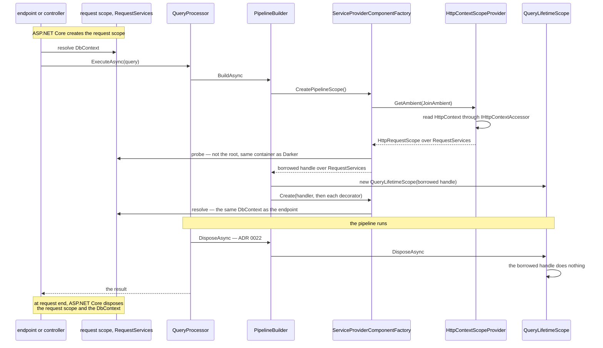
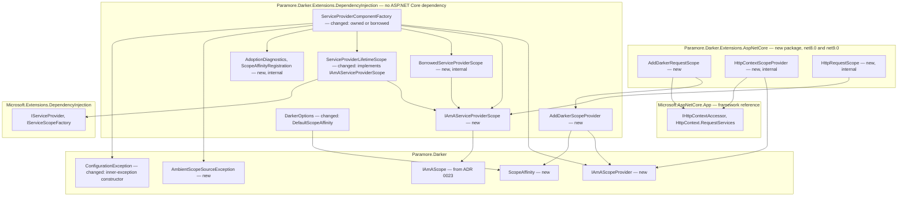
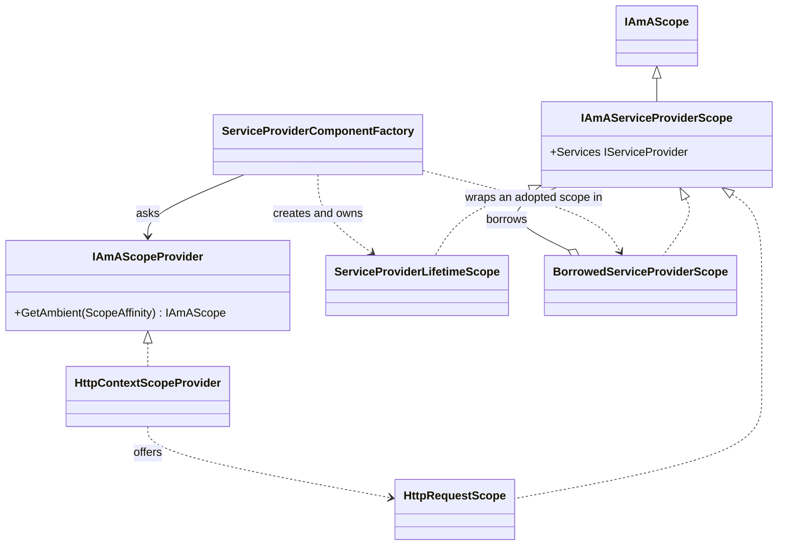

# 24. Ambient Scope Adoption

Date: 2026-10-09

## Status

Proposed

## Context

In an ASP.NET Core application, the controller and the Brighter command handlers resolve Scoped services, such as an EF Core `DbContext`, from the request's DI scope. Darker never uses that scope. It always creates a per-query scope of its own, so a query handler gets a different `DbContext` from the rest of the request, and reads and writes in one request do not share a unit of work. The guidance in ADR 0014, `CLAUDE.md` and the README says that a Scoped `QueryProcessor` fixes this. It does not, because Microsoft DI scopes do not nest.

### Terms

- **Pipeline scope**, **scope handle**, **owned scope**: see ADR 0023's *Terms*.
- **Recognised scope**: see ADR 0023's *Terms*. This ADR widens the term to any `IAmAServiceProviderScope` (*Key Components*).
- **Teardown**, **teardown fault**: see ADR 0022's *Terms*.
- **Ambient scope**: a DI scope that already exists around the call to the query processor, and that someone other than Darker created and disposes. The ASP.NET Core request scope (`HttpContext.RequestServices`) is the main example.
- **Scope provider**: an `IAmAScopeProvider`, the role that offers Darker the current ambient scope. *Key Components* gives its contract.
- **Affinity**: a `ScopeAffinity` value. It states whether a query may join an ambient scope (`JoinAmbient`) or must have a new one (`AlwaysNew`). *How the affinity is chosen* specifies where the value comes from.
- **Adopt**: use an offered ambient scope as the pipeline scope. The decision ladder in *The mechanism, end to end* specifies when Darker adopts.
- **Borrowed scope**: an adopted scope. Darker resolves from it and never disposes it.
- **Declined scope**: an offered scope that Darker does not adopt. Darker never disposes it either.

### Scope

- **Parent requirement**: [specs/015-di_lifetime_conformance/requirements.md](../../specs/015-di_lifetime_conformance/requirements.md), issue #380 under #377.
- **In scope**
  - FR13: core gains `IAmAScopeProvider` with `GetAmbient(ScopeAffinity)`, and the `ScopeAffinity` enum with `AlwaysNew` (the default value) and `JoinAmbient`.
  - FR14: `DarkerOptions` gains `DefaultScopeAffinity`, default `AlwaysNew`. With `AlwaysNew`, or with no scope provider registered, the DI factory does not ask any provider and creates an owned scope as today.
  - FR15: the DI factory's `CreatePipelineScope()` follows the decision ladder. It adopts only for `JoinAmbient`, a Scoped handler lifetime, an offered `IAmAServiceProviderScope` and a passing probe. Every other case falls back to an owned scope, and a fallback that signals a misconfiguration logs one Warning per reason per container.
  - FR16: a scope provider that throws surfaces as `AmbientScopeSourceException`, which wraps the original exception.
  - FR17: the DI factory wraps every adopted scope in an internal non-owning handle whose disposal does nothing. Declined scopes are dropped, not disposed. Resolution from a borrowed scope that its owner has already disposed throws `ConfigurationException`, which wraps the `ObjectDisposedException`.
  - FR18: decorators resolve from the same pipeline scope as the handler, owned or borrowed. This follows from ADR 0023, because every component reads the one handle on the lifetime.
  - FR19: the seam names no ASP.NET Core type. Any provider registered through `AddDarkerScopeProvider<TProvider>()`, such as an `AsyncLocal`-backed one, is adopted by the same ladder.
  - FR20: the new package `Paramore.Darker.Extensions.AspNetCore` provides `AddDarkerRequestScope(ScopeAffinity affinity = ScopeAffinity.JoinAmbient)`. It registers `IHttpContextAccessor`, an HTTP-context scope provider and the affinity, and adds no middleware.
  - FR21: the scope provider is a singleton that reads the ambient `HttpContext` through `IHttpContextAccessor` on each query, so adoption does not depend on the provider that built the processor. It works with Singleton and Scoped `QueryProcessorLifetime`.
  - FR22 (supersession part): this ADR supersedes ADR 0014's account of scope ownership and its "`QueryProcessorLifetime = Scoped` interaction" paragraph. ADR 0014 stays Accepted for its other decisions. ADR 0022 and ADR 0023 carry the teardown and scope-handle parts of FR22.
  - NFR Performance: the `AlwaysNew` and Singleton paths do no more work per query than after ADR 0023. The fallback Warning is latched per container, so it is never logged per query.
  - NFR Diagnosability (adoption part): each fallback Warning names its reason.
  - FR23 (contributes): this ADR states the corrected guidance in *The corrected guidance*. The spec's documentation tasks own the edits to `CLAUDE.md` and the README.
  - FR24 (contributes): the new package must be listed in `CLAUDE.md`, `CONTRIBUTING.md` and `.agent_instructions/project_structure.md`. The documentation tasks own the edits.
  - FR25 (contributes): the new package, the new option and the corrected guidance go into `release_notes.md`. This ADR adds no breaking change.
- **Out of scope**
  - Teardown order, fault boundaries, the never-throw rule and asynchronous disposal: ADR 0022.
  - The scope handle, `CreatePipelineScope()` and the shape of the lifetime and factory interfaces: ADR 0023.
  - Lifetime validation, for example a Scoped dependency in a Singleton handler, or a Scoped scope provider resolved from the root: issue #305.
  - Pipeline scopes for mappers and transforms (Brighter ADR 0070): Darker has no mappers or transforms.
  - Publish and message-pump suppression brackets (Brighter ADR 0075): Darker has no Publish fan-out and no message pump.
  - A shared lifetime or scope assembly with Brighter: excluded by the requirements' constraints.
  - Containers other than Microsoft.Extensions.DependencyInjection: ADR 0006.
  - ASP.NET Core middleware for the request scope: excluded by FR20.
  - A per-query or per-handler affinity: not required. The affinity is per processor, like `HandlerLifetime`.

### Where this ADR sits

| ADR | Decides |
| --- | --- |
| 0022 | Teardown releases every component independently, disposes the per-query scope last, and never throws — synchronously on the sync path, asynchronously on the async and stream paths. |
| 0023 | The pipeline obtains its scope from the handler factory up front (`CreatePipelineScope()`) and carries it on the lifetime as an `IAmAScope` handle, replacing the factory-held `ConditionalWeakTable`. |
| **0024** *(this one)* | A Scoped handler may adopt an ambient scope (`ScopeAffinity.JoinAmbient`, `IAmAScopeProvider`, `Paramore.Darker.Extensions.AspNetCore`) instead of creating its own; Darker disposes only scopes it created. |

Darker disposes exactly the scopes it creates, after it has released every component resolved from them, and a teardown fault never reaches the caller.

ADR 0023 makes `CreatePipelineScope()` the one point per query where the pipeline scope is decided, and in ADR 0023 every scope from that point is owned. This ADR adds the borrowed case at that point. The lifetime still disposes whatever handle it holds, under ADR 0022's rules. A borrowed handle's disposal does nothing, so the unifying sentence holds without any change to the lifetime.

### A query handler cannot see the request's Scoped services

| Configuration | Scope the query handler resolves from | Same `DbContext` as the controller? | Who disposes it |
| --- | --- | --- | --- |
| Default: `QueryProcessorLifetime = Singleton`, any handler lifetime | a new scope from the root | no | Darker, after the query |
| `QueryProcessorLifetime = Scoped` (the documented EF Core advice) | a new scope from the request scope's `IServiceScopeFactory`, which is a sibling of the request scope, not a child | no | Darker, after the query |
| After this ADR: `AddDarkerRequestScope()` and `HandlerLifetime = Scoped` | the request scope itself | yes | ASP.NET Core, at the end of the request |
| After this ADR: `AddDarkerRequestScope()` and `HandlerLifetime = Transient` | a new scope from the captured provider, as today | no | Darker, after the query |

Three consequences follow from the table:

- A query that reads data the same request has just written through a Brighter command handler uses a different `DbContext`. It cannot see uncommitted changes, and it opens a second connection.
- The documented fix is wrong. A developer who makes the `QueryProcessor` Scoped pays for a processor per request and still gets a separate `DbContext`.
- No configuration of Darker today gives a query handler the request's Scoped services. Brighter ADR 0072's Alternative 1 states that a Darker query handler resolves the controller's `DbContext`. Before this ADR, that statement does not hold for Darker.

The mechanism is Microsoft DI's scope model. `IServiceScopeFactory` is registered as a singleton in the root container. Every scope it creates is a child of the root, whichever provider the factory was resolved from. `AddDarker` registers the processor with a factory delegate. For a Singleton processor, the container passes the root provider to that delegate. For a Scoped processor, it passes the request scope. The DI factory captures that provider. After ADR 0023, it creates each owned scope from the captured provider's `IServiceScopeFactory`. In both cases the new scope is a sibling of the request scope. ADR 0014's statement that the scope "nests cleanly" under a Scoped processor is therefore incorrect.

### The forces

- The processor's factory delegate receives the root provider under the default Singleton lifetime, so the DI factory cannot reach the request scope through the provider it captures (`src/Paramore.Darker.Extensions.DependencyInjection/ServiceCollectionExtensions.cs:29`).
- Microsoft DI creates every scope as a child of the root, so Darker cannot create a scope that shares the request's Scoped instances (`src/Paramore.Darker.Extensions.DependencyInjection/ServiceProviderLifetimeScope.cs:38`).
- The DI package targets `netstandard2.0` and must not depend on ASP.NET Core (ADR 0007, `src/Paramore.Darker.Extensions.DependencyInjection/Paramore.Darker.Extensions.DependencyInjection.csproj:3`).
- Core names no container type (ADR 0004), so the core seam can offer a scope handle but not a service provider.
- The default handler lifetime is Transient, and ADR 0014 promises that Darker disposes Transient components after each query (`src/Paramore.Darker.Extensions.DependencyInjection/DarkerOptions.cs:9`).
- Decorators are registered with the handler lifetime, so one adoption decision covers the whole pipeline (`src/Paramore.Darker.Extensions.DependencyInjection/ServiceCollectionDecoratorRegistry.cs:21`).
- `AddDarker` builds `DarkerOptions` eagerly inside its own call, so a later registration cannot write into those options (`src/Paramore.Darker.Extensions.DependencyInjection/ServiceCollectionExtensions.cs:19-20`).
- A scope provider is user-replaceable, so Darker cannot assume that the scope it offers has a harmless `Dispose`.
- The pipeline sets per-query state on each handler and decorator instance, so a shared instance is unsafe under concurrency (`src/Paramore.Darker/PipelineBuilder.cs:70`).
- The stream path builds its pipeline on the first `MoveNextAsync`, which can run after the request has ended (ADR 0019, `src/Paramore.Darker/QueryProcessor.cs:160`).
- Brighter users already call `AddBrighterRequestScope()`. Darker cannot share Brighter's types (requirements, Constraints), so the two libraries need parallel opt-ins.
- ADR 0023 lets this ADR add borrowed scopes without reshaping the lifetime or the factory interfaces.

## Decision

**When the affinity is `JoinAmbient` and the handler lifetime is Scoped, the DI factory adopts the ambient scope that a registered scope provider offers, if the scope passes a probe, and wraps it in a handle that Darker never disposes; in every other case it creates and owns a scope as before.**

The decision is made once per query, in the DI factory's `CreatePipelineScope()`. Core gains only the seam: a scope provider role, the affinity enum and an exception for a failing provider. The DI package gains the capability to resolve from an offered scope, the option, a registration method for any scope provider, and the adoption ladder. A new ASP.NET Core package supplies the provider that offers `HttpContext.RequestServices` and the one-call opt-in `AddDarkerRequestScope()`. Ownership follows creation: Darker disposes the scopes it creates and never disposes a scope it was offered.

### The mechanism, end to end

The async path in an ASP.NET Core request is shown, with `HandlerLifetime = Scoped` and `AddDarkerRequestScope()`. The sync path is the same sequence. The stream path runs the same sequence on the first `MoveNextAsync`.



The DI factory evaluates these rows in order in `CreatePipelineScope()`. The first row that matches decides.

| # | Situation | Outcome | Diagnostic |
| --- | --- | --- | --- |
| 1 | Handler lifetime is Singleton | no scope (null), as in ADR 0023 | Warning, once per container, if the affinity is `JoinAmbient`: adoption needs a Scoped handler lifetime |
| 2 | Handler lifetime is Transient | owned scope | Warning, once per container, if the affinity is `JoinAmbient`: adoption needs a Scoped handler lifetime |
| 3 | No scope provider is registered | owned scope, as today | Warning, once per container, if the affinity is `JoinAmbient`: no scope provider is registered |
| 4 | The affinity is `AlwaysNew` | owned scope. The provider is not asked | none |
| 5 | The provider's `GetAmbient(JoinAmbient)` throws | the build fails with `AmbientScopeSourceException`, which wraps the original exception | the exception reaches the caller |
| 6 | The provider returns null | owned scope | none: no ambient scope is the normal answer outside a request |
| 7 | The offered scope is not an `IAmAServiceProviderScope` | owned scope. The offered scope is declined | Warning, once per container: the offered scope exposes no service provider |
| 8 | `Services` is null | owned scope. Declined | Warning, once per container: the offered scope has no service provider |
| 9 | `Services` is the root provider | owned scope. Declined | Warning, once per container: the offered provider is the root |
| 10 | `Services` belongs to a container in which this Darker registration does not exist | owned scope. Declined | Warning, once per container: the offered provider is from another container |
| 11 | A probe resolution throws, for example `ObjectDisposedException` | owned scope. Declined | Warning, once per container, with the exception type |
| 12 | Otherwise | borrowed scope: the offered scope, wrapped in a non-owning handle | none |

Rows 1 to 4 depend only on the configuration, so the factory evaluates them once, when it is constructed, and logs their Warnings then. Only rows 5 to 12 run per query, and only when adoption is enabled. *Implementation Approach* step 4 gives the ordered code that implements this table.

#### How the affinity is chosen

| Registrations present | Effective affinity |
| --- | --- |
| `AddDarker` only | `DarkerOptions.DefaultScopeAffinity`, which defaults to `AlwaysNew` |
| `AddDarker` and `AddDarkerScopeProvider<TProvider>(affinity)` or `AddDarkerRequestScope(affinity)` | the registered `affinity`, which overrides the option |

`BuildQueryProcessor` reads the affinity registration, the scope provider and the option when the container first builds the processor. All registrations are complete at that point, so the order of the `AddDarker` and `AddDarkerRequestScope` calls does not matter. A later `AddDarkerScopeProvider` or `AddDarkerRequestScope` call replaces an earlier one.

#### Where the ambient scope is read

The DI factory resolves `IAmAScopeProvider` once, when the processor is built, not per query. `HttpContextScopeProvider` is a singleton that holds `IHttpContextAccessor`, and the accessor reads the current `HttpContext` from an `AsyncLocal`. The provider therefore returns the scope of the request that is executing the query, whichever provider built the processor:

- With a Singleton `QueryProcessorLifetime`, the factory is built once from the root. The provider still reads each request's own `HttpContext`.
- With a Scoped `QueryProcessorLifetime`, the factory is built once per request from the request scope. The provider returns that same request scope.

On the stream path, the ambient scope is read on the first `MoveNextAsync`. ASP.NET Core enumerates a returned `IAsyncEnumerable` while it writes the response, so the request scope is still current. An enumeration that starts after the request has ended finds no `HttpContext`, and row 6 gives it an owned scope.

The load-bearing invariants read directly off the diagram and the tables:

- Darker disposes a scope only if it created that scope. Every adopted scope reaches the lifetime inside a handle whose disposal does nothing, whatever the offered scope's own `Dispose` does.
- A declined scope is dropped without disposal.
- Darker adopts only for a Scoped handler lifetime, so the per-query disposal of Transient components (ADR 0014) does not change.
- Darker never resolves Scoped or Transient components from the root provider, either by adoption (row 9) or by fallback (ADR 0023).
- With `AlwaysNew`, or with no provider, no provider code runs. A faulty provider cannot fail a query that did not ask to join an ambient scope.
- The handler and every decorator of one query resolve from the same handle (ADR 0023), owned or borrowed.
- Each fallback Warning is logged at most once per reason per container.

Requirements satisfied by these invariants:

- FR13: rows 5 and 6 use `GetAmbient(ScopeAffinity)`.
- FR14: rows 3 and 4, and *How the affinity is chosen*.
- FR15: rows 1 to 12.
- FR16: row 5.
- FR17: the first two invariants, and the `ConfigurationException` in *Key Components*.
- FR18: the sixth invariant.
- FR19: rows 5 to 12 apply to any registered provider.
- FR20, FR21: *Where the ambient scope is read*.
- NFR Performance: rows 1 to 4 run once per factory, and the last invariant.
- Ambient adoption acceptance criteria: row 12 (same instance, not disposed), rows 3 and 4 (no opt-in, or `AlwaysNew`), row 6 (outside a request), *Where the ambient scope is read* (both processor lifetimes), FR19 (`AsyncLocal` provider), rows 1 and 2 (Transient or Singleton does not adopt).

#### The corrected guidance

The documentation tasks (FR23) replace the "make `QueryProcessor` Scoped for EF Core" advice with this rule. A Scoped `QueryProcessor` does not share the request's `DbContext`. To share it, register Darker with Scoped handlers and opt in to the request scope:

```csharp
services.AddDarker(options => options.HandlerLifetime = ServiceLifetime.Scoped)
    .AddHandlersFromAssemblies(typeof(MyHandler).Assembly);
services.AddDarkerRequestScope();    // Paramore.Darker.Extensions.AspNetCore
services.AddBrighterRequestScope();  // Brighter's own opt-in, if Brighter is used
```

The two opt-in calls are independent. Brighter's `AmbientScopeSuppression` does not govern Darker.

### Where the pieces live



Dependencies point from the new package into the DI package and core, and from the DI package into core. The DI package does not reference `Microsoft.AspNetCore.App`. The new package uses a `FrameworkReference`, not a NuGet package, so `Directory.Packages.props` gains no entry. Core gains three small types and no package reference.

### Key Components

#### The roles, and what each is responsible for

| Role | Type | Responsibilities | Responsibility classifier | Collaborators |
| --- | --- | --- | --- | --- |
| Offers the ambient scope | `IAmAScopeProvider` | Knows the scope that is ambient for the current call, if any | knowing | `IAmAScope` |
| Names the scope policy | `ScopeAffinity` | Knows whether a query may join an ambient scope | knowing | none |
| Exposes a scope for resolution | `IAmAServiceProviderScope` | Knows the service provider of a scope | knowing | `IServiceProvider` |
| Reports a provider failure | `AmbientScopeSourceException` | Knows the provider's original exception | knowing | none |
| Decides owned or borrowed | `ServiceProviderComponentFactory` | Applies the decision ladder; probes an offered scope; creates owned scopes; wraps adopted scopes; resolves from either | deciding, doing | `IAmAScopeProvider`, `IAmAServiceProviderScope`, `BorrowedServiceProviderScope`, `ServiceProviderLifetimeScope`, `AdoptionDiagnostics` |
| Borrows a scope without owning it | `BorrowedServiceProviderScope` (internal) | Exposes the offered scope's provider; does nothing on disposal | knowing | `IAmAServiceProviderScope` |
| Owns a child DI scope | `ServiceProviderLifetimeScope` (internal) | Exposes the child scope's provider; disposes the child scope (ADR 0022) | knowing, doing | `AsyncServiceScope` |
| Reports fallbacks once per container | `AdoptionDiagnostics` (internal) | Knows which fallback reasons it has reported; logs each reason once at Warning; identifies the container in which this Darker registration exists | knowing, doing | `ILogger` |
| Carries a registered affinity | `ScopeAffinityRegistration` (internal) | Knows the affinity registered with the scope provider | knowing | `ScopeAffinity` |
| Registers a scope provider | `ServiceCollectionExtensions.AddDarkerScopeProvider` | Registers a provider and its affinity in the container | doing | `IServiceCollection` |
| Offers the request scope | `HttpContextScopeProvider` (internal) | Reads the current `HttpContext`; offers its `RequestServices`, or nothing | knowing | `IHttpContextAccessor`, `HttpRequestScope` |
| Adapts the request scope | `HttpRequestScope` (internal) | Exposes `RequestServices`; does nothing on disposal | knowing | `IServiceProvider` |
| Opts in to the request scope | `AddDarkerRequestScope` | Registers the accessor, the HTTP-context provider and the affinity | doing | `AddDarkerScopeProvider` |

The split that matters most is between the provider and the factory. The provider only knows what is ambient. It does not decide whether Darker may use the scope, and it does not decide who disposes the scope. The factory makes both decisions, because only the factory knows the handler lifetime, the root provider and the container in which Darker is registered. A third-party provider therefore cannot make Darker dispose a request scope, or resolve Scoped services from the root.



#### `IAmAScopeProvider` and `ScopeAffinity`

```csharp
namespace Paramore.Darker
{
    public interface IAmAScopeProvider
    {
        IAmAScope? GetAmbient(ScopeAffinity affinity);
    }

    public enum ScopeAffinity
    {
        AlwaysNew = 0,
        JoinAmbient
    }
}
```

| Member | Input | Output | Error conditions |
| --- | --- | --- | --- |
| `GetAmbient` | the effective affinity. The DI factory asks only when the affinity is `JoinAmbient` | the ambient scope, or null when none is ambient | May throw. The DI factory wraps the exception in `AmbientScopeSourceException`. Must be safe to call concurrently. Darker never disposes the returned scope, so a provider must not create a scope that it expects Darker to dispose |
| `AlwaysNew` | — | Darker creates and owns a scope per query | — |
| `JoinAmbient` | — | Darker adopts an offered scope when the decision ladder allows | — |

Both types live in the root `Paramore.Darker` namespace beside `IAmAScope`. `AlwaysNew` is zero, so a default `ScopeAffinity` keeps today's behaviour.

#### `IAmAServiceProviderScope`

```csharp
namespace Paramore.Darker.Extensions.DependencyInjection
{
    public interface IAmAServiceProviderScope : IAmAScope
    {
        IServiceProvider Services { get; }
    }
}
```

| Member | Input | Output | Error conditions |
| --- | --- | --- | --- |
| `Services` | none | the provider Darker resolves from | none. A null value makes the factory decline the scope (row 8) |
| `Dispose`, `DisposeAsync` | none | as `IAmAScope` (ADR 0023) | Darker calls them only on a scope it created. It never calls them on an offered scope |

The interface lives in the DI package because `IServiceProvider` resolution is a DI-package concern (ADR 0023, *Why a handle with no resolution members*). The owned `ServiceProviderLifetimeScope` also implements it. The factory's one recognition method (ADR 0023) therefore tests for `IAmAServiceProviderScope` and resolves through `Services` for both owned and borrowed scopes.

#### `AmbientScopeSourceException`

```csharp
namespace Paramore.Darker.Exceptions
{
    public sealed class AmbientScopeSourceException : Exception
    {
        public AmbientScopeSourceException(string message, Exception innerException);
    }
}
```

The message names the provider type. The exception lives in core beside `ConfigurationException` and `RoutingException`, because the seam it reports on is a core role. `ConfigurationException` gains a `(string message, Exception innerException)` constructor, so it can wrap the `ObjectDisposedException` of a borrowed scope.

#### `ServiceProviderComponentFactory` (internal)

| Member | Input | Output | Error conditions |
| --- | --- | --- | --- |
| constructor | the captured provider; the handler lifetime; the scope provider or null; the effective affinity; the container's `AdoptionDiagnostics` | the factory | none. Evaluates rows 1 to 4 and logs their Warnings through `AdoptionDiagnostics` |
| `CreatePipelineScope` | none | null, an owned `ServiceProviderLifetimeScope`, or a `BorrowedServiceProviderScope` (rows 1 to 12) | `AmbientScopeSourceException` (row 5). `InvalidOperationException` from the container when an owned scope cannot be created (ADR 0023) |
| `Create` (handler and decorator) | the component type; the lifetime | the component | `ConfigurationException` for a missing or unrecognised scope (ADR 0023). `ConfigurationException` wrapping `ObjectDisposedException` when the scope has been disposed |

The probe for rows 8 to 11 resolves only singleton services, so it creates nothing. A borrowed scope can be disposed by its owner after the build. The factory resolves nothing after the build, so the factory cannot report that case. The first Scoped service that the handler uses after disposal throws `ObjectDisposedException` in user code.

#### `ServiceCollectionExtensions.AddDarkerScopeProvider` and `DarkerOptions.DefaultScopeAffinity`

```csharp
public static IServiceCollection AddDarkerScopeProvider<TProvider>(
    this IServiceCollection services,
    ScopeAffinity affinity = ScopeAffinity.JoinAmbient)
    where TProvider : class, IAmAScopeProvider;

public ScopeAffinity DefaultScopeAffinity { get; set; } = ScopeAffinity.AlwaysNew;  // on DarkerOptions
```

| Member | Input | Output | Error conditions |
| --- | --- | --- | --- |
| `AddDarkerScopeProvider` | the service collection; the affinity | the same service collection | `ArgumentNullException` for a null collection. Registers `TProvider` as the singleton `IAmAScopeProvider` and the affinity as a `ScopeAffinityRegistration`, replacing any earlier registration of either |
| `DefaultScopeAffinity` | — | the affinity used when no affinity is registered | — |

#### `AddDarkerRequestScope` (new package)

```csharp
namespace Paramore.Darker.Extensions.AspNetCore
{
    public static class DarkerRequestScopeServiceCollectionExtensions
    {
        public static IServiceCollection AddDarkerRequestScope(
            this IServiceCollection services,
            ScopeAffinity affinity = ScopeAffinity.JoinAmbient);
    }
}
```

| Member | Input | Output | Error conditions |
| --- | --- | --- | --- |
| `AddDarkerRequestScope` | the service collection; the affinity | the same service collection | `ArgumentNullException` for a null collection. Calls `AddHttpContextAccessor()`, then `AddDarkerScopeProvider<HttpContextScopeProvider>(affinity)` |
| `HttpContextScopeProvider.GetAmbient` | the affinity | `new HttpRequestScope(context.RequestServices)` inside a request, otherwise null | none |
| `HttpRequestScope.Dispose`, `DisposeAsync` | none | nothing happens | none. ASP.NET Core owns the request scope |

`HttpContextScopeProvider` and `HttpRequestScope` are internal. `AddDarkerRequestScope` is the only public surface of the package, so the package has one obvious way to opt in.

The new package's name differs from `Paramore.Darker.AspNetCore`, the old name of the DI package that ADR 0007 renamed. The old package had no ASP.NET Core dependency. The new package exists only because it does have one.

#### Where each type is touched

| Assembly | Type | Change |
| --- | --- | --- |
| `Paramore.Darker` | `IAmAScopeProvider`, `ScopeAffinity` | new |
| `Paramore.Darker` | `AmbientScopeSourceException` | new, in `Paramore.Darker.Exceptions` |
| `Paramore.Darker` | `ConfigurationException` | gains a `(message, innerException)` constructor |
| `Paramore.Darker.Extensions.DependencyInjection` | `IAmAServiceProviderScope` | new |
| `Paramore.Darker.Extensions.DependencyInjection` | `DarkerOptions` | gains `DefaultScopeAffinity` |
| `Paramore.Darker.Extensions.DependencyInjection` | `ServiceCollectionExtensions` | gains `AddDarkerScopeProvider`. `AddDarker` registers `AdoptionDiagnostics`. `BuildQueryProcessor` resolves the scope provider, the affinity registration and `AdoptionDiagnostics`, and passes them to the factory |
| `Paramore.Darker.Extensions.DependencyInjection` | `ServiceProviderComponentFactory` | applies the decision ladder; recognises `IAmAServiceProviderScope`; wraps `ObjectDisposedException` |
| `Paramore.Darker.Extensions.DependencyInjection` | `ServiceProviderLifetimeScope` | implements `IAmAServiceProviderScope` |
| `Paramore.Darker.Extensions.DependencyInjection` | `BorrowedServiceProviderScope`, `AdoptionDiagnostics`, `ScopeAffinityRegistration` | new, internal |
| `Paramore.Darker.Extensions.AspNetCore` | `DarkerRequestScopeServiceCollectionExtensions`, `HttpContextScopeProvider`, `HttpRequestScope` | new package |

These stay deliberately unchanged. `IAmAScope`, `IAmALifetime`, `QueryLifetimeScope`, `PipelineBuilder<TResult>` and the four factory interfaces keep the shapes ADR 0022 and ADR 0023 give them. Teardown order and fault handling stay as ADR 0022 states. The Simple factories and `QueryProcessorBuilder` do not change, and they never adopt. The defaults of `HandlerLifetime` (Transient) and `QueryProcessorLifetime` (Singleton) do not change. An owned scope is still created from the captured provider's `IServiceScopeFactory`, so a Scoped `QueryProcessor` without the opt-in still gets a sibling scope. Singleton components still resolve from the captured provider and are never disposed by Darker (ADR 0014). `Paramore.Darker` and the DI package keep `netstandard2.0;net8.0;net9.0`.

### Technology Choices

#### Why a non-owning handle, rather than trusting the offered scope's `Dispose`?

The lifetime disposes whatever handle it holds (ADR 0023). If the factory passed an offered scope straight to the lifetime, Darker's ownership would depend on each provider's `Dispose`. A third-party provider could offer an `IServiceScope` adapter whose `Dispose` really disposes the scope, and Darker would then dispose a request scope during the request. The wrapper makes "Darker disposes only what it creates" true in the DI package, whatever the provider does. The wrapper also needs no change to the lifetime, and costs one small allocation on the adoption path, which replaces the allocation of a child scope.

#### Why is the provider not asked when the affinity is `AlwaysNew`?

FR14 requires unchanged behaviour with `AlwaysNew`. If the factory asked the provider, a provider that throws would fail queries that never asked to join an ambient scope (FR16). `AlwaysNew` is also the default, so not asking keeps the common path free of an `AsyncLocal` read and a call into user code. Brighter asks the provider once with the affinity. Darker keeps the affinity parameter on `GetAmbient` for parity with that seam, and so that a later per-query affinity needs no change to the provider role. In this ADR the DI factory always passes `JoinAmbient`.

#### Why does a registered affinity override the option, rather than write through into `DarkerOptions`?

`AddDarker` creates `DarkerOptions` and applies `configure` inside its own call, and the closures in `BuildQueryProcessor` capture that instance. A write-through from `AddDarkerRequestScope` would need to find that instance. Called first, it would find nothing. Called second, it would need the options registered as a service, which ADR 0014 Alternative D deferred. Brighter needs its write-through `ScopeAffinityOverride` because Brighter has several registration paths. Darker has one, `AddDarker`, so a container registration that `BuildQueryProcessor` reads at resolution time is enough. The registration is complete before the container builds the processor, so call order does not matter.

#### Why `AddDarkerScopeProvider` in the DI package?

`AddDarkerRequestScope` must register the affinity, and the affinity carrier is internal to the DI package. A public registration method lets the ASP.NET Core package register it without `InternalsVisibleTo` across separately versioned packages. The same method gives FR19's non-ASP.NET providers the same opt-in as the request scope. A user can still register an `IAmAScopeProvider` directly and set `DefaultScopeAffinity`, because the factory reads both.

#### Why a new package, rather than ASP.NET Core code in the DI package?

The DI package serves console apps, workers and MAUI apps. ADR 0007 renamed it to remove a misleading ASP.NET Core name, and the requirements forbid an ASP.NET Core dependency in it. `IHttpContextAccessor` lives in `Microsoft.AspNetCore.App`, which exists only for `net8.0` and later. A separate package confines that dependency to applications that are already ASP.NET Core applications.

#### Why adopt only for a Scoped handler lifetime?

A Transient component resolved from the request scope is tracked by the request scope and disposed at the end of the request, not at the end of the query. Adoption would break ADR 0014's promise that Darker disposes Transient components after each query. A Singleton handler has no pipeline scope to adopt. Scoped is the lifetime whose meaning, one instance per unit of work, matches a request.

#### Why probe and fall back, rather than fail?

FR15 requires a fallback. A provider may legitimately offer nothing usable in some contexts, for example a test host or a background service in the same process. A failure there would turn a configuration mismatch into failed queries. The probe protects the two things a fallback must never give up: no Scoped resolution from the root, and no resolution from a container that does not hold Darker's registrations. The Warning makes each mismatch visible once.

The root test uses Microsoft DI's behaviour: the root answers both `IServiceProvider` and `IServiceScopeFactory` with the root scope, while a request scope answers `IServiceProvider` with itself. The same-container test compares the `AdoptionDiagnostics` singleton that the offered provider resolves with the one the factory holds. Both tests resolve only singletons.

#### Why latch the Warning per container, rather than per factory or statically?

With a Scoped `QueryProcessorLifetime`, the container builds a new factory for each request, so a per-factory latch would log once per request. A static latch would leak across containers, for example between tests in one process. `AdoptionDiagnostics` is a singleton in the container that holds Darker's registrations, so it latches once per application.

### Implementation Approach

This ADR builds on ADR 0022 and ADR 0023, which are implemented first. Line numbers refer to the code before those ADRs land. Each behavioural step starts with a failing test, through `/test-first`. Tests use real `ServiceCollection`-built providers and real registries, follow the `When_..._should_...` naming, and capture logs with `test/Paramore.Darker.Extensions.Tests/Logging/LoggerCaptureFixture.cs`.

1. **Structural: core seam.** Add `src/Paramore.Darker/IAmAScopeProvider.cs` and `src/Paramore.Darker/ScopeAffinity.cs`, using `#nullable enable annotations` as ADR 0023 does. Add `src/Paramore.Darker/Exceptions/AmbientScopeSourceException.cs`. Add a `(string message, Exception innerException)` constructor to `ConfigurationException` (`src/Paramore.Darker/Exceptions/ConfigurationException.cs:7`). Nothing uses them yet.
2. **Structural: widen recognition.** Add `IAmAServiceProviderScope` to the DI package. Make `ServiceProviderLifetimeScope` implement it by exposing its child scope's provider as `Services`. Change the factory's recognition method from ADR 0023 to test for `IAmAServiceProviderScope` and resolve through `Services`. Only owned scopes exist, so behaviour is unchanged. Correct the misleading package description "ASP.NET Core integration for Darker" (`src/Paramore.Darker.Extensions.DependencyInjection/Paramore.Darker.Extensions.DependencyInjection.csproj:4`).
3. **Structural: configuration plumbing.** Add `DefaultScopeAffinity` to `DarkerOptions` (`src/Paramore.Darker.Extensions.DependencyInjection/DarkerOptions.cs:10`). Add internal `ScopeAffinityRegistration` and `AdoptionDiagnostics`. Register `AdoptionDiagnostics` with `TryAddSingleton` in `AddDarker` (`ServiceCollectionExtensions.cs:13-32`). Add `AddDarkerScopeProvider<TProvider>`. In `BuildQueryProcessor` (`:34-57`), resolve the provider, the registration and `AdoptionDiagnostics`, compute the effective affinity, and pass all three to the factory constructor (`:45`). The factory stores them and does not use them yet. `AdoptionDiagnostics` creates its logger at first use, after `BuildQueryProcessor` has set `ApplicationLogging.LoggerFactory` (`:43`).
4. **Behavioural: rows 1 to 4.** In the factory constructor, compute whether adoption is enabled, and log the configuration Warnings once through `AdoptionDiagnostics`. The ordered code is: Singleton returns null; adoption disabled returns an owned scope; otherwise ask the provider (step 5). Tests in `test/Paramore.Darker.Extensions.Tests`:
   - `AlwaysNew` with a provider that throws: the query succeeds with an owned scope, and the provider is never called;
   - `JoinAmbient` with a Transient handler lifetime: an owned scope, and one Warning across many queries;
   - `JoinAmbient` with a Singleton handler lifetime: no adoption, and one Warning;
   - `JoinAmbient` with no provider: an owned scope, and one Warning;
   - the affinity registration overrides `DefaultScopeAffinity`, with `AddDarkerScopeProvider` called before and after `AddDarker`.
5. **Behavioural: rows 5 and 6.** Call `GetAmbient(ScopeAffinity.JoinAmbient)` once. Wrap any exception in `AmbientScopeSourceException` naming the provider type. Return an owned scope for null. Tests: the caller sees `AmbientScopeSourceException` with the provider's exception as `InnerException`, and no scope is created; a provider returning null gives an owned scope and no Warning.
6. **Behavioural: row 12, adoption.** Add internal `BorrowedServiceProviderScope`. For an offered `IAmAServiceProviderScope` that passes the probe, return the wrapper. Use an `AsyncLocal`-backed test provider in `test/Paramore.Darker.Extensions.Tests/TestDoubles` (FR19). Tests on `Execute`, `ExecuteAsync` and `ExecuteStream`:
   - the handler and a decorator resolve the same Scoped instance as the ambient scope (FR18);
   - after the query, the ambient scope's disposable Scoped dependency is not disposed, and the ambient scope still resolves;
   - an offered scope whose own `Dispose` records calls is never disposed.
   The existing tests, including `When_two_queries_run_concurrently_should_isolate_scopes.cs`, must pass unchanged.
7. **Behavioural: rows 7 to 11, the probe.** Implement the null, root, same-container and resolution-fault checks, each declining with a reason through `AdoptionDiagnostics`. Tests: a non-`IAmAServiceProviderScope`, a null `Services`, the root provider (both `BuildServiceProvider()` and a root captured through a singleton factory delegate), a scope from a second container, and a disposed scope each give an owned scope, leave the offered scope undisposed, and log one Warning naming the reason across many queries.
8. **Behavioural: a disposed borrowed scope during the build.** In the factory's resolution, catch `ObjectDisposedException` and throw `ConfigurationException` wrapping it. Test: an offered scope whose provider passes the probe but throws `ObjectDisposedException` when resolving the handler type surfaces `ConfigurationException`.
9. **Structural: the new projects.** Create `src/Paramore.Darker.Extensions.AspNetCore/Paramore.Darker.Extensions.AspNetCore.csproj` with `net8.0;net9.0`, `<Nullable>enable</Nullable>`, `<FrameworkReference Include="Microsoft.AspNetCore.App" />` and a project reference to the DI package, following `src/Paramore.Darker.Caching/Paramore.Darker.Caching.csproj`. It inherits signing from `src/Directory.Build.props`. Create `test/Paramore.Darker.Extensions.AspNetCore.Tests` on `net8.0;net9.0` with the same `FrameworkReference` and the test packages of `test/Paramore.Darker.Extensions.Tests`. Add both projects to the `/src/` and `/test/` folders of `Darker.slnx` and to `Darker.Filter.slnf`. No `Directory.Packages.props` entry is needed. The tests use `DefaultHttpContext`, not `TestServer`.
10. **Behavioural: `AddDarkerRequestScope`.** Implement `DarkerRequestScopeServiceCollectionExtensions`, `HttpContextScopeProvider` and `HttpRequestScope`. Tests set a `DefaultHttpContext` whose `RequestServices` is a scope of the built provider on the registered `IHttpContextAccessor`:
    - with `HandlerLifetime = Scoped`, the handler resolves the same Scoped instance as `RequestServices`, and Darker does not dispose it;
    - the same holds with Singleton and with Scoped `QueryProcessorLifetime` (FR21);
    - with no `HttpContext`, the query uses an owned scope;
    - `AddDarkerRequestScope(ScopeAffinity.AlwaysNew)` gives an owned scope;
    - a Transient handler lifetime does not adopt;
    - `AddDarkerRequestScope` before and after `AddDarker` behave the same.
11. **Documentation and release notes.** Update XML documentation on every new public type and on `DarkerOptions.DefaultScopeAffinity`. Apply *The corrected guidance* to `CLAUDE.md` "Handler Lifecycle" (`CLAUDE.md:104-108`) and "ASP.NET Core Registration" (`:166-172`), and to the README's EF Core warning (`README.md:25-31`). List the new package in `CLAUDE.md` Key Components (`:99-102`), `CONTRIBUTING.md` Project Structure (`:345-366`) and `.agent_instructions/project_structure.md:4`. `samples/SampleMinimalApi` is an ASP.NET Core minimal API and is the natural place for a usage example. The documentation tasks decide whether it gains one. Record in `release_notes.md` the new package, `DefaultScopeAffinity`, `AddDarkerScopeProvider`, the new core types, and the corrected EF Core guidance.

## Consequences

### Positive

- With `AddDarkerRequestScope()` and `HandlerLifetime = Scoped`, a query handler, the controller and Brighter command handlers in one request share Scoped services, including one `DbContext` (FR20, ambient adoption acceptance criteria).
- Darker never disposes a scope it did not create, even when a third-party provider's scope has a real `Dispose` (FR17).
- Without the opt-in, or with `AlwaysNew`, behaviour and per-query cost are unchanged, and no provider code runs (FR14, NFR Performance).
- A misconfiguration, such as a Transient handler lifetime with `JoinAmbient`, falls back safely and is reported once with its reason (FR15, NFR Diagnosability).
- The seam works for any ambient context, not only ASP.NET Core (FR19).
- The DI package keeps its framework-neutral dependencies. Only ASP.NET Core applications take the new package (FR20).
- The documentation stops recommending a Scoped `QueryProcessor` for a benefit it does not give (FR23).
- On the adoption path, Darker no longer creates and disposes a child scope per query.

### Negative

- Concurrent queries in one request, for example under `Task.WhenAll`, share the request's Scoped services under `JoinAmbient`. EF Core's `DbContext` rejects concurrent operations, so such queries fail where they succeeded with owned scopes.
- A Scoped handler or decorator instance is shared by every query of the same type in one request. The pipeline sets `Context` on that instance per query (`src/Paramore.Darker/PipelineBuilder.cs:70`), so two concurrent queries of one type in one request race on it.
- On the `JoinAmbient` path, each query pays for a provider call and three singleton resolutions in the probe. The probe cannot be cached per scope, because that would be per-query state on the factory (ADR 0023).
- The provider's affinity parameter always receives `JoinAmbient` in this ADR.
- An application that uses Darker and Brighter makes two opt-in calls, and Brighter's suppression rules do not reach Darker.
- A borrowed scope that its owner disposes after the build surfaces as `ObjectDisposedException` from the user's own services, not as Darker's `ConfigurationException`.
- The probe's root test relies on Microsoft DI's resolution of `IServiceProvider` and `IServiceScopeFactory`, which the container documents only implicitly.
- Darker gains a package to build, sign, test and release.

### Risks and Mitigations

- **Risk:** a user enables `JoinAmbient` and runs queries concurrently within one request. **Mitigation:** the documentation states that adopted Scoped services are shared across the request, as they are for the controller, and that concurrent queries need `AlwaysNew`.
- **Risk:** a future Microsoft DI version changes how the root answers `IServiceProvider`, and the root test passes for the root. **Mitigation:** step 7 tests the root test against a real root and a real root captured by a singleton factory delegate, so a container upgrade that changes the behaviour fails the build.
- **Risk:** a user registers the scope provider as Scoped while the processor is Singleton, so `BuildQueryProcessor` resolves it from the root. **Mitigation:** `AddDarkerScopeProvider` registers the provider as a singleton. A direct Scoped registration is a lifetime-validation case for issue #305.
- **Risk:** a stream is enumerated after its request has ended, and the user expects the request's `DbContext`. **Mitigation:** row 6 gives the stream an owned scope, so it never resolves from a disposed request scope. The documentation states that the stream path reads the ambient scope on the first `MoveNextAsync`.
- **Risk:** the Warning is lost because no logging provider is configured. **Mitigation:** the fallback is always safe, and the Warning is a diagnostic, not a guard.

## Alternatives Considered

1. **Do nothing, and keep recommending a Scoped `QueryProcessor`.** The advice does not give the request's `DbContext`, because Microsoft DI scopes do not nest. The defect and the wrong guidance would stay. Rejected.
2. **Create the owned scope as a child of the request scope.** Microsoft DI has no nested scopes. Every `IServiceScopeFactory` creates a child of the root. Rejected.
3. **Resolve from `HttpContext.RequestServices` directly in the DI factory.** The DI package would need an ASP.NET Core dependency, which ADR 0007 and the requirements forbid, and FR19's non-ASP.NET providers would have no seam. Rejected.
4. **Pass the offered scope to the lifetime unwrapped, and require providers to make `Dispose` a no-op.** Darker's ownership rule would then depend on every third-party provider. One provider with a real `Dispose` would dispose the request scope mid-request. Rejected.
5. **Add an ownership flag to `IAmAScope` or the lifetime, and let the lifetime skip disposal of borrowed scopes.** The flag reshapes the types that ADR 0023 fixes, and adds a branch to teardown that ADR 0022 keeps simple. A non-owning handle gives the same result with no change to either. Rejected.
6. **Ask the provider for every affinity, as Brighter does.** Under `AlwaysNew`, a throwing provider would fail queries, which FR14 forbids, and the default path would pay for the call. Rejected.
7. **Write the affinity through into `DarkerOptions`, as Brighter ADR 0076's `ScopeAffinityOverride` does.** `AddDarker` builds its options inside its own call, so the result would depend on call order, or the options would have to become a container service. Darker's single registration path makes a resolution-time registration enough. Rejected.
8. **Adopt for Transient handlers as well.** The request scope would hold Transient components until the request ends, which breaks ADR 0014's per-query disposal. Rejected.
9. **Throw when an offered scope fails the probe.** FR15 requires a fallback, and a host that offers an unusable scope in some contexts would fail its queries. Rejected.
10. **Latch the Warning per factory, or in a static field.** A per-factory latch logs once per request under a Scoped processor. A static latch leaks across containers in one process. Rejected.
11. **Put `AddDarkerRequestScope` in the old `Paramore.Darker.AspNetCore` package name.** ADR 0007 retired that name for the DI package, and reusing it would confuse users upgrading from it. Rejected.

## References

- Requirements: [specs/015-di_lifetime_conformance/requirements.md](../../specs/015-di_lifetime_conformance/requirements.md): FR13, FR14, FR15, FR16, FR17, FR18, FR19, FR20, FR21; FR22 (supersession part); the ambient adoption acceptance criteria; NFR Performance and Diagnosability (adoption part); contributes to FR23, FR24, FR25.
- Related ADRs:
  - [0014-factory-component-lifetime](0014-factory-component-lifetime.md): partially superseded. This ADR supersedes its account of scope ownership and its "`QueryProcessorLifetime = Scoped` interaction" paragraph in Decision 3, which wrongly states that scopes nest. Its other decisions stay in force.
  - [0022-robust-pipeline-teardown](0022-robust-pipeline-teardown.md): sibling. Its teardown rules apply unchanged to a borrowed handle.
  - [0023-pipeline-scope-handle](0023-pipeline-scope-handle.md): sibling. This ADR widens its recognised scope and adds the borrowed case at `CreatePipelineScope()`.
  - [0019-streaming-query-pipeline](0019-streaming-query-pipeline.md): the stream path reads the ambient scope on the first `MoveNextAsync`.
  - [0007-rename-di-package](0007-rename-di-package.md) and [0006-remove-third-party-di-packages](0006-remove-third-party-di-packages.md): the DI package's history, name and single-container scope.
  - [0004-factory-registry-abstractions](0004-factory-registry-abstractions.md) and [0009-simple-and-inmemory-factory-implementations](0009-simple-and-inmemory-factory-implementations.md): the container-agnostic core and the Simple factories, which never adopt.
- External references:
  - Brighter ADR 0072 (ambient scope adoption seam), ADR 0073 (ASP.NET Core request scope package) and ADR 0076 (scope affinity option): the Brighter decisions this ADR mirrors. <https://github.com/BrighterCommand/Brighter/blob/master/docs/adr/>
  - Issues [#380](https://github.com/BrighterCommand/Darker/issues/380) and [#377](https://github.com/BrighterCommand/Darker/issues/377).
  - Microsoft DI service lifetimes and scopes: <https://learn.microsoft.com/dotnet/core/extensions/dependency-injection#service-lifetimes>
  - Accessing `HttpContext` through `IHttpContextAccessor`: <https://learn.microsoft.com/aspnet/core/fundamentals/http-context>
