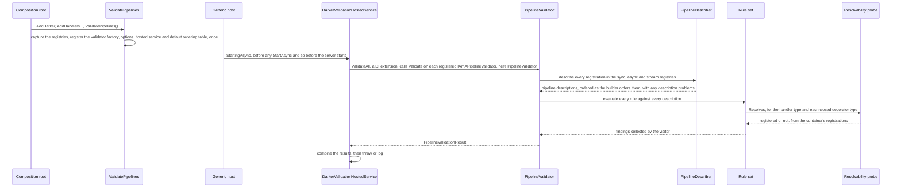
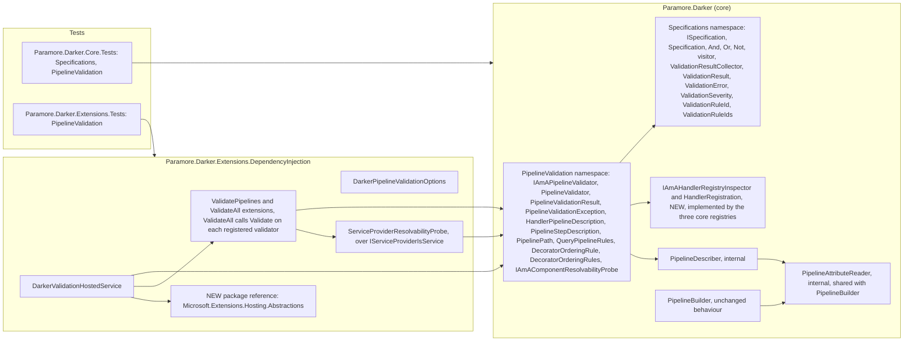

# 25. Pipeline Validation at Startup

Date: 2026-10-20

## Status

Proposed

## Context

Darker builds each query pipeline lazily, the first time a query of that type runs. A pipeline that cannot be built therefore fails at that point, in production, and one mistake at a time. A missing handler, an unregistered decorator, a decorator attribute of the wrong kind and a decorator order that disables another decorator are all configuration facts that are knowable when the host starts. Darker should report all of them then, in one place, before the host serves any query.

### Terms

- **Pipeline description** — a read-only record of one pipeline: its path (sync, async or stream), query type, result type, handler type, ordered decorator steps and any problems found while reading it. A router registration yields one description per candidate handler. Validation reads descriptions and never builds pipelines.
- **Finding** — one reported problem. A finding has a severity (Error or Warning), a rule identifier, a source naming the offender, and an actionable message.
- **Rule** — one `ISpecification` over a pipeline description. A rule that fails yields one or more findings through the specification visitor.
- **Rule set** — the public, composable collection of rules that core exposes for pipeline descriptions.
- **Resolvability probe** — a synchronous question, "is this component type registered?". The probe answers from registration membership. It never creates a component, a scope or a handler.
- **Outer and inner** — position in the decorator chain. The outer decorator runs first and wraps the inner one. A lower `Step` is outer, because the builder applies attributes in descending `Step` order. This ADR states ordering rules by position, never by "higher" or "lower".

### Scope

- **Parent requirement** — [specs/016-pipeline_validation/requirements.md](../../specs/016-pipeline_validation/requirements.md) (issue #305)
- **In scope**
  - FR1 — the `ValidatePipelines(throwOnError = true)` extension method on `IDarkerHandlerBuilder` in the DI package. Without that call, the method registers nothing. Calling it twice registers the validator, options, hosted service and default ordering table once, and the last call sets `throwOnError`.
  - FR2 — a hosted service that runs every registered validator once, in the host's starting phase (`IHostedLifecycleService.StartingAsync`). That phase completes before any `StartAsync`, so it precedes the web server. The service also runs validation from `StartAsync` when the host does not call the starting phase.
  - FR3 — `PipelineValidator` evaluates every rule against every description and collects every finding into one `PipelineValidationResult`. Each finding carries a severity, a `ValidationRuleId`, a source and a message. A registration that cannot be described, and a rule that throws, become findings and never stop the run. If describing a registry's registrations throws unexpectedly, that registry yields one `RuleEvaluationFailed` finding and the other registries are still validated.
  - FR4 — the hosted service throws `PipelineValidationException` when there are errors and `throwOnError` is true. Otherwise it logs errors at Error level. It always logs warnings at Warning level, and it logs a clean result at Debug level only.
  - FR5 — `IAmAPipelineValidator` is registered in the container. `Validate` returns the result and does not throw. `ValidateAll` on `IServiceProvider` runs every registered validator and returns one combined result, so a caller never sees a partial view when ADR 0026 adds a second validator.
  - FR6 — rules `HandlerRegistered`, `HandlerPublic` and `HandlerResolvable`. Darker supports only public handlers, because a handler is the public facade of a module and is tested through that facade. Assembly scanning already enforces this through `ExportedTypes` (ADR 0011). `HandlerPublic` applies the same policy to explicit registrations. `HandlerResolvable` asks the resolvability probe whether the handler type is registered.
  - FR7 — rule `DecoratorResolvable`, which asks the probe whether each closed decorator type is registered.
  - FR8 — rules `HandlerMatchesPath` and `DecoratorAttributeKind`. The rule `PipelineDescribable` serves FR3 and FR8 together: it reports a pipeline whose Execute method is ambiguous, whose attributes cannot be read or whose decorator type is null or cannot be closed, so the describer never throws for a misconfiguration.
  - FR9 — rules `DuplicateStep` and `DecoratorOrdering`. `DecoratorOrdering` reads an extensible table of outer/inner pairs.
  - FR13 (pipeline part) — the README gains a `ValidatePipelines()` section that lists the pipeline rules. ADR 0026 owns the lifetime-rule guidance.
  - FR14 (pipeline part) — evaluation is lazy, at host start, over the live registries and the built provider. The pipeline findings therefore do not depend on the call order. The documentation still tells users to call `ValidatePipelines()` last. ADR 0026 decides the same question for the lifetime findings.
  - NFR opt-in and non-breaking — no existing public member changes. The new registry capability is a separate interface, and the existing interfaces gain no members.
  - NFR startup cost — reflection runs once, inside the validator. `PipelineBuilder` per-query work is unchanged.
  - NFR no side effects — validation reads types, attributes and registrations. It never creates a handler, a decorator or a scope, and it never calls `Execute`, `ExecuteAsync` or `InitializeFromAttributeParams`.
  - NFR messages — every finding names the offending type and says what to change, through the catalogue's "Message names" column.
  - NFR core purity — core gains no `Microsoft.Extensions.*` types. The hosting reference and the container wiring live in the DI package.
  - NFR multi-target — every new type builds on `netstandard2.0`, `net8.0` and `net9.0`. `Microsoft.Extensions.Hosting.Abstractions` and `IServiceProviderIsService` ship for all three targets.
  - Untagged scope — the Specification pattern is copied from Brighter into core as general-purpose public API, with its tests (requirements, Constraints).
- **Why one ADR.** The Specification copy, the registry inspector, the probe interface and the hosting reference exist to serve startup validation, and they ship together in one change. Each is described here as a consequence of the one decision, and the Specification copy is also general-purpose public API.
- **Out of scope**
  - FR10–FR12, the lifetime and scope rules, and the FR13 guidance for those rules — ADR 0026.
  - Proof that a handler's constructor dependencies resolve. That needs instantiation, which this ADR rejects. The container's own `ValidateOnBuild` option covers it.
  - Health-check integration and automatic validation in Development — follow-up work. FR5 leaves the door open.
  - A pipeline description report like Brighter's `DescribePipelines()` — out of scope in the requirements.
  - Request validation of query *values* — ADR [0020-validation-decorator-architecture](0020-validation-decorator-architecture.md). That ADR covers a different concern that shares the word "validation".
  - Checks that a named Polly policy or resilience pipeline exists — these need `InitializeFromAttributeParams` and a query context. The requirements exclude them.
  - Reporting internal handler types that assembly scanning skipped. A skipped type leaves no registration, so validation has nothing to inspect. Detecting it needs the scanned assembly list, which is follow-up work.
  - A validation hook on the non-DI `QueryProcessorBuilder` — not requested. The core `PipelineValidator` can be constructed by hand over the registries.
  - Cache ordering rules. Placing Retry outside or inside Cache is a documented choice (ADR 0021), so no initial rule reports it. Any decorator package can add a rule later through the table's extension point.
  - Correcting the "higher step is outermost" wording in ADR 0002, `CLAUDE.md`, the caching README and `.agent_instructions/skills_overview.md`. This ADR records the drift and does not supersede anything. A separate documentation change corrects those four.

### Where this ADR sits

| ADR | Decides |
|-----|---------|
| **0025 Pipeline Validation at Startup** *(this one)* | **The validation architecture (Specification copy, validator, result, exception, hosted service, `ValidatePipelines()`), the resolvability probe, and the pipeline rules FR6–FR9.** |
| 0026 Lifetime Scope Validation *(planned)* | The three lifetime and scope rules (inert `JoinAmbient` is an error, Singleton-captures-Scoped is a warning, duplicate `IAmAScopeProvider` is a warning). A second validator in the DI package evaluates them over the service registrations. Where it evaluates them is decided in 0026. |

Every validator evaluates Specification rules over a read-only view of the configuration, reports every finding into one combined result, and never executes a query or creates a component.

### Configuration mistakes surface one at a time, at first execution

| Mistake | Today | With `ValidatePipelines()` |
|---|---|---|
| A registration names no handler | `ConfigurationException` on the first `Execute` | Error `HandlerRegistered` at start |
| A router registration has no candidates, so it can resolve no handler | `RoutingException` from `RoutedHandlers.ResolveHandlerType` on the first `Execute` | Error `HandlerRegistered` at start |
| A handler registered explicitly is not public | Runs, because the registry and the factories accept internal types. Only public handlers are supported, and scanning silently skips non-public types | Error `HandlerPublic` at start |
| The handler type is not registered with the container | `ConfigurationException` on first use, because the DI factory returns null | Error `HandlerResolvable` at start |
| A decorator named by an attribute is not registered | `ConfigurationException` on first use | Error `DecoratorResolvable` at start |
| A handler sits in the registry of the wrong path (`Register(Type, Type, Type)` does not check the interface) | Fails only on that path | Error `HandlerMatchesPath` at start |
| A sync attribute on `ExecuteAsync`, or the reverse | `ConfigurationException` on first use | Error `DecoratorAttributeKind` at start |
| A handler has overloaded `Execute` or `ExecuteAsync` methods, an attribute cannot be read, or a decorator type is null or cannot be closed over `IQuery<TResult>` and `TResult` | An unhandled reflection exception (`AmbiguousMatchException`, `ArgumentException`, `TargetInvocationException`) on first use | Error `PipelineDescribable` at start |
| Two attributes on one method with the same `Step` | Order is undefined, and no report is made | Warning `DuplicateStep` |
| A Fallback inside a Retry | Silent: the Fallback catches the failure, so the Retry never retries | Warning `DecoratorOrdering` |

Each row fails late because `QueryProcessor` constructs a `PipelineBuilder` per call and the builder resolves, checks and wires the pipeline at that moment. The only check today is "can this one query run now". A mistake on a rarely used query can therefore stay hidden for weeks, and each fix reveals only the next mistake.

Decorator ordering is the most error-prone row, because the written guidance contradicts the code. ADR 0002, `CLAUDE.md`, the caching README and the Darker skills guide all say the highest `Step` is outermost. The builder makes the lowest `Step` outermost, and the caching ordering test pins that behaviour (`OrderingTestQueryHandlerAsync` in the caching tests). A developer who follows the documentation inverts the chain. Nothing reports the inversion.

### The forces

- **Opt-in and non-breaking.** An application that never calls `ValidatePipelines()` must see no new behaviour. A public interface cannot gain members, because a member addition breaks third-party implementers.
- **One source of pipeline knowledge.** The rules must find the path's method, read attributes, order steps, close decorator types and judge attribute kinds exactly as the builder does. A second reflection path would drift from the first.
- **Validation must not enter the runtime lifetime model.** Creating a handler runs its constructor, opens a scope and needs teardown through the factories (ADRs 0022 and 0023). At host start the static logger has no providers, so a teardown fault would be lost. Brighter's handler describer never calls the handler factory.
- **The rules are synchronous.** `ISpecification<T>.IsSatisfiedBy` returns a `bool`. A rule that needs asynchronous work would have to block on it.
- **The registries cannot be enumerated.** `IQueryHandlerRegistry` exposes only `Get` and `Register` (`src/Paramore.Darker/IQueryHandlerRegistry.cs`). The registrations exist only inside a private dictionary of `IResolveHandlers` routes.
- **The registries are not in the container.** `AddDarker` captures them in the `IQueryProcessor` factory closure and in the builder (`ServiceCollectionExtensions.cs`). Only the internal `ServiceCollectionDarkerHandlerBuilder` holds them.
- **Running at start needs a hosted service.** The DI package references no hosting package. Only `Paramore.Darker.Extensions.AspNetCore` gets hosting types, through its framework reference to `Microsoft.AspNetCore.App`.
- **Core purity.** Core must gain no container or hosting types. The core project already lists `Microsoft.Extensions.DependencyInjection` as a package reference (`src/Paramore.Darker/Paramore.Darker.csproj`), but no core source uses that package, and this ADR adds no use.
- **Name collisions.** `DataAnnotationsQueryValidatorDecorator` uses `ValidationResult` from `System.ComponentModel.DataAnnotations` through a using directive (`src/Paramore.Darker.Validation.DataAnnotations/DataAnnotationsQueryValidatorDecorator.cs`). C# resolves a type in an enclosing namespace before a using directive. A `Paramore.Darker.ValidationResult` would therefore silently capture that name. `Paramore.Darker.Validation` is already the request-validation package's namespace.
- **Extensibility.** ADR 0026 must add a validator without editing this one. A decorator package must be able to add ordering rules that core cannot name.

## Decision

**Darker validates every registered query pipeline once at host start, by evaluating Specification rules over pipeline descriptions, and `ValidatePipelines()` opts in.**

The validator describes each pipeline from the registries and evaluates core's rules against the descriptions. A synchronous probe answers whether a component type is registered and never creates it. Core owns the Specification pattern (copied whole from Brighter as public API), the validator, the result, the rules and the probe role. The DI package owns only the wiring: the `ValidatePipelines()` extension, a container-backed probe and a hosted service that combines every validator's result, then throws or logs. Evaluation is lazy, so the validator sees everything registered before the provider was built.

### The mechanism, end to end

| Combined result | `throwOnError` | Hosted service outcome |
|---|---|---|
| One or more errors | true | Throws `PipelineValidationException` that lists every finding. The host does not start. |
| One or more errors | false | Logs each error at Error level and the host starts. |
| Warnings (with or without errors) | either | Logs each warning at Warning level. Warnings never block. |
| No findings | either | Logs one summary at Debug level. |

The mechanism holds these invariants:

- **Nothing runs without the opt-in.** `ValidatePipelines()` is the only call that registers the validator, the options and the hosted service.
- **Every finding is reported.** `AndSpecification` and `OrSpecification` evaluate both children, and the collector visits every leaf. The validator evaluates every rule against every description and never stops early.
- **A misconfiguration never throws out of `Validate`.** The describer does not throw when the path's method is ambiguous, when an attribute cannot be read (an attribute constructor throws, or a type fails to load), or when a decorator type is null, throws from `GetDecoratorType` or cannot be closed. It records a problem on the description, and the `PipelineDescribable` rule reports it. An absent method, including a handler that implements the path's interface explicitly so that no public method of that name exists, is reported by `HandlerMatchesPath`. A decorator that yields a problem adds no step to the description, so the step-based rules see only the decorators that did close. As a backstop, if describing a registry's registrations still throws, or reading them throws, the validator reports one `RuleEvaluationFailed` finding that names the registry and goes on to the other registries.
- **Validation never creates a component.** The validator reads registries, types and attributes, and the probe reads registrations. No handler, decorator or scope is created, and nothing is executed, so there is nothing to release.
- **Validation runs once, before the server.** The hosted service runs validation in `StartingAsync`. Every `StartingAsync` completes before any `StartAsync` begins, including when `ServicesStartConcurrently` is true. A host that does not call the starting phase reaches the same code from `StartAsync`. A once-only guard makes the second call a no-op.
- **One description per candidate.** A router registration has several candidate handlers. The describer emits one description for each, with the registration as its source, so every rule runs on every candidate. A registration with a null handler type, or a router with no candidates, yields one description with no handler type. `HandlerRegistered` fails on it, and every other rule is satisfied by it.
- **Without a probe, validation says so.** A validator built without a probe skips `HandlerResolvable` and `DecoratorResolvable` and reports one `ResolvabilityNotChecked` warning. The DI validator has no probe when the container supplies no `IServiceProviderIsService`, which Microsoft's container always does.
- **Order is deterministic.** Findings follow the registry order (sync, async, stream), then the registration order, then the candidate order within a router registration, then the rule order. Findings about a registry as a whole (`RegistryNotInspectable`, a registry-level `RuleEvaluationFailed`) come first for that registry, and `ResolvabilityNotChecked` is reported once, ahead of all registries. Two runs over the same configuration produce identical results.
- **Registration order does not matter.** The validator is constructed in a factory delegate at host start, over the same registry instances that the runtime uses, and it asks the built provider about registrations.

### Where the pieces live

All dependencies point inward to core. Core references neither the DI package nor hosting.

### Key Components

#### The roles, and what each is responsible for

| Role | Type | Responsibilities | Responsibility classifier | Collaborators |
|---|---|---|---|---|
| Judges one entity against one condition | `ISpecification<T>` and `Specification<T>`, `AndSpecification<T>`, `OrSpecification<T>`, `NotSpecification<T>` | Evaluate a predicate or a result-returning evaluator. Store the findings of the last evaluation. Compose with And, Or and Not. Accept a visitor. | knowing, deciding | `ISpecificationVisitor`, `ValidationResult` |
| Collects findings from a specification graph | `ValidationResultCollector<T>` | Walk the graph and gather each leaf's stored results | doing | `ISpecification<T>` |
| Carries one finding | `ValidationError` | Know the severity, rule identifier, source and message | knowing | `ValidationSeverity`, `ValidationRuleId` |
| Names a rule | `ValidationRuleId`, `ValidationRuleIds` | Know the identifier string of a rule, and the neutral evaluation-failure identifier | knowing | `ValidationError` |
| Validates configuration on demand | `IAmAPipelineValidator` (role), `PipelineValidator` (core pipelines) | Produce one result for the configuration it covers, without throwing | doing, deciding | `PipelineDescriber`, `QueryPipelineRules`, probe |
| Lists registrations | `IAmAHandlerRegistryInspector`, `HandlerRegistration` | Know every registered query, result type and candidate handler, in registration order | knowing | The three core registries |
| Describes pipelines | `PipelineDescriber` (internal) | Turn each registration into one description per candidate handler, ordered as the builder orders it. Record a problem instead of throwing | doing | `IAmAHandlerRegistryInspector`, `PipelineAttributeReader` |
| Records one pipeline | `HandlerPipelineDescription`, `PipelineStepDescription`, `PipelinePath` | Know the path, the types, the ordered steps, the misplaced attributes and the description problems of one registration | knowing | `PipelineAttributeReader` |
| Reads decorator attributes | `PipelineAttributeReader` (internal) | Per path, find the Execute method, read and order the attributes, close each decorator type and name the wrong kinds, exactly as the builder does. Return a failure to the caller and never choose the response | doing | Handler and decorator types, their attributes and `MethodInfo` |
| Supplies pipeline rules | `QueryPipelineRules` | Create a fresh specification for each pipeline rule | doing | Specifications, probe, ordering table |
| States ordering constraints | `DecoratorOrderingRule`, `DecoratorOrderingRules` | Know an outer decorator type, an inner decorator type, a rule identifier and the reason, and hold the initial table | knowing | `QueryPipelineRules` |
| Answers whether a type is registered | `IAmAComponentResolvabilityProbe` (role), `ServiceProviderResolvabilityProbe` (DI) | Answer `Resolves(Type)` from registration membership, without creating the type | knowing | `IServiceProviderIsService` |
| Holds a combined outcome | `PipelineValidationResult` | Know the errors and warnings. Combine results. Throw if invalid. | knowing | `PipelineValidationException` |
| Signals failed start | `PipelineValidationException` | Carry the result and list every finding in the message | knowing | `PipelineValidationResult` |
| Opts in | `ValidatePipelines` extension, `DarkerPipelineValidationOptions` | Capture the registries. Register the validator, options, hosted service and the default ordering table once, and hold `throwOnError` | doing, knowing | `ServiceCollectionDarkerHandlerBuilder` |
| Runs validation at start | `DarkerValidationHostedService` (internal) | Call `ValidateAll` once, in the starting phase or else at start. Then throw or log | doing, deciding | `IAmAPipelineValidator`, options, `ILogger` |

#### Rule catalogue

| Rule identifier | Severity | FR | Fails when | Message names |
|---|---|---|---|---|
| `HandlerRegistered` | Error | FR6 | A registration has a null handler type, or a router registration has no candidates | The query type and registry path |
| `HandlerPublic` | Error | FR6 | The handler type is not `Type.IsVisible` (internal, or nested in a non-public type) | The handler type, with the advice to make it public, because a handler is the public facade of a module |
| `HandlerResolvable` | Error | FR6 | The probe says the handler type is not registered | The handler type and the advice to register it |
| `DecoratorResolvable` | Error | FR7 | The probe says the closed decorator type is not registered | The decorator type, the handler, and the advice to register it |
| `HandlerMatchesPath` | Error | FR8 | The handler in the sync registry lacks `IQueryHandler<TQuery,TResult>`, in the async registry lacks `IQueryHandlerAsync<,>`, or in the stream registry lacks `IStreamQueryHandler<,>`, or it has no public `Execute` or `ExecuteAsync` method for the path (an explicit interface implementation) | The handler, the query and the expected interface. For the explicit-implementation case, the advice to implement the method publicly |
| `DecoratorAttributeKind` | Error | FR8 | The path's method carries attributes of another path's kind | The handler, the attribute and the correct kind |
| `DuplicateStep` | Warning | FR9 | Two attributes of the path's kind on one method share a `Step` | The handler, the step and both attributes |
| `DecoratorOrdering` | Warning | FR9 | Both decorators of a `DecoratorOrderingRule` are present, and the "outer" one sits inside the "inner" one | The handler, both decorators and the reason |
| `PipelineDescribable` | Error | FR3, FR8 | The path's Execute method is ambiguous (overloaded), an attribute on it cannot be read, or a decorator type is null, throws from `GetDecoratorType` or cannot be closed over `IQuery<TResult>` (`IStreamQuery<TResult>` on the stream path) and `TResult` | The handler, the method or attribute, and the exception message |
| `ResolvabilityNotChecked` | Warning | FR6, FR7 | The validator has no probe, so `HandlerResolvable` and `DecoratorResolvable` were not evaluated | The reason and the advice to supply a probe |
| `RegistryNotInspectable` | Warning | FR6 | A custom registry does not implement `IAmAHandlerRegistryInspector`, so its handlers cannot be checked | The registry type |
| `RuleEvaluationFailed` | Error | FR3 | A rule throws while it is evaluated (the `Specification<T>` catch path, `ValidationRuleIds.EvaluationFailed`), or reading or describing a registry's registrations throws | The entity or registry, and the exception message |

Every rule except `HandlerRegistered` is satisfied by a description that has no handler type. A handler with no public Execute method for the path has nothing to read, so `HandlerMatchesPath` reports it and `PipelineDescribable` stays silent.

Under `AddDarker`, the DI handler registries always add the handler's descriptor. `HandlerResolvable` therefore fires there only when a descriptor was removed, and it matters most for custom registries and for wiring done without `AddDarker`. `DecoratorResolvable` is the rule that most often fires under DI.

The initial ordering table has one pair for the sync path and one for the async path. No Fallback or Retry decorator exists for streams:

| Outer (must run first) | Inner | Reason | Contributed by |
|---|---|---|---|
| `FallbackPolicyDecorator<,>` | `RetryableQueryDecorator<,>` | An inner Fallback catches the failure, so the outer Retry never sees an exception and never retries. | Core |
| `FallbackPolicyDecoratorAsync<,>` | `RetryableQueryDecoratorAsync<,>` | As above, on the async path. | Core |

Under the code's semantics, a Retry inside a Fallback means that the Retry attribute has a higher `Step` number than the Fallback attribute. The rule compares positions taken from the builder's own ordering, so it stays correct even where the documentation states the opposite. `DecoratorOrderingRules.Default` holds these core pairs. The `PipelineValidator` constructor takes the complete table, so a hand-built validator passes `Default` plus any extra rules. `ValidatePipelines()` registers `Default` in the container as part of its once-only registration, so a second call adds nothing. A package adds a rule with a plain `AddSingleton` of a `DecoratorOrderingRule`, and those rules accumulate. Registration with `TryAddEnumerable` would drop them, because every rule has the same implementation type.

#### `IAmAPipelineValidator`

| Member | Input | Output | Error conditions |
|---|---|---|---|
| `Validate` | — | `PipelineValidationResult` | Never throws for a finding. A rule that throws becomes a `RuleEvaluationFailed` finding. |

#### `PipelineValidator`

| Member | Input | Output | Error conditions |
|---|---|---|---|
| constructor | The sync, async and stream registries (each may be null), the complete `IEnumerable` of `DecoratorOrderingRule`, an optional `IAmAComponentResolvabilityProbe` | — | `ArgumentNullException` for a null rule collection |
| `Validate` | — | Result over every description from the registries | As the role. A registry that is not an inspector yields `RegistryNotInspectable`. A registry whose registrations cannot be read or described yields one `RuleEvaluationFailed`, and the other registries are still validated. |

#### `IAmAComponentResolvabilityProbe`

| Member | Input | Output | Error conditions |
|---|---|---|---|
| `Resolves` | `Type` | true when the type is registered | Never throws. Returns false for an unregistered type. |

`ServiceProviderResolvabilityProbe` implements the role over `IServiceProviderIsService`, which the built provider supplies. The service answers from registrations, so it creates nothing. It reports a closed generic as registered when an open generic registration covers it, which matches how Darker registers its decorators. The describer closes each decorator through `PipelineAttributeReader`, as the builder does: over `IQuery<TResult>` (or `IStreamQuery<TResult>`) and `TResult`, not over the concrete query type.

#### `IAmAHandlerRegistryInspector`

| Member | Input | Output | Error conditions |
|---|---|---|---|
| `GetRegistrations` | — | Read-only collection of `HandlerRegistration` (query type, result type, candidate handler types), in registration order | Implementations should not throw. The validator reports a throw as `RuleEvaluationFailed` |

`HandlerRegistration` is a public record with a public constructor that does not validate its arguments.

`QueryHandlerRegistry`, `QueryHandlerRegistryAsync` and `StreamQueryHandlerRegistry` implement the interface by recording each `Register` call. The DI subclasses inherit the implementation.

#### `PipelineValidationResult`

| Member | Input | Output | Error conditions |
|---|---|---|---|
| `Errors`, `Warnings` | — | Read-only lists of `ValidationError` | None |
| `IsValid` | — | true when there are no errors | None |
| `ThrowIfInvalid` | — | — | `PipelineValidationException` when there are errors |
| `Combine` (static) | Results | One result that keeps the input order | None |

#### `PipelineValidationException`

| Member | Input | Output | Error conditions |
|---|---|---|---|
| constructor | `PipelineValidationResult` | The message lists the error count and every finding (errors first, then warnings), one line each as `[rule] source: message` | None |
| `Result` | — | The result that failed | None |

#### `ValidatePipelines` (DI extension)

| Member | Input | Output | Error conditions |
|---|---|---|---|
| `ValidatePipelines` | `IDarkerHandlerBuilder`, `throwOnError` (default true) | The same builder | `InvalidOperationException` when the builder was not created by `AddDarker` and so does not expose the registries |
| `ValidateAll` (on `IServiceProvider`) | — | One combined `PipelineValidationResult` from every registered `IAmAPipelineValidator`, in registration order | Never throws for a finding. A single `GetRequiredService` of `IAmAPipelineValidator` returns only the last registration, so callers use this method. |

#### `DarkerValidationHostedService` (internal)

| Member | Input | Output | Error conditions |
|---|---|---|---|
| `StartingAsync` (`IHostedLifecycleService`) | `CancellationToken` | Calls `ValidateAll` once and returns a completed task | Throws `PipelineValidationException` when there are errors and `ThrowOnError` is true |
| `StartAsync` | `CancellationToken` | Runs the same once-only validation when `StartingAsync` has not run. Otherwise completes | As `StartingAsync` |
| `StartedAsync`, `StoppingAsync`, `StoppedAsync` (`IHostedLifecycleService`) | `CancellationToken` | Completed task | None |
| `StopAsync` | `CancellationToken` | Completed task | None |

#### Where each type is touched

| Assembly | Type | Change |
|---|---|---|
| Paramore.Darker | `ISpecification<T>`, `Specification<T>`, `AndSpecification<T>`, `OrSpecification<T>`, `NotSpecification<T>`, `ISpecificationVisitor<TData,TResult>`, `ValidationResultCollector<T>`, `ValidationResult`, `ValidationError`, `ValidationSeverity` | New, copied from Brighter into `Paramore.Darker.Specifications`. `ValidationError` gains an init-only nullable `RuleId`. |
| Paramore.Darker | `ValidationRuleId`, `ValidationRuleIds` | New. The record wraps the identifier string. `ValidationRuleIds` holds the neutral `EvaluationFailed` constant. Both live in `Paramore.Darker.Specifications`. |
| Paramore.Darker | `IAmAPipelineValidator`, `PipelineValidator`, `PipelineValidationResult`, `PipelineValidationException`, `HandlerPipelineDescription`, `PipelineStepDescription`, `PipelinePath`, `QueryPipelineRules`, `DecoratorOrderingRule`, `DecoratorOrderingRules`, `IAmAComponentResolvabilityProbe` | New, in `Paramore.Darker.PipelineValidation` |
| Paramore.Darker | `IAmAHandlerRegistryInspector`, `HandlerRegistration` | New |
| Paramore.Darker | `QueryHandlerRegistry`, `QueryHandlerRegistryAsync`, `StreamQueryHandlerRegistry` | Implement the inspector (additive) |
| Paramore.Darker | `PipelineAttributeReader`, `PipelineDescriber` | New, internal |
| Paramore.Darker | `PipelineBuilder` | Structural only: finds the Execute method, reads attributes, closes decorator types and checks the wrong kinds through `PipelineAttributeReader`. Its exceptions and messages are unchanged. |
| DI package | `ValidatePipelines` extension class (with `ValidateAll`), `DarkerPipelineValidationOptions`, `DarkerValidationHostedService`, `ServiceProviderResolvabilityProbe` | New. The hosted service calls `ValidateAll`. |
| DI package | `ServiceCollectionDarkerHandlerBuilder` | Exposes its registries internally |
| DI package csproj, `Directory.Packages.props` | — | Adds `Microsoft.Extensions.Hosting.Abstractions` 10.0.10 |
| Extensions test project csproj, `Directory.Packages.props` | — | Adds `Microsoft.Extensions.Hosting` 10.0.10 as a test-only reference, so tests can run a real host |
| README | — | New `ValidatePipelines()` section: the call, its position, the start-phase guarantee and its limits, the rule catalogue, and the step-position rule |

Deliberately unchanged:

- `IQueryHandlerRegistry`, `IQueryHandlerRegistryAsync`, `IStreamQueryHandlerRegistry`, the factory interfaces and `IDarkerHandlerBuilder` gain no members.
- `ConfigurationException` stays sealed and keeps its current uses.
- The pipeline's runtime behaviour, per-query cost, attribute semantics, step semantics and teardown (ADRs 0002, 0016, 0022, 0023) do not change. `QueryLifetimeScope`, the factories and `ServiceCollectionExtensions` do not change.
- The runtime adoption diagnostics (ADR 0024) do not change.
- `QueryProcessorBuilder` does not change.
- The request-validation packages and the caching package do not change.
- No ADR is superseded.

### Technology Choices

#### Why the probe answers from registration membership rather than creating components

Brighter's handler describer never calls the handler factory, and its `IAmATransformerResolvabilityProbe` answers from registration membership and never instantiates (`Brighter/src/Paramore.Brighter/Validation/IAmATransformerResolvabilityProbe.cs`). Darker follows both. Creating a handler runs its constructor and opens a scope, and it needs teardown through the factories on the sync, async and stream paths. That would need a teardown shared with `PipelineBuilder`, and an asynchronous probe called from synchronous rules. It would also create Singleton components before the first query, and its teardown faults would reach a static logger that has no providers at host start. Membership needs none of that. The cost is that a registered handler with a missing constructor dependency passes validation. The container's `ValidateOnBuild` option reports that case, and the lifetime rules in ADR 0026 read dependencies from descriptors.

#### Why `IServiceProviderIsService` rather than reading service descriptors

The service answers from the built provider, so it sees every registration, including open generics that the reader closes as the builder does, without a snapshot of the service collection. It ships in `Microsoft.Extensions.DependencyInjection.Abstractions` for `netstandard2.0`, `net8.0` and `net9.0`. ADR 0026 still needs descriptors for its dependency rules and reads them itself.

#### Why evaluate lazily at host start rather than snapshot at call time

Brighter snapshots service descriptors when `ValidatePipelines()` is called, so Brighter users must call it last. Darker's pipeline facts live in mutable registry objects. The runtime `IQueryProcessor` factory uses the same objects (`ServiceCollectionExtensions.cs`). If `ValidatePipelines()` captures references to those registries and builds the validator in a factory delegate, the validator sees every registration made before the provider was built. The pipeline findings therefore cannot depend on call order, which satisfies the pipeline part of FR14. The README still tells users to call `ValidatePipelines()` last. That position matches Brighter, and ADR 0026 must state whether its evaluation keeps the same independence.

#### Why the DI package references Microsoft.Extensions.Hosting.Abstractions rather than a separate hosting package

Brighter places its hosted service in `Paramore.Brighter.Extensions.DependencyInjection` (`BrighterValidationHostedService.cs`). That project references `Microsoft.Extensions.Hosting.Abstractions` directly, beside the DI abstractions. Darker does the same. The abstractions package contains only interfaces such as `IHostedService`. A registered hosted service is inert in an application that runs no host, so non-hosted users pay a package reference but see no behaviour. Version 10.0.10, which matches Darker's other `Microsoft.Extensions.*` versions in `Directory.Packages.props`, ships `lib` folders for `netstandard2.0`, `net8.0` and `net9.0`. A separate `Paramore.Darker.Extensions.Hosting` package would avoid the reference, but it would split one opt-in call across two packages.

#### Why validation runs in `StartingAsync` rather than only in `StartAsync`

FR2 requires validation before queries are served. The generic host constructs every hosted service, runs every `StartingAsync` to completion, and only then runs `StartAsync`. The ASP.NET Core server starts in its own `StartAsync`. Validation in `StartingAsync` therefore precedes the server, even when `HostOptions.ServicesStartConcurrently` is true. Validation in `StartAsync` would not: an earlier hosted service, or a concurrent start, could serve queries first. Brighter's hosted service uses `StartAsync` only, so this choice departs from Brighter on purpose. `IHostedLifecycleService` exists in the `netstandard2.0`, `net8.0` and `net9.0` builds of `Microsoft.Extensions.Hosting.Abstractions` 10.0.10, so no target needs a fallback to compile.

The guarantee has three limits, and the README states them:
- A hosted service constructor that runs a query runs before validation, because the host constructs every service first.
- Another service's `StartingAsync` that runs queries can run before or beside validation. Its registration order decides under sequential start, and nothing decides under `ServicesStartConcurrently`.
- A host built on an older hosting library never calls `StartingAsync`. There, validation runs from `StartAsync` in registration order, and the ordering guarantee is absent. The once-only guard only stops a second run.

#### Why `Validate` is synchronous

Validation creates and releases nothing, so it has no asynchronous work. The rules are synchronous Specifications, and the hosted service returns a completed task. This matches Brighter's synchronous `Validate()`.

#### Why `PipelineValidationException` derives from `Exception` rather than `ConfigurationException`

Brighter's exception derives from its `ConfigurationException`. Darker's `ConfigurationException` is `sealed`. Unsealing it would change a public declaration. Unsealing would also make every existing `catch (ConfigurationException)` block start to catch start-up validation failures. The new exception derives from `System.Exception`, is sealed, and carries the result.

#### Why a new inspector interface rather than new members on the registry interfaces

A new member on `IQueryHandlerRegistry` would break every third-party implementation. A separate `IAmAHandlerRegistryInspector`, modelled on Brighter's `IAmASubscriberRegistryInspector`, is additive. Core's three registries implement it, and so the DI registries inherit it. A custom registry without the interface yields a `RegistryNotInspectable` warning instead of silence.

#### Why the Specification types get their own namespace

The copy is general-purpose public API, so its home is core and its types keep Brighter's names. The types cannot live in `Paramore.Darker`. There, `ValidationResult` would bind ahead of the `System.ComponentModel.DataAnnotations` type in any file under a `Paramore.Darker.*` namespace, and the DataAnnotations package would fail to build. The types also cannot live in `Paramore.Darker.Validation`, which belongs to the request-validation package. `Paramore.Darker.Specifications` and `Paramore.Darker.PipelineValidation` avoid both collisions.

#### Why ordering rules are a table of outer/inner pairs stated by position

Darker has no messaging middleware, so Brighter's backstop and resilience ordering families do not apply. A table of pairs is small, readable and open. Any package can register a `DecoratorOrderingRule` in the container. Each rule compares positions taken from `PipelineAttributeReader`, the ordering that the builder itself uses. The rule therefore stays correct whatever the prose says about "higher" and "lower". The initial table holds only the Fallback and Retry pair, because that ordering makes the Retry ineffective. Cache and Retry in either order leave both decorators effective, and the caching README offers both as choices.

#### Why copy the Specification pattern whole, with its tests

Darker and Brighter take no dependency on each other (requirements, Constraints). A partial copy would lose the And, Or and Not composition and the visitor, which make "report everything" (FR3) natural. The pattern also has uses beyond validation. Copying Brighter's tests proves the copy behaves as the original, including the no-short-circuit And and Or behaviour that FR3 depends on.

### Implementation Approach

Each behavioural step follows `/test-first` (`.agent_instructions/testing.md`). Every new source file carries the full `#region Licence … #endregion` MIT header in the form of `src/Paramore.Darker/ScopeAffinity.cs:1`. Copied files keep the copyright line of their Brighter source. New core files use `#nullable enable`, because core does not enable nullable reference types project-wide. Records rely on the existing `src/Paramore.Darker/IsExternalInit.cs` for `netstandard2.0`.

1. **Structural — copy the Specification pattern.** Copy `Specification.cs` (which holds `ISpecification<T>`), `AndSpecification.cs`, `OrSpecification.cs`, `NotSpecification.cs`, `ISpecificationVisitor.cs`, `ValidationResultCollector.cs`, `ValidationResult.cs`, `ValidationError.cs` and `ValidationSeverity.cs` from `Brighter/src/Paramore.Brighter/` into `src/Paramore.Darker/Specifications/`, in namespace `Paramore.Darker.Specifications`. Copy Brighter's four tests from `tests/Paramore.Brighter.Core.Tests/Specifications/` into `test/Paramore.Darker.Core.Tests/Specifications/`. They are `When_evaluating_a_specification.cs`, `When_and_specification_left_fails_should_evaluate_both_sides.cs`, `When_specification_with_error_factory_fails_should_collect_error.cs` and `When_collector_visits_specification_graph_should_collect_all_failures.cs`. Copy `SpecificationTestState.cs` into `test/Paramore.Darker.Core.Tests/TestDoubles/`. Keep the `[Behavior]Tests` class names. Do not copy `src/Paramore.Brighter.Validation.Specification/`, which is a request-validation handler and a different thing. The copy is verbatim apart from the namespace, so it introduces new code only and changes no existing behaviour.
2. **Behavioural — rule identifiers.** Add `ValidationRuleId` and `ValidationRuleIds`. `ValidationError` keeps Brighter's three positional members and gains an init-only nullable `RuleId` that defaults to null, so the copied tests still compile unchanged. The evaluation-failure path in `Specification<T>` stamps the neutral constant `ValidationRuleIds.EvaluationFailed`, whose value is `RuleEvaluationFailed`, so the general-purpose types name no pipeline rule. Test in `test/Paramore.Darker.Core.Tests/Specifications/`, for example `When_predicate_throws_should_report_evaluation_failed_rule_id.cs`, which asserts the collected error's `RuleId`.
3. **Structural — extract `PipelineAttributeReader`.** Move the Execute-method lookups (`PipelineBuilder.cs:194`, `:199` and the signature lookup at `:300-302`), the attribute read and order logic (`:253-256`, `:342-345`, `:410-413`) and the decorator closing (`MakeGenericType` at `:264`, `:354`, `:425`) into one internal reader. The reader catches an exception from each of its reflective operations (method lookup, `GetCustomAttributes`, `GetDecoratorType`, `MakeGenericType`) and returns it as a failure, treating a null decorator type as a failure too. It throws nothing itself. The builder rethrows the original exception, or raises the same `ConfigurationException` message as today, so its behaviour is unchanged. Where today's failure is a `NullReferenceException` (a null decorator type, or a sync handler with no `Execute` method), the builder keeps it and does not improve it. The describer turns the failure into a description problem. The builder wraps each decorator around the previous one (`:110-122`), so the highest `Step` sits next to the handler. Move the wrong-kind checks at `:80-83`, `:145-148` and `:306-309`, with their messages, into the same reader. Run the existing suite before and after.
4. **Structural — expose the registries.** Give `ServiceCollectionDarkerHandlerBuilder` internal read access to the registries that `ServiceCollectionExtensions.cs:22-33` creates.
5. **Behavioural — registry inspection.** Add `IAmAHandlerRegistryInspector` and `HandlerRegistration`. Record registrations in the three core registries (`QueryHandlerRegistry.cs`, `Register` overloads). Tests go in `test/Paramore.Darker.Core.Tests/PipelineValidation/`, for example `When_handlers_are_registered_should_list_them_in_registration_order.cs`.
6. **Behavioural — result, exception, describer and validator skeleton.** The `PipelineValidator` constructor grows across steps 6, 8 and 9 as each new parameter gains a test. Add `PipelineValidationResult`, `PipelineValidationException`, `IAmAPipelineValidator`, `PipelineValidator`, the description types and `PipelineDescriber`. Test a clean configuration (no errors, using a public handler that `Exported/` already provides), the exception message, and the router case of one description per candidate. Test that a registry whose inspector throws yields one `RuleEvaluationFailed` finding and that the other registries are still validated, using an inspector double in `TestDoubles/`. A registry that cannot be read or described is covered by that test, because the validator guards the two together.
7. **Behavioural — one rule per commit**, in this order: `HandlerRegistered`, `HandlerPublic`, `HandlerMatchesPath`, `DecoratorAttributeKind`, `PipelineDescribable`, `DuplicateStep`. The two resolvability rules wait for step 8, which introduces the probe. Each rule gets a test that builds the misconfiguration with Simple or InMemory doubles (no mocks), runs `PipelineValidator`, and asserts the rule identifier, the severity and the offender's name. Put tests in `test/Paramore.Darker.Core.Tests/PipelineValidation/` and doubles in `test/Paramore.Darker.Core.Tests/TestDoubles/`. Handler doubles stay internal, as everywhere in the test project, so that assembly scanning never collects them and each test registers its doubles explicitly (ADR 0011). Because `HandlerPublic` flags every internal handler, a rule test asserts on the finding for its own rule identifier and never on the total error count. The `HandlerPublic` test registers an internal handler explicitly. The test that expects no errors uses a public handler that `Exported/` already provides. The `HandlerMatchesPath` tests cover a sync-only handler in the async registry and a handler that implements the interface explicitly, and assert the advice in the second message. The `PipelineDescribable` tests use a handler with overloaded `ExecuteAsync`, an attribute double whose constructor throws, an attribute double whose `GetDecoratorType` throws or returns null, and an attribute whose decorator type cannot be closed. Each yields a finding and no exception. A further `PipelineDescribable` test asserts that a sync-only handler in the async registry yields no such finding. Add a test that a custom registry double without the inspector yields the `RegistryNotInspectable` warning, a test that several mistakes appear in one result (FR3), a determinism test, and a test that a description with no handler type yields only the `HandlerRegistered` error. These tests assert on errors, because once step 8 lands a validator built without a probe also reports the `ResolvabilityNotChecked` warning.
8. **Behavioural — the probe role and the resolvability rules.** Add `IAmAComponentResolvabilityProbe` and the `HandlerResolvable` and `DecoratorResolvable` rules. Tests use a `SimpleResolvabilityProbe` double that wraps a delegate, in `TestDoubles/`. Add a test that a validator without a probe reports the `ResolvabilityNotChecked` warning and no resolvability error. Add a test that a probe double which throws yields a `RuleEvaluationFailed` finding with the rule identifier `RuleEvaluationFailed`, reported through `PipelineValidator`.
9. **Behavioural — the ordering table.** Add `DecoratorOrderingRule`, `DecoratorOrderingRules` with the Fallback and Retry pairs for the sync and async paths, and the `DecoratorOrdering` rule. Add a test that a rule registered by a caller extends the table.
10. **Build — hosting references.** Add `<PackageVersion Include="Microsoft.Extensions.Hosting.Abstractions" Version="10.0.10" />` and `<PackageVersion Include="Microsoft.Extensions.Hosting" Version="10.0.10" />` to `Directory.Packages.props`. Add the abstractions `PackageReference` to `src/Paramore.Darker.Extensions.DependencyInjection/Paramore.Darker.Extensions.DependencyInjection.csproj`. Add the `Microsoft.Extensions.Hosting` reference to the Extensions test project only.
11. **Behavioural — DI wiring.** Add `ValidatePipelines`, `ValidateAll`, `DarkerPipelineValidationOptions`, `DarkerValidationHostedService` and `ServiceProviderResolvabilityProbe`. Tests go in `test/Paramore.Darker.Extensions.Tests/PipelineValidation/`. Their handler doubles are public classes in that project, which no scan targets (every `AddHandlersFromAssemblies` call scans the Core.Tests assembly), so they carry no `HandlerPublic` error and are registered explicitly. They cover:
    - no registration without the call, registration with it, and one registration when the call is made twice, where the second call yields a single `DecoratorOrdering` finding and not two;
    - a rule contributed through `AddSingleton` still accumulates beside the default table;
    - an unregistered decorator, and a handler whose descriptor the test removes, reported through a real container, and an open-generic decorator reported as registered once closed;
    - validation in `StartingAsync` before another hosted service's `StartAsync`, the once-only guard when both phases run, and a concurrent-start host (`ServicesStartConcurrently`);
    - throw versus log, and warnings that never block;
    - an on-demand `ValidateAll` call;
    - call-order independence, where a handler added after `ValidatePipelines()` is still validated;
    - no component created, using a handler whose constructor records that it ran.
12. **Documentation.** Add the README section on `ValidatePipelines()`, its position, the start-phase guarantee and its limits, the rule catalogue, and the position meaning of `Step`. ADR 0026 adds the lifetime guidance.

## Consequences

### Positive

- FR1–FR9: every pipeline mistake in the catalogue is reported at start, all at once, with an actionable message.
- FR14 (pipeline part): the pipeline findings do not depend on registration order.
- Validation creates no handler, decorator or scope, so it has no side effects and no teardown, and start-up cost stays small.
- The Specification pattern becomes reusable public API in core, proven by Brighter's own tests.
- Non-DI users can construct `PipelineValidator` over the registries and validate in a test.
- The ordering rule reports a Fallback placed inside a Retry, which silently disables the Retry, and the README states the code's `Step` semantics.
- ADR 0026, and any decorator package, extend validation by registration alone.

### Negative

- Every user of the DI package gains a package reference to `Microsoft.Extensions.Hosting.Abstractions` and its transitive abstractions (configuration, file providers, diagnostics), even without opting in.
- A registered handler whose constructor dependency is missing passes validation. Only the container's `ValidateOnBuild` reports it.
- A configuration that registers an internal handler explicitly runs today and fails validation once the application opts in. This is intended: only public handlers are supported.
- An `internal` handler that assembly scanning skipped (the `ExportedTypes` filter, ADR 0011) leaves no registration, so validation cannot see its query. `HandlerPublic` catches only explicit registrations.
- `PipelineAttributeReader` must stay the single reflection path. A future builder change that bypasses the reader would let validation drift from runtime behaviour.
- A single container resolve of `IAmAPipelineValidator` returns one validator's view, because the container returns the last registration. On-demand callers must use `ValidateAll` to see every finding.
- `DecoratorOrdering` cannot see inside a Polly resilience pipeline, so a retry configured in `UseResiliencePipeline` is outside the table.
- The copied Specification types are adapted, not synchronised, so fixes in Brighter must be ported by hand.

### Risks and Mitigations

- **Risk: `Specification<T>` is stateful.** It stores the last results between `IsSatisfiedBy` and the visitor (Brighter ADR 0053, statefulness note). *Mitigation:* `QueryPipelineRules` creates fresh specifications for each validation run, and the validator evaluates descriptions sequentially.
- **Risk: the start-phase guarantee has limits.** Hosted-service constructors, other services' `StartingAsync` and older hosts all fall outside it. *Mitigation:* the README states the three limits, and the guarantee is described as "before the server" and not as "before any query".
- **Risk: `IsService` reports a type as registered that the runtime then fails to build.** A missing constructor dependency is the case. *Mitigation:* the Out of scope list says so, and the README points to `ValidateOnBuild`.
- **Risk: duplicate registrations repeat findings.** *Mitigation:* `ValidatePipelines()` registers the validator, options, hosted service and default ordering table once, and a test pins the double call, including a single `DecoratorOrdering` finding.
- **Risk: users read "lower step" against stale documentation.** *Mitigation:* rules and messages speak of outer and inner positions. The README states the code's semantics, and the drift in ADR 0002, `CLAUDE.md`, the caching README and `skills_overview.md` is flagged for correction.
- **Risk: AOT analysis.** The shared reader closes decorator types with `MakeGenericType`, as `PipelineBuilder` already does. *Mitigation:* the validator adds no new kind of dynamic code. It reuses the builder's pattern and runs only when opted in.

## Alternatives Considered

- **Do nothing.** Mistakes keep surfacing at first execution, one at a time. FR1–FR9 rejected this.
- **Create each component through the factories and release it through a teardown shared with `PipelineBuilder`.** This proves the factory can construct the handler. It needs a teardown extraction, a fault callback on `QueryLifetimeScope`, an asynchronous probe called from synchronous rules, and a logger that works before `IQueryProcessor` exists. It also runs constructors at start. Registration membership gives the useful part of the answer without those costs.
- **Snapshot registrations at call time, as Brighter does.** This is simpler to reason about, but it makes call order load-bearing for no gain, because Darker's registries are live objects that the runtime shares.
- **Build each pipeline with `PipelineBuilder` in a dry run.** The builder sets `Context`, calls `InitializeFromAttributeParams` (which reads policy registries), and stops at the first error. Validation would then report one finding at a time and could fail for runtime-only reasons.
- **Read the service collection's descriptors for membership.** This needs a snapshot and its own handling of open generics. `IServiceProviderIsService` answers from the built provider.
- **Place the hosted service in `Paramore.Darker.Extensions.AspNetCore`, where hosting is already present.** This adds no package reference, but worker-service and console hosts do not use that package and would lose validation.
- **A separate `Paramore.Darker.Extensions.Hosting` package for the hosted service.** It avoids the abstractions reference for non-hosted users, but it splits a single opt-in across two packages and departs from Brighter's proven layout.
- **Validate in `StartAsync` only, as Brighter does.** This is the simplest hosted service. It does not stop a concurrent start or an earlier hosted service from serving queries first, so FR2 would hold only by registration order.
- **Ship Cache and Retry ordering rows.** Both orders leave both decorators effective, and the caching README documents both as choices, so a warning would flag a deliberate configuration.
- **Unseal `ConfigurationException` and derive from it.** This mirrors Brighter, but it changes an existing public declaration and widens existing catch blocks.
- **Port Brighter's ordering rule families.** Those families encode messaging backstop semantics that Darker lacks. A table of pairs is enough.
- **Place the Specification types in core's root namespace, or make them internal.** The root namespace breaks the DataAnnotations package through name capture. Internal types would forfeit the general-purpose value and the extension point for third-party rules.

## References

- Requirements: [specs/016-pipeline_validation/requirements.md](../../specs/016-pipeline_validation/requirements.md)
- Related ADRs (none superseded):
  - [0002-attribute-driven-decorator-pipeline](0002-attribute-driven-decorator-pipeline.md) — step ordering. Its "highest step outermost" wording contradicts `PipelineBuilder`, as do `CLAUDE.md`, the caching README and `skills_overview.md`.
  - [0004-factory-registry-abstractions](0004-factory-registry-abstractions.md) — the registry roles that the validator reads
  - [0008-split-handler-interfaces](0008-split-handler-interfaces.md) — the sync, async and stream split behind FR8
  - [0011-merge-builtin-decorators](0011-merge-builtin-decorators.md) — `ExportedTypes` scanning
  - [0014-factory-component-lifetime](0014-factory-component-lifetime.md)
  - [0015-resilience-pipeline-integration](0015-resilience-pipeline-integration.md)
  - [0016-pipeline-attribute-memoization](0016-pipeline-attribute-memoization.md) — the shared attribute reader is the natural home for that cache
  - [0019-streaming-query-pipeline](0019-streaming-query-pipeline.md)
  - [0020-validation-decorator-architecture](0020-validation-decorator-architecture.md) — request validation, a different concern
  - [0021-caching-decorator-architecture](0021-caching-decorator-architecture.md) — decorator placement is a choice, so no Cache ordering row ships
  - [0022-robust-pipeline-teardown](0022-robust-pipeline-teardown.md), [0023-pipeline-scope-handle](0023-pipeline-scope-handle.md), [0024-ambient-scope-adoption](0024-ambient-scope-adoption.md) — the runtime lifetime model, which validation deliberately never enters
  - 0026 Lifetime Scope Validation (planned) — FR10–FR12 and the lifetime part of FR13
- External references:
  - Brighter ADR 0053 "Pipeline Validation and Diagnostic Report at Startup" (`Brighter/docs/adr/0053-pipeline-validation-at-startup.md`), ADR 0064 "Validate Pipeline Assembly Scanning and Validation-Provider Registration", ADR 0074 "Where the scope-configuration rules are evaluated"
  - Brighter sources: `src/Paramore.Brighter/{Specification,AndSpecification,OrSpecification,NotSpecification,ISpecificationVisitor,ValidationResultCollector,ValidationResult,ValidationError,ValidationSeverity,IAmASubscriberRegistryInspector}.cs`. `src/Paramore.Brighter/Validation/{PipelineValidator,HandlerPipelineValidationRules,HandlerPipelineDescription,PipelineStepDescription,PipelineValidationResult,PipelineValidationException,IAmAPipelineValidator,IAmATransformerResolvabilityProbe,ValidationProviderRegistrations}.cs`. `src/Paramore.Brighter.Extensions.DependencyInjection/{BrighterPipelineValidationExtensions,BrighterPipelineValidationOptions,BrighterValidationHostedService}.cs` and its csproj, which references `Microsoft.Extensions.Hosting.Abstractions`.

