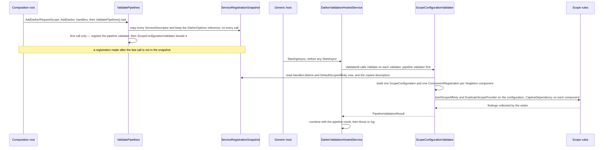
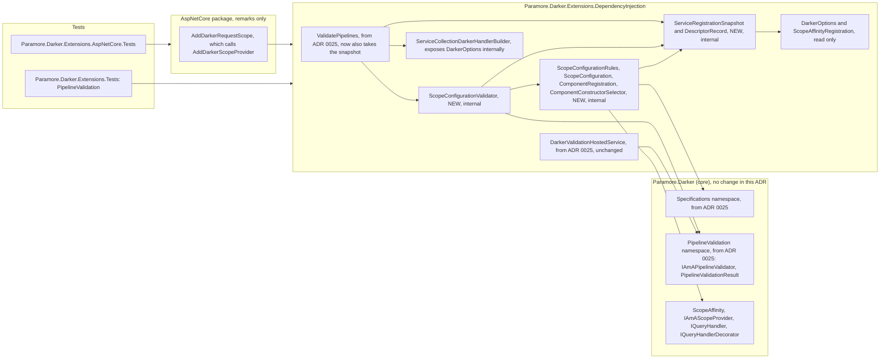

# 26. Lifetime Scope Validation

Date: 2026-10-21

## Status

Accepted

## Context

Spec 015 lets an application choose a handler lifetime, a scope affinity and a scope provider. Some combinations of these look correct but do nothing, or are unsafe, and nothing reports them at start. ADR 0025 gives Darker a startup validator for pipelines. This ADR adds the lifetime and scope rules beside it, and decides where and when those rules read their inputs.

### Terms

- **Finding**, **rule**: see ADR 0025's *Terms*. Here a rule is evaluated over a scope configuration or a component record, not over a pipeline description.
- **Affinity**, **scope provider**, **adopt**, **ambient scope**: see ADR 0024's *Terms*. *How the affinity is chosen* in ADR 0024 defines the **effective affinity**.
- **Component** — a query handler or a query decorator. A handler implements `IQueryHandler`, and a decorator implements `IQueryHandlerDecorator`.
- **Configured lifetime** — the lifetime with which Darker obtains a component. *Why a component counts as Singleton when either lifetime says so* specifies it.
- **Effective descriptor** — for one service type and an optional key, the last descriptor that matches both. A null key matches unkeyed descriptors only. Microsoft's container resolves that one.
- **Snapshot** — a copy of the service collection's descriptor list, taken when `ValidatePipelines()` is called. Step 2 of *Implementation Approach* specifies how it is taken.
- **Scope configuration** — a read-only record of one host's lifetime and scope settings. The two rules about the host as a whole read it. *Key Components* lists its members.

### Scope

- **Parent requirement** — [specs/016-pipeline_validation/requirements.md](../../specs/016-pipeline_validation/requirements.md) (issue #305)
- **In scope**
  - FR10 — rule `InertScopeAffinity` (Error). It fails when the effective affinity is `JoinAmbient` and either `HandlerLifetime` is not `Scoped` or no unkeyed `IAmAScopeProvider` descriptor exists. Either cause leaves the opt-in unable to take effect, so each query silently gets a scope of its own. The rule reads the affinity from the `ScopeAffinityRegistration` that `AddDarkerScopeProvider` writes, and `AddDarkerRequestScope()` calls `AddDarkerScopeProvider`. When no registration exists, the rule reads `DarkerOptions.DefaultScopeAffinity`.
  - FR11 — rule `CaptiveDependency` (Warning). It fails when a component whose configured lifetime is Singleton has a constructor parameter whose effective descriptor is Scoped. The rule reads constructors by reflection and lifetimes from the snapshot.
  - FR12 — rule `DuplicateScopeProvider` (Warning). It fails when the unkeyed `IAmAScopeProvider` descriptors name more than one distinct implementation.
  - FR13 (lifetime part) — every lifetime finding ends with a link to a README section named after its rule identifier. The README gains one section for each rule.
  - FR14 (lifetime part) — the lifetime rules read a snapshot taken when `ValidatePipelines()` is called. Call order therefore matters for these findings. The README states that `ValidatePipelines()` must be called last.
  - FR3, FR4, FR5 — this ADR contributes findings to the combined result. ADR 0025 owns the result, the outcome and `ValidateAll`.
  - NFR opt-in and non-breaking — `ValidatePipelines()` registers the new validator. Without that call, nothing new is registered. No public member changes.
  - NFR startup cost — constructor reflection runs once for each `Validate` call, and no per-query work changes.
  - NFR no side effects — the validator reads descriptors, types and constructors. It never resolves a service, never builds a provider and never creates a component or a scope.
  - NFR core purity — every new type lives in the DI package. Core gains no type.
  - NFR messages — every message names the offender and says what to change, through the catalogue's "Message names" column.
  - NFR multi-target — the keyed-service members of `ServiceDescriptor` and `FromKeyedServicesAttribute` ship in `Microsoft.Extensions.DependencyInjection.Abstractions` 10.0.10 for `netstandard2.0`, `net8.0` and `net9.0`.
- **Out of scope**
  - The validation architecture, the hosted service, `ValidateAll`, the result and exception types, and the pipeline rules FR6–FR9 — ADR 0025.
  - The runtime adoption diagnostics, which still warn once per container — ADR 0024. This ADR leaves them unchanged.
  - Proof that a component's dependencies can be resolved. That needs instantiation. The container's `ValidateOnBuild` option covers it, as ADR 0025 says.
  - Transitive captivity, where a Singleton takes a Transient that takes a Scoped. No requirement asks for it.
  - Brighter's four other scope rules (mixed lifetimes, defeated opt-in, repeated opt-in, unreadable override). They guard Brighter registration paths that Darker does not have.

### Where this ADR sits

| ADR | Decides |
|-----|---------|
| [0025 Pipeline Validation at Startup](0025-pipeline-validation-at-startup.md) | The validation architecture (Specification copy, validator, result, exception, hosted service, `ValidatePipelines()`), the resolvability probe, and the pipeline rules FR6–FR9. |
| **0026 Lifetime Scope Validation** *(this one)* | **The three lifetime and scope rules (inert `JoinAmbient` is an error, Singleton-captures-Scoped is a warning, duplicate `IAmAScopeProvider` is a warning). A second validator in the DI package evaluates them at host start, over a snapshot of the service descriptors taken when `ValidatePipelines()` is called, so for these findings `ValidatePipelines()` must be called last.** |

Every validator evaluates Specification rules over a read-only view of the configuration, reports every finding into one combined result, and never executes a query or creates a component.

### Lifetime and scope mistakes run without a report

| Mistake | Today | With `ValidatePipelines()` |
|---|---|---|
| The effective affinity is `JoinAmbient`, but `HandlerLifetime` is Transient or Singleton | Each query gets an owned scope. One Warning is logged when the container first builds the query processor | Error `InertScopeAffinity` at start |
| The effective affinity is `JoinAmbient` (from `DarkerOptions.DefaultScopeAffinity`), but no `IAmAScopeProvider` is registered | The same: each query gets an owned scope, with one Warning when the query processor is first built | Error `InertScopeAffinity` at start |
| A Singleton handler or decorator takes a dependency registered Scoped | In Production, one instance of the Scoped dependency is captured for the life of the container, with no report. Hosts built with `HostApplicationBuilder` or `WebApplicationBuilder` turn on `ValidateScopes` and `ValidateOnBuild` in Development, so a Singleton handler with a Scoped dependency fails at build, before this validator runs. A captive decorator fails only when first resolved, because the container does not validate open generics at build. The Warning matters most outside Development | Warning `CaptiveDependency` at start |
| Two different `IAmAScopeProvider` implementations are registered | The container returns the last registration. The other provider is silently ignored | Warning `DuplicateScopeProvider` at start |

Each mistake stays hidden because Darker reads these settings only when it builds the query processor. At that point, a mismatch is either a single Warning in a log or no report at all. `AddDarkerScopeProvider` replaces an earlier provider. A direct `AddSingleton<IAmAScopeProvider, …>` call, however, adds a second provider beside the first, and nothing reports it.

### The forces

- **The inputs are container concepts.** Lifetimes, descriptors and the internal `ScopeAffinityRegistration` belong to the DI package. Core must gain no `Microsoft.Extensions.DependencyInjection` types.
- **The descriptor list cannot be reached from the built provider.** `IServiceProviderIsService` answers membership questions only. It does not report a lifetime or a constructor.
- **`DarkerOptions` is not in the container.** `AddDarker` creates the options object, passes it to the configure callback and keeps it in the `IQueryProcessor` factory closure (`ServiceCollectionExtensions.cs`). No `IOptions<DarkerOptions>` exists. Only the builder that `AddDarker` returns can reach the options.
- **Validation must not enter the runtime lifetime model.** Resolving a Singleton component would run its constructor before the first query. That also creates the captive instance that the rule exists to report (ADRs 0022, 0023 and 0025).
- **ADR 0025 fixes the extension point.** A second `IAmAPipelineValidator` that is registered in the container is enough. `ValidateAll` and the hosted service already combine every registered validator.
- **The rules must agree with the runtime.** The runtime reads the last affinity registration, the last scope provider and the effective descriptor of each component. A rule that reads anything else reports on a configuration that the runtime does not use.
- **Darker resolves components unkeyed.** `ServiceProviderComponentFactory` resolves each component by its type, without a key.
- **Brighter has solved the same problem.** Brighter ADR 0074 adds a second validator in Brighter's DI package. That validator reads descriptors from a snapshot taken at call time, and it reads options at host start.

## Decision

**A second validator in the DI package evaluates the lifetime and scope rules at host start, over a snapshot of the service descriptors that `ValidatePipelines()` takes, and over `DarkerOptions` as the runtime reads it.**

`ValidatePipelines()` copies the service collection's descriptors on every call, and keeps a reference to the builder's `DarkerOptions`. Its once-only registration from ADR 0025 also registers `ScopeConfigurationValidator`, beside the pipeline validator. At host start, ADR 0025's hosted service calls `ValidateAll`, which runs both validators. The new validator reads the lifetime and the default affinity from the options, and the affinity registration and the provider registrations from the snapshot. It builds one scope configuration and one record for each Singleton component, then evaluates its three Specification rules. Registrations made after the last `ValidatePipelines()` call are not in the snapshot, so `ValidatePipelines()` must be called last.

### The mechanism, end to end

The validator reads its inputs at two different moments, and each moment is chosen for its input:

| Input | Read from | When |
|---|---|---|
| Every `ServiceDescriptor` | The service collection that the builder holds | Each `ValidatePipelines()` call. The last call's copy is evaluated |
| `HandlerLifetime`, `DefaultScopeAffinity` | The `DarkerOptions` instance that `AddDarker` created, which is the same object that `BuildQueryProcessor` reads | Host start, inside `Validate` |

`CaptiveDependency` decides on each descriptor in the snapshot in this order. The first row that applies gives the outcome.

| # | Situation | Outcome |
|---|---|---|
| 1 | The descriptor is keyed | Not a candidate. Darker resolves components unkeyed |
| 2 | The descriptor has no `ImplementationType`, because a factory delegate or an instance registered it. An instance's runtime type does not count | Not a candidate. The rule cannot know the constructor |
| 3 | The service type differs from the implementation type (an alias such as an interface registration), or the implementation type implements neither `IQueryHandler` nor `IQueryHandlerDecorator` | Not a candidate. Darker registers and resolves each component by its own type |
| 4 | The descriptor is not the effective descriptor for its own service type and key (a later descriptor with the same type and key replaces it) | Not a candidate. The container resolves the effective one |
| 5 | `HandlerLifetime` is not Singleton, and the descriptor's lifetime is not Singleton | Not inspected |
| 6 | The type has no public constructor with parameters, or two public constructors share the widest parameter count | Not inspected |
| 7 | A parameter carries `[FromKeyedServices(key)]` with an explicit key. A parameterless attribute or a null-key lookup falls through to row 8, because Darker resolves components unkeyed | Read the last keyed descriptor for the parameter type and that key |
| 8 | Otherwise, the parameter type has its own unkeyed descriptor | Read the effective descriptor |
| 9 | Otherwise, the parameter type is a constructed generic | Read the effective descriptor of its generic type definition. The rule ignores generic constraints |
| 10 | No descriptor was found, as for `IServiceProvider`, `IEnumerable<T>` or a bare type parameter | No finding |
| 11 | The descriptor that was found is Scoped | One Warning for that parameter |

The mechanism holds these invariants:

- **Nothing runs without the opt-in.** Only `ValidatePipelines()` takes the snapshot and registers the validator.
- **Descriptors are read, never resolved.** The validator reads `ServiceType`, `Lifetime`, `ImplementationType`, `ImplementationInstance` and the keyed equivalents. It never calls `GetService` and never builds a provider. Reading a registered instance, such as a `ScopeAffinityRegistration`, creates nothing.
- **The snapshot is a copy.** `ServiceDescriptor` is immutable, so a new list of the same descriptor references is a true copy. Later additions to the service collection, and later removals, do not change it.
- **The last call wins.** Each `ValidatePipelines()` call retakes the snapshot. The registration of validators happens once, as in ADR 0025. A second call therefore yields one set of lifetime findings, taken from the later state of the service collection. This matches ADR 0025, where the last call sets `throwOnError`.
- **The rules read what the runtime reads, as of the snapshot.** The affinity is the last `ScopeAffinityRegistration`, otherwise `DefaultScopeAffinity`, as `BuildQueryProcessor` computes it. The scope provider in use is the last unkeyed `IAmAScopeProvider`. Each component is judged by its effective descriptor.
- **A misconfiguration never throws out of `Validate`.** Constructor reflection runs inside the rule's evaluator. If the evaluator throws, `Specification<T>` converts the exception into a `RuleEvaluationFailed` finding (ADR 0025). That finding is an Error, even when the failing rule is a Warning.
- **`CaptiveDependency` yields one finding for each Scoped parameter.** It uses `Specification<T>`'s result-evaluator form, which returns a list of results for one component, as Brighter's rule does. The predicate form returns at most one finding for each entity, and would hide a second Scoped parameter of the same component.
- **Order is deterministic within each severity list.** The rules are evaluated in the order `InertScopeAffinity`, `DuplicateScopeProvider`, `CaptiveDependency`. `InertScopeAffinity` is an Error, so it follows the pipeline Errors. `DuplicateScopeProvider` comes before `CaptiveDependency` in the Warnings, after the pipeline Warnings. `CaptiveDependency` findings follow snapshot order, then parameter order. `ValidateAll` places this validator's findings after the pipeline findings of the same severity.
- **The snapshot is written during composition and read-only afterwards.** `Capture` runs inside `ValidatePipelines()`, before the host starts. A hand-built provider must not see `ValidatePipelines()` called after it is built. `Validate` only reads the snapshot and builds its own fresh specifications, so concurrent on-demand `ValidateAll` calls are safe.

### Where the pieces live

Every dependency points inward. The DI package depends on core, and the ASP.NET Core package depends on the DI package. The validator needs no reference to the ASP.NET Core package. `AddDarkerRequestScope()` reaches the validator only through the `ScopeAffinityRegistration` and `IAmAScopeProvider` descriptors that it writes.

### Key Components

#### The roles, and what each is responsible for

| Role | Type | Responsibilities | Responsibility classifier | Collaborators |
|---|---|---|---|---|
| Validates the lifetime and scope configuration | `ScopeConfigurationValidator` (internal) | Read the options at host start. Build the scope configuration and the component records. Evaluate the three rules and return one result without throwing | doing, deciding | `ServiceRegistrationSnapshot`, `ScopeConfigurationRules`, `ValidationResultCollector<T>` |
| Holds the copied registrations | `ServiceRegistrationSnapshot` (internal) | Copy the descriptor list and keep the options reference on each capture. Answer the effective descriptor for a service type and key, list the descriptors of a service type, and list candidate components | knowing | `IServiceCollection`, `DarkerOptions`, `DescriptorRecord` |
| Records one registration of a service type | `DescriptorRecord` (internal) | Know the position, the service type, the key, the `ServiceLifetime`, and the `ImplementationType`, the `ImplementationInstance`, or that a factory registered it, as separate facts. The instance's runtime type is derived from the instance | knowing | `ServiceRegistrationSnapshot` |
| Records the host's scope settings | `ScopeConfiguration` (internal record) | Know `HandlerLifetime`, the effective affinity and its source, and the unkeyed `IAmAScopeProvider` registrations | knowing | `ScopeConfigurationRules` |
| Records one candidate component | `ComponentRegistration` (internal record) | Know the component type, whether it is a handler or a decorator, and why it counts as Singleton | knowing | `ScopeConfigurationRules` |
| Chooses the constructor to read | `ComponentConstructorSelector` (internal) | Return the widest public constructor, or nothing on a tie or when no constructor has parameters | deciding | `ComponentRegistration` |
| Supplies the lifetime rules | `ScopeConfigurationRules` (internal static) | Create a fresh specification for each rule. Hold the three rule identifiers and the README link | doing, knowing | `Specification<T>`, `ValidationRuleId`, `ServiceRegistrationSnapshot` |
| Opts in | `ValidatePipelines` extension (from ADR 0025) | Additionally, capture the snapshot on every call, and register `ScopeConfigurationValidator` within the once-only registration | doing | `ServiceCollectionDarkerHandlerBuilder`, `ServiceRegistrationSnapshot` |

#### Rule catalogue

| Rule identifier | Severity | FR | Fails when | Message names |
|---|---|---|---|---|
| `InertScopeAffinity` | Error | FR10 | The effective affinity is `JoinAmbient`, and `HandlerLifetime` is not `Scoped` or no unkeyed `IAmAScopeProvider` is registered | The affinity's source: `DarkerOptions.DefaultScopeAffinity`, or the scope provider in use, which is the last unkeyed `IAmAScopeProvider` descriptor, rendered as in `DuplicateScopeProvider`. Every cause that applies, in one finding: the `HandlerLifetime` value with the advice to set `ServiceLifetime.Scoped`, and the missing provider with the advice to call `AddDarkerScopeProvider` (or `AddDarkerRequestScope()` in ASP.NET Core). The advice to use `AlwaysNew` if joining is not wanted. The link |
| `CaptiveDependency` | Warning | FR11 | A candidate component counts as Singleton, and the descriptor read for one of its constructor parameters is Scoped | Handler or decorator, and its type. Why it counts as Singleton. The parameter's name and type. The advice to register that type Singleton or Transient, or to change the component's lifetime. The link |
| `DuplicateScopeProvider` | Warning | FR12 | The unkeyed `IAmAScopeProvider` descriptors name more than one distinct implementation | Every implementation, each rendered as below. The one that Darker uses, which is the last registered. The advice to keep one provider and register it with `AddDarkerScopeProvider` or `AddDarkerRequestScope`. The link |
| `RuleEvaluationFailed` | Error | FR3 | A rule's predicate or evaluator throws, through ADR 0025's `Specification<T>` catch path | The entity and the exception message |

Each rule has a `Source` string. `InertScopeAffinity` uses `"Scope affinity"`, and `DuplicateScopeProvider` uses `"Scope provider registration"`. `CaptiveDependency` uses `"Handler 'X'"` or `"Decorator 'X'"`. The link is `https://github.com/BrighterCommand/Darker/blob/master/README.md#` followed by the lower-case rule identifier. The anchor is the one that GitHub generates for a README heading that is the rule identifier.

`DuplicateScopeProvider` compares implementations as follows:

- A descriptor with an implementation type contributes that type.
- An instance descriptor contributes the instance's runtime type.
- A factory descriptor contributes its position, and counts as distinct from every other descriptor, because its type is unknown. Messages render it as "a factory registration at position N", where N is the 1-based position among the unkeyed `IAmAScopeProvider` descriptors, also when it is the one Darker uses.

The same type registered twice is not a finding. Keyed descriptors are ignored, because Darker resolves the provider unkeyed.

`AddDarkerScopeProvider` replaces the first earlier `IAmAScopeProvider` descriptor. The Darker API alone therefore never produces this finding. It comes from a direct `AddSingleton` or `TryAddEnumerable` of the interface, beside or after the API.

`InertScopeAffinity` repeats the first three checks of `EvaluateAdoption` in `ServiceProviderComponentFactory` (affinity, handler lifetime, scope provider), over the same inputs. The runtime reports only the first failing check, and the rule reports every cause in one finding. The runtime check stays unchanged. The rule reports the condition before the first query, as an Error. A missing provider arises only when the affinity comes from `DefaultScopeAffinity`, because `AddDarkerScopeProvider` registers the provider together with its affinity.

`ScopeAffinityRegistration` is internal to the DI package, and only `AddDarkerScopeProvider` registers it, always as an instance, which `DescriptorRecord` carries. The rule can therefore always read its value. No rule is needed for a registration whose value cannot be read.

#### `ScopeConfigurationValidator` (internal, implements `IAmAPipelineValidator`)

| Member | Input | Output | Error conditions |
|---|---|---|---|
| constructor | `ServiceRegistrationSnapshot` | — | `ArgumentNullException` for a null snapshot |
| `Validate` | — | `PipelineValidationResult` with this ADR's findings only | Never throws for a finding. A throwing rule becomes `RuleEvaluationFailed` |

#### `ServiceRegistrationSnapshot` (internal)

| Member | Input | Output | Error conditions |
|---|---|---|---|
| `Capture` | `IServiceCollection`, `DarkerOptions` | — | `ArgumentNullException` for either argument. Replaces the previous copy and reference |
| `Options` | — | The captured `DarkerOptions` reference | None |
| `EffectiveDescriptor` | Service type, optional key | The `DescriptorRecord` of the last descriptor that matches the type and key. A null key matches unkeyed descriptors only. Null when none matches | None |
| `DescriptorsFor` | Service type | Unkeyed `DescriptorRecord`s in registration order | None |
| `Components` | — | Rows 1–4 of the ladder: one candidate type per effective descriptor that is a handler or a decorator | None |

#### `ValidatePipelines` (DI extension, changed)

| Member | Input | Output | Error conditions |
|---|---|---|---|
| `ValidatePipelines` | `IDarkerHandlerBuilder`, `throwOnError` (default true) | The same builder | As ADR 0025. Additionally, every call captures the snapshot. The first call registers one snapshot instance and `ScopeConfigurationValidator` with `AddSingleton<IAmAPipelineValidator>`, after the pipeline validator |

#### Where each type is touched

| Assembly | Type | Change |
|---|---|---|
| DI package | `ScopeConfigurationValidator`, `ServiceRegistrationSnapshot`, `DescriptorRecord`, `ScopeConfiguration`, `ComponentRegistration`, `ComponentConstructorSelector`, `ScopeConfigurationRules` | New, internal |
| DI package | `ValidatePipelines` extension (ADR 0025) | Captures the snapshot on every call. Registers the second validator within the once-only registration |
| DI package | `ServiceCollectionDarkerHandlerBuilder` | Takes and exposes the `DarkerOptions` instance internally, beside the registries that ADR 0025 exposes |
| DI package | `ServiceCollectionExtensions.AddDarker` | Passes the options object to the builder. No behaviour change. This is an exception to ADR 0025's "deliberately unchanged" list, which names `ServiceCollectionExtensions` |
| AspNetCore package | `AddDarkerRequestScope` | Documentation only: the XML remarks drop "The order of this call relative to `AddDarker` does not matter" and say to call it before `ValidatePipelines()` |
| DI package | `AddDarkerScopeProvider` | Documentation only: the XML remarks say to call it before `ValidatePipelines()` |
| README | — | One section for each lifetime rule, headed by its rule identifier. The "call `ValidatePipelines()` last" rule. The existing EF Core snippet moves `AddDarkerRequestScope()` before the chain |
| `samples/SampleMinimalApi` | `Program.cs` | Registers the request scope before the chain and ends the chain with `ValidatePipelines()`, so the sample shows the supported order |

Deliberately unchanged:

- Core gains no type and no member.
- `IAmAPipelineValidator`, `PipelineValidator`, `PipelineValidationResult`, `ValidateAll` and `DarkerValidationHostedService` do not change. ADR 0025 built them to combine any number of validators.
- `DarkerOptions`, `ScopeAffinityRegistration` and the handler and decorator registries do not change, and neither does the behaviour of `AddDarkerScopeProvider` or `AddDarkerRequestScope`. Only their XML remarks change.
- `ServiceProviderComponentFactory`, its adoption ladder and `AdoptionDiagnostics` do not change (ADR 0024).
- No package reference changes. ADR 0025 already adds the hosting abstractions.
- No ADR is superseded.

### Technology Choices

#### Why a snapshot at call time rather than the live collection at host start

ADR 0025 reads its registries lazily, because they are live objects that the runtime shares. The validator therefore sees every registration that the runtime will use. The descriptor list is different. The built provider does not expose the descriptor list, and `IServiceProviderIsService` answers only membership. The only way to read a descriptor list at host start is to hold the `IServiceCollection` that the application built the provider from. On the hosted path the two match, because the host builders make the collection read-only when they build. A hand-built provider does not: a test or a tool can call `BuildServiceProvider()` and keep adding to the same collection, and an on-demand `ValidateAll` would then report registrations that the provider never received. A copy is exact for the moment it was taken, and the README makes that moment the last one. Brighter ADR 0074 made the same choice, so one rule, "call it last", serves users of both libraries.

#### Why the options are read at host start rather than copied at call time

The runtime reads `HandlerLifetime` and `DefaultScopeAffinity` from the options object when the container first builds the query processor. The validator reads the same object, so it judges the values that the runtime uses. `AddDarker` creates the object, and neither registers it nor returns it. In practice its values are therefore fixed once the configure callback returns, and both moments give the same values. Reading at host start meets the requirements' constraint that lifetimes are read from `DarkerOptions` at host start. Configuring `DarkerOptions` through `services.Configure` has no effect on Darker today, and it has none on validation either.

#### Why a second registered validator rather than wrapping the pipeline validator

ADR 0025's `ValidateAll` already runs every registered `IAmAPipelineValidator` and combines the results. A second registration therefore needs no change to the hosted service, the pipeline validator or core. Wrapping would give `PipelineValidator` a DI-specific collaborator, or would need a decorator that owns the inner validator. It would also couple two validators whose inputs arrive at different moments.

#### Why the rules live in the DI package rather than core

Every input is a container concept: a `ServiceLifetime`, a `ServiceDescriptor`, a key, or the internal `ScopeAffinityRegistration`. Core must gain no `Microsoft.Extensions.DependencyInjection` types. A core description type would have to restate those concepts in core's own terms, which is a translation layer with one user.

#### Why descriptors are read rather than instances resolved

Resolving a Singleton component runs its constructor and creates the captive Scoped instance that the rule exists to report. Resolving also brings in the teardown and logging concerns that ADR 0025 avoids. A descriptor carries the lifetime, and reflection supplies the constructor, so the rule needs nothing else.

#### Why the effective affinity rather than every affinity source

The runtime uses the registered affinity when there is one, and otherwise the option. A `DefaultScopeAffinity` of `JoinAmbient` that a registered `AlwaysNew` overrides has no effect. An Error that blocks start for a setting with no effect would report a configuration that the runtime does not use. FR10's two sources are both covered, because whichever source applies is the one the rule reads.

#### Why a component counts as Singleton when either lifetime says so

Darker obtains a component as a Singleton in two cases. When `HandlerLifetime` is Singleton, `ServiceProviderComponentFactory` resolves every component from the provider that built the query processor, which is the root under the default Singleton `QueryProcessorLifetime`. When the component's own effective descriptor is Singleton, the container caches one instance, whichever provider resolves it. That can happen when the application registers the handler before `AddDarker`, because the registries use `TryAdd`. Under `AddDarker` alone, handlers take `HandlerLifetime`, and decorators are Singleton only when `HandlerLifetime` is Singleton. The two cases then coincide.

#### Why the widest public constructor rather than Microsoft's constructor selection

The rule asks what a type appears to need. It does not ask which constructor the container would activate. Microsoft's selection also needs the set of resolvable services and throws on ambiguity. Brighter's `ArtefactConstructorSelector` makes the same choice. The cost is a wrong warning in one case. When the widest constructor has a parameter with no descriptor, the container falls back to a narrower constructor, and the rule can warn about a Scoped parameter that the container never injects. *Negative* records this case.

#### Why candidates are narrower than Brighter's

Brighter inspects every descriptor that has an implementation type. Darker inspects only unkeyed, effective, self-registered descriptors of handler and decorator classes. Darker's registries register each component under its own type, and the factory resolves it by that type without a key. A keyed or alias descriptor is never the one Darker resolves, and inspecting it would report a configuration that the runtime does not use. The same applies to a descriptor that a later one replaces.

#### Why `[FromKeyedServices]` is honoured

A Singleton component that takes `[FromKeyedServices("k")] IDb` receives the keyed registration. An unrelated unkeyed Scoped `IDb` is a normal registration elsewhere in the application. An unkeyed lookup would warn about a dependency that the container never injects there.

#### Why the last call's snapshot rather than the first call's

ADR 0025 lets a second call set `throwOnError` and register nothing more. Retaking the snapshot keeps the same "last call wins" meaning for the lifetime findings. A later snapshot also sees more of the application's registrations, which is the direction the "call it last" rule asks for. Only the registration of validators is guarded, so the findings appear once.

#### Why there is no exclusion for Darker's own decorators

Brighter excludes its shipped components, so that a Brighter type is not reported as the application's. Darker's shipped decorators take no constructor parameters, or only `IServiceProvider`, which has no descriptor. Examples are the policy, logging, caching and validation decorators. None of them can raise the finding. A Darker decorator that later takes a Scoped dependency under a Singleton `HandlerLifetime` would be a real captive dependency, and the rule should report it.

#### Why the validator is internal

It is constructed only by `ValidatePipelines()`, and its inputs are internal types. Tests reach it through `ValidatePipelines()` and `ValidateAll`, so a public type would add API surface with no user.

### Implementation Approach

Each behavioural step follows `/test-first` (`.agent_instructions/testing.md`). New source files carry the full `#region Licence … #endregion` MIT header, in the form of `src/Paramore.Darker.Extensions.DependencyInjection/ScopeAffinityRegistration.cs:1-22`. This ADR builds on ADR 0025's steps 1–11, which must have landed first.

Test conventions for every step:

- Tests live in `test/Paramore.Darker.Extensions.Tests/PipelineValidation/`, except the `AddDarkerRequestScope()` test in step 3, which lives in `test/Paramore.Darker.Extensions.AspNetCore.Tests/`. One test class per file, named `[Behavior]Tests`. File and method are named `When_x_should_y`.
- Tests reach only public exports, through `AddDarker`, `ValidatePipelines()`, `ValidateAll` and a host. There is no `InternalsVisibleTo`.
- Prefer Real, then Simple, then InMemory doubles. Use no mocks. Doubles go in `TestDoubles/`, and each test registers its handler doubles explicitly. No scan targets this assembly. Handler doubles in this project are public, as ADR 0025 step 11 sets, so a host that starts with `throwOnError` true does not also fail on `HandlerPublic`.
- Every rule test asserts the `RuleId` against a `ValidationRuleId` built from the rule's string, the severity, the offender's name in the message, and the README anchor. A test asserts only on its own rule's findings, never on total counts.
- Pass `TestContext.Current.CancellationToken` to every host start and stop.
- Tests that build a host or a provider with real logging carry `[Collection("DarkerHostBootstrap")]` (`test/Paramore.Darker.Extensions.Tests/Logging/DarkerHostBootstrapCollection.cs:10`). They never dispose a provider whose `ILoggerFactory` is real, because `BuildQueryProcessor` stores the factory in the static `ApplicationLogging` (`ServiceCollectionExtensions.cs:75-76`).

Steps, in commit order:

1. **Structural — the builder carries the options.** Add a `DarkerOptions` parameter to `ServiceCollectionDarkerHandlerBuilder`'s constructor (`ServiceCollectionDarkerHandlerBuilder.cs:17`), with an internal `Options` property. Pass `options` from `AddDarker` (`ServiceCollectionExtensions.cs:33`). Run the existing suite before and after. No behaviour changes.
2. **Behavioural — snapshot and validator skeleton.** Add `ServiceRegistrationSnapshot` and `ScopeConfigurationValidator`, with an empty rule list. `Capture` copies the list with `new List<ServiceDescriptor>(services)`. In `ValidatePipelines`, capture on every call. Inside ADR 0025's once-only branch, register the snapshot instance and then `AddSingleton<IAmAPipelineValidator>(sp => new ScopeConfigurationValidator(snapshot))`, after the pipeline validator. A later call finds the snapshot through its descriptor's `ImplementationInstance` and captures again. Tests:
   - `ValidatePipelines()` registers two `IAmAPipelineValidator` descriptors. `GetServices<IAmAPipelineValidator>()` returns the public `PipelineValidator` first, then the lifetime validator;
   - calling `ValidatePipelines()` twice registers two validators in total, not three.
3. **Behavioural — `InertScopeAffinity`.** Add `DescriptorRecord`, `ScopeConfiguration` and `ScopeConfigurationRules` with the rule identifier, the README link and the rule. `Capture` reads `ImplementationType` and `ImplementationInstance` only when `IsKeyedService` is false, and `KeyedImplementationType` and `KeyedImplementationInstance` otherwise. In `Microsoft.Extensions.DependencyInjection.Abstractions` 10.0.10 the keyed properties throw `InvalidOperationException` on an unkeyed descriptor, and the unkeyed properties return null on a keyed one. The snapshot members that return a record arrive in the step whose test first needs them. The effective affinity is the last unkeyed `ScopeAffinityRegistration` instance, otherwise `Options.DefaultScopeAffinity`, as at `ServiceCollectionExtensions.cs:79-81`. Tests:
   - `AddDarkerScopeProvider<T>(JoinAmbient)` with a Transient `HandlerLifetime` yields the Error, naming `T` and `Transient`;
   - `DefaultScopeAffinity = JoinAmbient` with a Singleton `HandlerLifetime` and a provider registered by direct `AddSingleton` yields the Error, naming the option;
   - a registered `AlwaysNew` that overrides a `JoinAmbient` default yields nothing;
   - `JoinAmbient` with a Scoped `HandlerLifetime` and a registered provider yields nothing;
   - `DefaultScopeAffinity = JoinAmbient` with a Scoped `HandlerLifetime` and no provider yields the Error, naming the option and the advice to call `AddDarkerScopeProvider`;
   - a Transient `HandlerLifetime` and no provider yield one finding that names both causes;
   - a provider registered with a direct `AddSingleton` satisfies the rule, and a keyed-only provider does not;
   - a host with `throwOnError` true fails start with `PipelineValidationException` that lists the finding, in the `DarkerHostBootstrap` collection;
   - in `test/Paramore.Darker.Extensions.AspNetCore.Tests/`, `AddDarkerRequestScope()` with a Transient `HandlerLifetime` yields the Error. That project already references the Extensions test project and has the collection.
4. **Behavioural — `DuplicateScopeProvider`.** Tests:
   - two different provider types registered with `AddSingleton` yield the Warning, which names both and says the last is used;
   - a factory registration beside a type registration yields the Warning;
   - an instance registration of a different type beside a type registration yields the Warning, naming the instance's runtime type;
   - the same type registered twice yields nothing;
   - a keyed provider beside one unkeyed provider yields nothing;
   - a provider registered with `AddDarkerScopeProvider` and then replaced through the same API yields nothing;
   - a warning alone never blocks host start.
5. **Behavioural — `CaptiveDependency`.** Add `ComponentRegistration`, `ComponentConstructorSelector` and the rule. The rule factory takes the snapshot. The rule uses the result-evaluator constructor of `Specification<T>`, returning one result for each Scoped parameter. Constructor reflection runs inside that evaluator, so a throw becomes `RuleEvaluationFailed`, and no bespoke `try` or `catch` is added. Tests, one commit for each group:
   - a Singleton `HandlerLifetime` and a handler that takes a Scoped dependency yield the Warning;
   - a Singleton handler with two Scoped parameters yields two Warnings, in parameter order;
   - an open-generic decorator registered through `RegisterDecorator` under a Singleton `HandlerLifetime`, taking a Scoped dependency, yields the Warning, naming the decorator;
   - a Transient `HandlerLifetime` with the handler registered Singleton before `AddDarker` yields the Warning;
   - a Transient or Scoped dependency, an `IServiceProvider` parameter and an unregistered parameter yield nothing;
   - with a Transient `HandlerLifetime`, a keyed Singleton component registration with a Scoped dependency yields nothing (row 1), and a Singleton component registered by factory delegate or by instance before `AddDarker` yields nothing (row 2);
   - with a Transient `HandlerLifetime`, `AddSingleton<H>()` before `AddDarker` and then `AddTransient<H>()` yields nothing, because only the last descriptor is effective (row 4);
   - a Singleton handler that takes `IRepository<Order>`, with the open generic `IRepository<>` registered Scoped, yields the Warning naming the parameter (row 9);
   - an interface registration `AddSingleton<IQueryHandlerAsync<Q, R>, H>()` beside the Transient registration of `H` that Darker uses yields nothing;
   - a `[FromKeyedServices("k")]` parameter bound to a keyed Singleton, beside an unkeyed Scoped registration of the same type, yields nothing, and bound to a keyed Scoped registration yields the Warning (row 7). A parameterless `[FromKeyedServices]` is read as an unkeyed lookup (row 8);
   - two equal-width public constructors yield nothing;
   - a handler whose constructor reflection throws inside the evaluator (a type whose parameter fails to load) yields a `RuleEvaluationFailed` Error with its rule identifier set, and no `CaptiveDependency` finding.
6. **Behavioural — snapshot semantics and side effects.** Tests:
   - a Scoped dependency added after `ValidatePipelines()` is not reported. This pins the "call it last" rule;
   - a scope provider added between two `ValidatePipelines()` calls is seen, through the second call's snapshot;
   - validation creates nothing, using a handler and a scope provider whose constructors record that they ran;
   - several lifetime mistakes appear in one combined result, beside a pipeline finding (FR3);
   - with one pipeline Error and one pipeline Warning beside an `InertScopeAffinity` Error, a `DuplicateScopeProvider` Warning and a `CaptiveDependency` Warning, the lifetime findings follow the pipeline findings in each list, and `DuplicateScopeProvider` precedes `CaptiveDependency` in the Warnings.
7. **Documentation and sample.** These are the only documentation edits, and they land together in one commit. In ADR 0025's README section, add one `####` heading for each rule, named by its identifier. Each heading states the cause and the fix. State that `ValidatePipelines()` must be called last, after `AddDarker`, handler registration, `AddDarkerScopeProvider` or `AddDarkerRequestScope`, and the registrations of handlers' dependencies. Show the scope provider registered before the chain that ends in `ValidatePipelines()`, or `ValidatePipelines()` called on the held builder as the final statement, and move `AddDarkerRequestScope()` before the chain in the existing EF Core snippet. List the cases that the captive rule cannot see. Correct the XML remarks of `AddDarkerRequestScope`, and add the call-order sentence to those of `AddDarkerScopeProvider`. Update `samples/SampleMinimalApi/Program.cs` to register the request scope first and end the chain with `ValidatePipelines()`.

## Consequences

### Positive

- FR10–FR12: the three silent lifetime and scope mistakes are reported at start, beside the pipeline findings, in one result.
- FR13: each lifetime message links to the README section for its rule.
- FR10: a `JoinAmbient` opt-in that cannot work, whether from the handler lifetime or a missing provider, now stops the host under `throwOnError`, instead of logging one Warning when the query processor is first built.
- No component, scope or provider is created. Validation stays free of side effects and teardown.
- Core, the hosted service, `ValidateAll` and the pipeline validator do not change. ADR 0025's extension point carries the new validator unchanged.
- The design matches Brighter ADR 0074 on the evaluation site, the capture moments, constructor selection and parameter lookup. One body of guidance serves both libraries.

### Negative

- FR14: call order matters for the lifetime findings. A registration after the last `ValidatePipelines()` call is invisible.
- A later registration can also change a service type's effective lifetime. The rule can then warn about a dependency that is no longer Scoped, or stay silent about one that now is.
- A scope provider registered with `AddDarkerScopeProvider` or `AddDarkerRequestScope()` after the last `ValidatePipelines()` call hides both the provider and its affinity registration. `InertScopeAffinity` can then report either cause falsely, for a configuration whose runtime affinity is `AlwaysNew` or whose provider exists. That Error blocks start, so the README's "call it last" rule matters most here.
- The natural code shape hides FR10's input. `AddDarkerRequestScope()` is a separate `IServiceCollection` call, and it is often written after the `AddDarker(...).ValidatePipelines()` chain. Users must move it before the chain, or call `ValidatePipelines()` on the held builder last.
- The two validators behave differently. Pipeline findings do not depend on order, but lifetime findings do. One README rule, "call it last", covers both.
- `CaptiveDependency` cannot see some cases, and stays silent on them:
  - components registered by factory delegate or by instance;
  - keyed component registrations, which Darker never resolves;
  - `IEnumerable<T>` parameters;
  - transitive captivity;
  - closed registrations behind a parameter of an open-generic decorator that uses the decorator's type parameters;
  - `KeyedService.AnyKey` registrations.
- A fault in `CaptiveDependency`, such as a `TypeLoadException` from constructor reflection, becomes a `RuleEvaluationFailed` Error and blocks start under `throwOnError`, although the rule itself is a Warning.
- `CaptiveDependency` can warn wrongly in four cases:
  - the container would fall back to a narrower constructor than the widest;
  - a handler or decorator class is self-registered but named by no Darker registry or attribute, so Darker never resolves it;
  - an open generic's constraints select a different registration than the last one;
  - a Transient or Scoped component sits under a Singleton `HandlerLifetime` while the query processor is resolved from a scope (for example with a Scoped `QueryProcessorLifetime`), so the component is not captive.
- `InertScopeAffinity` repeats the condition in `EvaluateAdoption`. A change to the runtime ladder must be mirrored in the rule.
- The validator keeps a copy of the descriptor list for the life of the container. The copy is one list of references.

### Risks and Mitigations

- **Risk: users chain `ValidatePipelines()` and register dependencies afterwards.** *Mitigation:* the README says "call it last" and shows both safe shapes. A test pins the invisibility of a later registration, so the behaviour is deliberate and documented.
- **Risk: reading the wrong property family for a descriptor.** The keyed properties throw on an unkeyed descriptor, and the unkeyed properties return null on a keyed one, which is harmless here, because no rule consumes the implementation of a keyed descriptor. *Mitigation:* the snapshot checks `IsKeyedService` before it reads either family. Any test with an ordinary unkeyed provider or handler fails if the keyed properties are read unconditionally.
- **Risk: the rule and the runtime drift.** The affinity computation, the last-wins provider choice and the component lifetimes are read in two places. *Mitigation:* each rule test uses the same registration calls as the runtime, through `AddDarker`, `AddDarkerScopeProvider` and `RegisterDecorator`. A change to those calls fails the tests.
- **Risk: two `AddDarker` calls in one container.** The runtime uses the first `IQueryProcessor` registration, because `AddDarker` uses `TryAdd`. The validator reads the options of the builder on which `ValidatePipelines()` was called. *Mitigation:* none in this ADR. ADR 0025's registry capture has the same limit, and Darker does not support two `AddDarker` calls.
- **Risk: `Specification<T>` is stateful.** *Mitigation:* `ScopeConfigurationRules` creates fresh specifications on each `Validate` call, as ADR 0025's rules do.

## Alternatives Considered

- **Do nothing, and rely on the runtime Warning and the container's own scope validation.** The inert opt-in is logged once, when the query processor is first built. The container reports captive dependencies only where scope validation is on, which is Development by default. Duplicate providers are never reported. FR10–FR12 rejected this.
- **Read the live `IServiceCollection` at host start.** This makes lifetime findings independent of order in the common hosts. It needs the validator to hold a mutable collection whose relationship to the built provider is not guaranteed outside the host builders. It also departs from Brighter's guidance.
- **Wrap the pipeline validator in a validator that adds the lifetime rules.** This gives one registration. It couples two validators with different inputs, and it gives ownership of the pipeline validator to the DI wrapper. ADR 0025's `ValidateAll` makes wrapping unnecessary.
- **Evaluate the rules in core over a container-neutral description.** Core would have to model lifetimes, keys and descriptor shapes, which only the DI package has. That breaks core purity, or it adds a translation layer with one user.
- **Resolve each Singleton component from the built provider, with scope validation on.** This proves the captive case exactly. It runs constructors, creates the captive instance before the first query, and needs teardown. The NFR on side effects forbids it.
- **Build a second provider from the snapshot with `ValidateOnBuild` and `ValidateScopes`.** The container would report Singleton-consumes-Scoped itself. It reports every service in the application, not only Darker's components, and always as an error. It also misses one captive case. Under a Singleton `HandlerLifetime`, Darker resolves a Transient component from the query processor's provider, which is the root under the default `QueryProcessorLifetime`. That component's descriptor is not Singleton, so the container does not flag it.
- **Report every `JoinAmbient` source, including an overridden default.** This matches FR10's wording literally. It blocks start for a setting that has no effect at run time.
- **Take the snapshot on the first call only.** This is simpler. It departs from ADR 0025's "last call wins" for `throwOnError`, and it sees fewer registrations.
- **A separate opt-in call for the lifetime rules.** This adds a second call with no benefit. FR1 makes `ValidatePipelines()` the single opt-in.
- **Leave a missing scope provider to the runtime Warning.** The runtime logs it once when the query processor is first built, and the query still runs with an owned scope. The configuration then does something other than what it asked for, and only an observable effect, such as a second `DbContext`, reveals it.
- **Port Brighter's seven rules.** Four of them guard Brighter registration paths, such as `IBrighterOptions` overrides and repeated affinity overrides. Darker's internal `ScopeAffinityRegistration` and its `Replace`-based API make those paths impossible.
- **Make `ScopeConfigurationValidator` public, as Brighter does.** No caller outside `ValidatePipelines()` constructs it, and its inputs are internal.

## References

- Requirements: [specs/016-pipeline_validation/requirements.md](../../specs/016-pipeline_validation/requirements.md)
- Related ADRs (none superseded):
  - [0004-factory-registry-abstractions](0004-factory-registry-abstractions.md) — the registry and factory roles that keep container concepts out of core
  - [0007-rename-di-package](0007-rename-di-package.md) — the DI package where the validator lives
  - [0014-factory-component-lifetime](0014-factory-component-lifetime.md) — `HandlerLifetime` and how components are resolved for each lifetime
  - [0022-robust-pipeline-teardown](0022-robust-pipeline-teardown.md), [0023-pipeline-scope-handle](0023-pipeline-scope-handle.md) — the runtime lifetime model that validation never enters
  - [0024-ambient-scope-adoption](0024-ambient-scope-adoption.md) — the affinity, the scope provider and the adoption ladder that the rules check
  - [0025-pipeline-validation-at-startup](0025-pipeline-validation-at-startup.md) — the validation architecture, `ValidatePipelines()`, `ValidateAll` and the hosted service
- External references:
  - Brighter ADR 0074 "Where the scope-configuration rules are evaluated" (`Brighter/docs/adr/0074-lifetime-validation-evaluation-site.md`) and ADR 0053 "Pipeline Validation and Diagnostic Report at Startup"
  - Brighter sources: `src/Paramore.Brighter.Extensions.DependencyInjection/{ScopeConfiguration,ScopeConfigurationRules,ScopeConfigurationValidator,ContainerRegistrationSnapshot,DescriptorRecord,ArtefactConstructorSelector,BrighterPipelineValidationExtensions}.cs`
