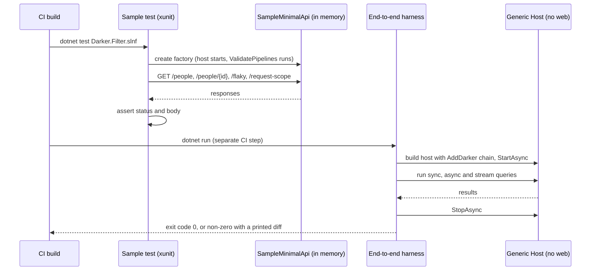
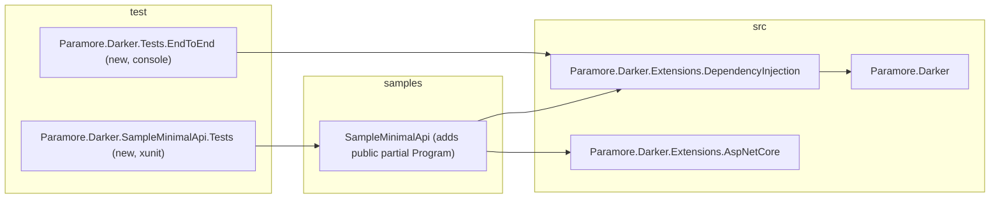

# 27. End-to-End Verification Outside Developer Tests

Date: 2026-11-05

## Status

Accepted

## Context

Every Darker test builds its own container and wires its own doubles. That proves each part works. It does not prove that a user can follow the documented setup, start a real host and get answers. V5 added startup validation (`ValidatePipelines()`), request-scope sharing (`AddDarkerRequestScope()`) and per-pipeline scopes. These features only show their faults when a real host composes them in the order a user would.

Two real compositions exist today, and neither is checked. `samples/SampleMinimalApi` is the setup users copy, but no test starts it. No program uses Darker outside ASP.NET Core, although Darker does not depend on ASP.NET Core.

### Terms

- **Real host** — a process that builds its service collection with the public `AddDarker` registration calls, starts a host, runs queries through `IQueryProcessor` and stops the host. It uses no `Simple*` factories and no test registries.
- **Harness** — a console program that runs scenarios and reports the result as its exit code, as `Paramore.Darker.Tests.AOT` does. A harness is not an xunit host.
- **Scenario** — one routine in a harness. It returns 0 on success and non-zero, after printing what differed, on failure.

### Scope

**In scope**

- A test that starts `SampleMinimalApi` in memory and calls its endpoints.
- A harness that starts a Generic Host with no web server and runs queries through it.
- A CI step that runs the harness.

**Out of scope**

- Benchmarks. A later decision covers them.
- Native AOT coverage of the validation and request-scope paths. `Paramore.Darker.Tests.AOT` stays as it is.
- Consuming Darker from packed NuGet packages. Both new projects use project references.
- Changes to any `src/` project.

### The problem: a green suite says nothing about the composed product

| Question a user asks | Which existing test answers it |
| --- | --- |
| Does the sample start with `ValidatePipelines()` at the end of the chain? | None |
| Does `/request-scope` return one id when `AddDarkerRequestScope()` is present? | Unit-level tests of the scope provider, with a fake request |
| Does the retry pipeline recover the `/flaky` handler in a running app? | Handler-level tests, with a hand-built pipeline |
| Does Darker work in a worker or console host? | None |

A registration mistake, a missing package reference or a wrong call order passes every row above and fails for a user.

### The forces

- The sample is documentation that compiles. A test of the sample keeps it truthful.
- The check must run on every CI build, so it must be fast and need no network or external service.
- Darker must not require ASP.NET Core, so one check must run without it.
- `AddDarker` stores a real `ILoggerFactory` in the static `ApplicationLogging.LoggerFactory`. Disposing that factory breaks later static loggers in the same process.
- `dotnet test Darker.Filter.slnf` is the one command CI runs for tests. A check that this command does not run needs its own CI step.
- A test project must not use `InternalsVisibleTo`. Both new projects therefore use only the public surface, which is the point of the exercise.

## Decision

**Darker verifies V5 end to end with two real-host projects: an xunit test that starts `SampleMinimalApi` in memory through `WebApplicationFactory`, and a console harness that runs queries in a Generic Host with no web server.**

The first project proves that the sample a user copies still works. The second project proves that Darker works outside ASP.NET Core. Both reference the product by project, call only public API and run in CI.

### The mechanism, end to end

Three invariants follow from the diagram:

1. A host that fails validation does not start. The sample test and the harness both fail at the start step, before any query runs.
2. Each project uses the public `AddDarker` chain and nothing else, so a missing public registration fails the project.
3. The harness reports through its exit code, so CI needs no test runner to read the result.

The harness covers these scenarios:

- A valid configuration starts and runs a sync, an async and a stream query.
- A retry pipeline recovers a handler that fails once.
- Scoped handlers receive Scoped dependencies and the host disposes them after each query.
- An invalid configuration fails at host start with a message naming the fault.

The sample test covers these cases:

- The host starts with validation enabled.
- `/people` and `/people/{id}` return the repository data.
- `/flaky` returns the success text after a retry.
- `/request-scope` returns the same id for the endpoint and the handler.

### Where the pieces live

The arrows point from user to dependency. Nothing in `src/` references either new project.

### Key Components

#### The roles, and what each is responsible for

| Role | Type | Responsibilities | Responsibility classifier | Collaborators |
| --- | --- | --- | --- | --- |
| Starts the sample in memory | `WebApplicationFactory<Program>` fixture, one per test class | Builds the sample host once, shares it across tests, disposes it at the end | **doing** | `SampleMinimalApi`, the test class |
| Knows what the sample promises | `SampleEndpointsTests` | Holds the expected status codes and bodies for each endpoint | **knowing** | The fixture's `HttpClient` |
| Runs scenarios and decides pass or fail | `Program` in the harness | Runs scenarios in order, stops at the first non-zero result and returns it as the exit code | **deciding** | The scenarios |
| Exercises one behaviour | One class per scenario | Builds a host, runs queries, compares results and returns 0 or non-zero | **doing** | Generic Host, `IQueryProcessor` |
| Provides the handlers the scenarios query | Harness `Handlers/` types | Answer fixed queries, including one that fails once | **knowing** | The scenarios |

The roles split on one line. The fixture and the scenarios start things. The test class and the harness `Program` decide whether the result is right.

#### Where each type is touched

| Assembly | Type | Change |
| --- | --- | --- |
| `SampleMinimalApi` | `Program` | Adds `public partial class Program;` so the factory can name it |
| `Paramore.Darker.SampleMinimalApi.Tests` | Test project, fixture, `SampleEndpointsTests` | New |
| `Paramore.Darker.Tests.EndToEnd` | Console project, scenarios, handlers | New |
| `Directory.Packages.props` | `Microsoft.AspNetCore.Mvc.Testing` | New central package version |
| `Darker.slnx`, `Darker.Filter.slnf` | Both new projects | Added |
| `.github/workflows/dotnet-core.yml` | A step that runs the harness for each target framework | New |

Everything under `src/` is unchanged. The sample's endpoints, registrations and behaviour are unchanged. `Paramore.Darker.Tests.AOT` is unchanged.

### Technology Choices

#### Why `WebApplicationFactory` and not a started process and `HttpClient`?

The factory starts the host in memory, so the test needs no port, no process management and no wait loop. A failed start surfaces as an exception in the test, with the validation message attached.

#### Why a console harness and not another xunit project for the Generic Host?

The harness follows `Paramore.Darker.Tests.AOT`, which is already the precedent for a program that runs outside a test runner. It also proves that Darker needs nothing from a test framework at run time. A later decision can publish the same harness for AOT without a rewrite.

#### Why project references and not packed packages?

Project references are fast and need no local feed. They do not prove packaging. That gap is accepted and stated under Consequences.

### Implementation Approach

1. **Structural.** Add `public partial class Program;` to the sample.
2. **Behavioural.** Add `Microsoft.AspNetCore.Mvc.Testing` to `Directory.Packages.props`. Create `Paramore.Darker.SampleMinimalApi.Tests`, add it to `Darker.slnx` and `Darker.Filter.slnf`, and write one test per endpoint using a single shared fixture.
3. **Behavioural.** Create `Paramore.Darker.Tests.EndToEnd` with the four scenarios, one commit per scenario, and add it to the solution files.
4. **Behavioural.** Add a CI step after the test step that runs the harness for `net8.0` and `net9.0`.
5. **Documentation.** Update `.agent_instructions/project_structure.md` with the two projects.

Each test and scenario is written test-first through `/tdd:test-first`. Each is seen failing for the right reason before the code that satisfies it exists.

## Consequences

### Positive

- The documented setup is checked on every build.
- A faulty registration order or a missing public registration fails CI, not a user.
- Darker's independence from ASP.NET Core is shown by a running program.
- The harness gives a ready base for later AOT and benchmark work.

### Negative

- Project references do not prove the packages contain what users need.
- The sample test covers only the sample's four endpoints.
- A new CI step and a new package version need maintenance.
- The sample gains one line that exists only for tests.

### Risks and Mitigations

| Risk | Mitigation |
| --- | --- |
| Disposing the factory disposes a real `ILoggerFactory` that `AddDarker` stored globally, and breaks later static loggers | The sample test is its own assembly, so no other test shares the process. One shared fixture builds the host once |
| The harness runs only in its own CI step and is forgotten when the workflow changes | The step names the harness, and the harness is in `Darker.Filter.slnf`, so a build break fails CI too |
| Scenarios depend on timing in the retry pipeline | The retry handler fails by call count, never by delay, and the pipeline uses no delay in the harness |
| The sample changes and the test lags | The sample test lives beside the sample in the solution and fails when an endpoint's body changes |

## Alternatives Considered

**1. Do nothing.** Rely on the unit and integration suites. **Rejected because** the table under "The problem" lists questions that none of those tests answer.

**2. Add the sample test to `Paramore.Darker.Extensions.AspNetCore.Tests`.** **Rejected because** that project tests the AspNetCore package with test doubles. A host started from the sample's own `Program` is a different kind of check, and the logger-factory risk argues for a separate process.

**3. Make the harness an xunit project.** **Rejected because** it would then not show that Darker works without a test framework, and it could not reuse the `Tests.AOT` pattern.

**4. Run `dotnet run` against the sample in CI and call it with `curl`.** **Rejected because** it needs ports, a wait loop and process cleanup, and it reports failure as a log line instead of a test result.

**5. Consume packed packages from a local feed.** **Deferred, not rejected.** It is the stronger release check and it needs a separate decision on feed setup and CI cost.

## References

- Related ADRs:
  - [ADR 0009: Simple and InMemory factory implementations](0009-simple-and-inmemory-factory-implementations.md) - the doubles the real-host projects deliberately avoid.
  - [ADR 0013: Migrate legacy tests to test doubles](0013-migrate-legacy-tests-to-test-doubles.md) - the test-double conventions the unit suites follow.
  - [ADR 0024: Ambient scope adoption](0024-ambient-scope-adoption.md) - the request-scope behaviour `/request-scope` exercises.
  - [ADR 0025: Pipeline validation at startup](0025-pipeline-validation-at-startup.md) - the validation the host runs at start.
  - [ADR 0026: Lifetime scope validation](0026-lifetime-scope-validation.md) - the scope rules the invalid-configuration scenario triggers.
- External references:
  - [Integration tests in ASP.NET Core](https://learn.microsoft.com/aspnet/core/test/integration-tests)
